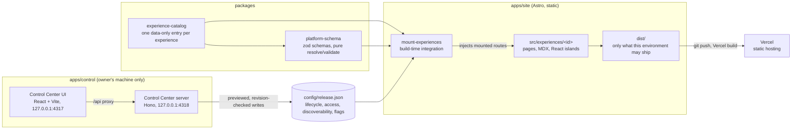

# Orrery

A personal universe: one static site that holds an engineering profile, writing, projects and independent interactive experiences. Each experience owns its own design; the platform underneath decides only what gets built, where it is listed and when it is released.

Orrery is also an architecture project in its own right. Its release model, build-time checks and local control surface are written down as decisions ([`docs/adr/`](docs/adr/)) and tested like product code. It favours clarity over cleverness, static output over servers, and an explicit release step over "whatever is in the folder ships".

## Live

| | URL | Status (checked 7 November 2026) |
| --- | --- | --- |
| Orrery | https://orrery-teal.vercel.app/ | live |
| The Orrery Journal | https://orrery-teal.vercel.app/journal | live: the platform's own history, chapter by chapter |
| Resume | https://orrery-teal.vercel.app/resume | live since 3 November 2026, with a PDF download ([docs/resume.md](docs/resume.md)) |
| Claude Skills Archive | https://orrery-teal.vercel.app/skills | live since 7 November 2026: five skills with their source and downloadable packages |
| Dev X-Ray | https://devxray-one.vercel.app/ | live; a separate project, linked from Orrery |
| KawaiUI | https://kawaiui.vercel.app/ | live; a separate project, linked from Orrery |

Source: https://github.com/Achchutan-S/orrery (public)

## How it fits together



A catalog entry says what an experience is; `config/release.json` says where it ships and whether it is listed; the build mounts only what the release state allows in that environment, and checks prove nothing else reached the output. The Control Center edits the release file on the owner's machine and never commits, pushes or deploys. Workspace layout and boundaries: [blueprint § 2](docs/blueprint.md#2-current-system-architecture).

## Getting started

Node.js 22.23.4 or a later 22.x (`nvm use`; `pnpm install` refuses any other version) and Corepack. From the repository root:

```sh
corepack enable
pnpm install
pnpm dev            # site with drafts, http://localhost:4321
pnpm control        # Control Center, http://127.0.0.1:4317
pnpm typecheck && pnpm test && pnpm check && pnpm test:browser   # what CI runs
```

Every command, and the rules contributors and agents follow: [AGENTS.md](AGENTS.md). No application secrets exist ([`.env.example`](.env.example)).

## What is public

The release state controls the **website**, not the repository. Four things are separate ([ADR-022](docs/adr/adr-022-link-previews-smoke-and-public-repository.md)):

| | Who can see it | A draft experience (for example the two test fixtures) |
| --- | --- | --- |
| The website | whatever `config/release.json` releases to that environment | not in production; built in previews |
| This repository | anyone: it is public on GitHub, including raw file URLs | its source, text and committed files are readable here |
| Git history | anyone, for every pushed commit | earlier versions stay readable; history has not been rewritten |
| The Control Center | the owner, on their own machine | listed with its release state; never deployed |

So "draft" or "owner only" means "not on the site", never "private". Nothing that must stay private belongs in a commit.

## Documentation

| Document | Covers |
| --- | --- |
| [AGENTS.md](AGENTS.md) | Commands and working rules for contributors and coding agents |
| [docs/blueprint.md](docs/blueprint.md) | Architecture, principles, release and access model, security, roadmap, decision register (revision 3, proposed) |
| [docs/experience-contract.md](docs/experience-contract.md) | What every experience must provide and may do (version 1.0, proposed) |
| [docs/adr/](docs/adr/README.md) | Architecture decision records, with an index |
| [docs/tracker.md](docs/tracker.md) | What is live, open work, decisions waiting for the owner |
| [docs/add-experience.md](docs/add-experience.md) | Adding an experience, step by step |
| [docs/repository-checks.md](docs/repository-checks.md) | Boundaries, metadata, leaks, budgets, hygiene and CI |
| [docs/deployment.md](docs/deployment.md) | Vercel setup, production build gate, smoke test, rollback |
| [docs/accessibility.md](docs/accessibility.md) | Automated accessibility coverage, the manual checklist and its results |
| [apps/control/README.md](apps/control/README.md) | The Control Center: running it, security model, API |
| [docs/architecture-review.md](docs/architecture-review.md) | The 7 November 2026 review behind blueprint revision 3 |

Records kept for one subject each: [docs/resume.md](docs/resume.md) (resume provenance and publishing), [docs/claude-skills/publication-decisions.md](docs/claude-skills/publication-decisions.md) (what the Skills Archive publishes), [docs/design/platform-identity.md](docs/design/platform-identity.md) (the platform's visual identity, the first design record). The project's history, as published: [the Journal](https://orrery-teal.vercel.app/journal).
