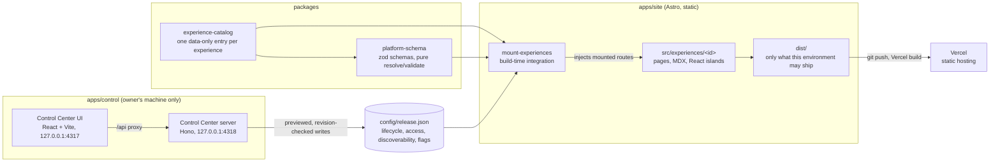

# Orrery

A personal universe: one static site that holds an engineering profile, writing, projects and independent interactive experiences. Each experience owns its own design; the platform underneath decides only what gets built, where it is listed and when it is released.

Orrery is also an architecture project in its own right. Its release model, build-time checks and local control surface are written down as decisions ([`docs/adr/`](docs/adr/)) and tested like product code. It favours clarity over cleverness, static output over servers, and an explicit release step over "whatever is in the folder ships".

## Live

| | URL | Status (checked 3 November 2026) |
| --- | --- | --- |
| Orrery | https://orrery-teal.vercel.app/ | live |
| The Orrery Journal | https://orrery-teal.vercel.app/journal | live: the platform's own history, chapter by chapter |
| Resume | https://orrery-teal.vercel.app/resume | **not on the site yet**: a draft awaiting the owner's approval, so production answers 404 by design. Its source and generated PDF are in this public repository ([What is public](#what-is-public), [docs/resume.md](docs/resume.md)) |
| Dev X-Ray | https://devxray-one.vercel.app/ | live; a separate project, linked from Orrery |
| KawaiUI | https://kawaiui.vercel.app/ | live; a separate project, linked from Orrery |

Source: https://github.com/Achchutan-S/orrery (public)

## How it fits together



The Control Center edits `config/release.json` on disk. It never commits, pushes or deploys; the owner reviews the change and commits it like any other.

| Path | Responsibility |
| --- | --- |
| `apps/site` | The public Astro site. `integrations/mount-experiences.ts` reads the catalog and release state at build time and injects only the routes of experiences that may ship in this environment. `src/experiences/<id>/` holds one folder per experience; `src/platform/` is the small shared layer (page root, discovery, Beacon, release helpers). |
| `apps/control` | The Control Center: `server/` is a local Hono API over `config/release.json`; `web/` is a React UI served by Vite preview. Local only, never deployed. |
| `packages/platform-schema` | Zod schemas and pure functions: experience definitions, release state, resolution per environment, validation, release patches and the Control Center API contract. Depends only on `zod`. |
| `packages/experience-catalog` | Data only: `src/entries/<id>.ts` for each experience (kind, routes, tags, Index placement), listed in `src/index.ts`. |
| `config` | `release.json`, the release state, and `release.schema.json`, generated from the schema. |
| `tools/checks` | Repository checks (boundaries, metadata, leaks, budgets), the release-schema generator and the HTTP smoke test. |
| `docs` | Blueprint, architecture, ADRs, tracker and runbooks. |

The experiences today: the Index at `/`, the Journal, two sample experiences (`sample-content`, `sample-app`), the resume (draft), two permanent test fixtures that must never ship, and two external entries (Dev X-Ray, KawaiUI) that are links only and are never built here. The table in [docs/architecture.md](docs/architecture.md#experiences-today) is the current list.

## Stack

Versions are the ones pinned in the repository.

| | |
| --- | --- |
| Runtime | Node.js 22.23.4 (`.nvmrc`; Astro 7's minimum), pnpm 10.34.9 via Corepack (`packageManager`) |
| Site | Astro 7.4.4 (static output), `@astrojs/react` 7.1.2 with React 19.3.1 for islands, `@astrojs/mdx` 8.1.2 |
| Language | TypeScript 6.0.3; Node runs `.ts` files directly (type stripping), with no separate compile step for scripts and tests |
| Schemas | zod 4.6.7 |
| Control Center | Hono 4.13.13 with `@hono/node-server` 2.1.5; React 19.3.1 UI built and served by Vite 8.3.5 |
| Tests | `node:test` for unit and integration tests; Playwright 1.64.1 with `@axe-core/playwright` 4.14.0 for browser and accessibility tests |
| Workspace | pnpm workspaces, one lockfile, no Turborepo |
| Hosting | Vercel, static files only: no adapter, no functions |
| CI | GitHub Actions (`.github/workflows/ci.yml`) |

## Getting started

Prerequisites: Node.js 22.23.4 or a later 22.x (`nvm use` reads `.nvmrc`; every `engines.node` is `>=22.23.4 <23` and `pnpm install` refuses any other version) and Corepack.

Run everything from the repository root.

```sh
corepack enable
pnpm install
```

| Task | Command |
| --- | --- |
| Site dev server (development: drafts mounted, http://localhost:4321) | `pnpm dev` |
| Control Center (UI on http://127.0.0.1:4317, API on 127.0.0.1:4318) | `pnpm control` |
| Typecheck (`tsc` for packages, `astro check` for the site) | `pnpm typecheck` |
| Unit and integration tests | `pnpm test` |
| Browser tests (first time: `pnpm --filter @pu/site exec playwright install chromium`) | `pnpm test:browser` |
| Production build, as production resolves it | `pnpm build:production` |
| Repository checks (boundaries, production build, metadata, leaks, budgets) | `pnpm check` |
| What Vercel runs (production: typecheck, checks, build; stops at the first failure) | `VERCEL_ENV=production PU_DEPLOYMENT=1 pnpm build:deployment` |
| Everything CI runs | `pnpm typecheck && pnpm test && pnpm check && pnpm test:browser` |
| Smoke-test a deployment over HTTP | `pnpm smoke <url> --env production` (or `--env preview`) |
| Smoke-test a local production build (skips only what Vercel does) | `pnpm build:production && pnpm --filter @pu/site preview`, then `pnpm smoke http://localhost:4321 --env production --local` |

`pnpm build` without `VERCEL_ENV` is a development build and includes drafts; use `pnpm build:production` to see what production would contain. Environment variables are described in [`.env.example`](.env.example); no application secrets exist.

## Release lifecycle

An experience being implemented does not make it public. Three things are separate:

1. **Definition** (code): a catalog entry and an experience folder. The build fails if either exists without the other.
2. **Release state** (data): one entry per experience in `config/release.json`. No entry means an owner-only draft.
3. **Environment**: `VERCEL_ENV` at build time, which is `development` locally, `preview` on branch deployments and `production` on `main`.

`platform-schema`'s `resolve()` combines them:

| Release field | Values | Effect |
| --- | --- | --- |
| `lifecycle` | `draft`, `alpha`, `beta`, `published`, `frozen`, `deprecated`, `archived` | production mounts only `beta`, `published`, `frozen` and `deprecated`; `archived` is never mounted |
| `access.kind` | `public`, `owner` (`signed-in` and `policy` are defined for Phase 4) | production mounts only `public` |
| `discoverability` | `listed`, `unlisted` | only public, listed, non-deprecated experiences appear on the Index and in the Beacon palette |

Development and preview builds mount everything that is not archived, so drafts can be reviewed there; they are still never listed. A route that is not mounted is never compiled, so its pages, islands and files cannot reach `dist/`, and production answers it with the site's 404.

The Index and the Beacon palette both read the same `publicDiscoveryIndex()`. No page hand-writes a list of experiences.

Safeguards against leaking unreleased work into production:

- **Build:** unknown `VERCEL_ENV` values fail the build. So does a deployment build (`PU_DEPLOYMENT=1`) with no `VERCEL_ENV`, rather than falling back to development and mounting drafts.
- **`pnpm check`:** it builds production and scans every output file for anything of an unreleased experience: titles, summaries, a canary token, its prose in any common encoding, and byte-for-byte copies of its files; every output file must also be on an allowlist. It also checks required metadata (including link-preview images), per-experience size budgets and import boundaries (an experience never imports another; client code never reads the catalog or release file).
- **Production build gate:** on Vercel, a production build runs the typecheck and these checks and fails the deployment at the first failure ([deploy runbook](docs/runbooks/deploy.md#production-build-gate)).
- **Fixtures:** `canary-draft` and `sample-hostile` are permanent drafts that prove the scan and CSS isolation work.
- **Experience files:** a PDF or image belongs to an experience and is served by that experience's routes, never from `public/`, so it ships only when the experience does.
- **Smoke test:** `pnpm smoke` checks a live deployment against the release state. Every mounted route must answer 200, everything else 404, every response must have the right media type and every security header its exact value.
- **CSP:** pages run under a strict Content Security Policy with hashed inline scripts and no `unsafe-inline`.

Feature flags are not secrecy: an island's JavaScript is emitted even when its flag is off.

## What is public

The release state controls the **website**, not the repository. Four things are separate ([ADR-022](docs/adr/022-link-previews-smoke-and-public-repository.md)):

| | Who can see it | A draft experience (the resume today) |
| --- | --- | --- |
| The website | whatever `config/release.json` releases to that environment | not in production; built in previews |
| This repository | anyone: it is public on GitHub, including raw file URLs | its source, text and committed files (the resume's PDF and preview image) are readable here |
| Git history | anyone, for every pushed commit | earlier versions stay readable; history has not been rewritten |
| The Control Center | the owner, on their own machine | listed with its release state; never deployed |

So "draft" or "owner only" means "not on the site", never "private". Nothing that must stay private belongs in a commit.

## Control Center

A local, owner-facing control surface for release state. `pnpm control` builds the UI and starts the UI and server together in one process; Ctrl+C stops both.

- It reads the catalog and release state, and changes lifecycle, access, discoverability and flags through `config/release.json`.
- Every change is previewed (the exact diff and its effect per environment), confirmed, then written. Writes are never retried automatically.
- Each write carries the revision (a SHA-256 of the file) the page was showing. If the file changed in between, the write is refused as stale instead of overwriting it. Files are written atomically.
- The server binds only to 127.0.0.1. It checks `Host` and `Origin` on every request and uses an HttpOnly, SameSite=Strict session cookie. It sends no CORS headers and refuses to start under `CI` or `VERCEL`.

It is not a public administration endpoint and is never deployed. Details: [docs/control-center.md](docs/control-center.md).

## Deployment

One Vercel project serves `apps/site` as static files. Settings that can live in code are in `apps/site/vercel.json`:

| Setting | Value |
| --- | --- |
| Install | `pnpm install --frozen-lockfile` |
| Build | `PU_DEPLOYMENT=1 pnpm -w run build:deployment` (production also runs the checks) |
| Output | `dist` |
| URLs | `cleanUrls: true`, `trailingSlash: false` (`/x.html` and `/x/` redirect 308 to `/x`) |
| Headers | HSTS, `nosniff`, referrer policy, permissions policy, `frame-ancestors 'none'`, `X-Frame-Options: DENY`; immutable caching for hashed `/_astro/` assets |

Dashboard settings, set once and described in [docs/runbooks/deploy.md](docs/runbooks/deploy.md):

- Root Directory `apps/site`, with "Include files outside the root directory" on (the build reads `config/` and the workspace packages).
- `ENABLE_EXPERIMENTAL_COREPACK=1`.
- System Environment Variables exposed, so `VERCEL_ENV` is set.
- Vercel Authentication on previews.

Previews contain drafts. Preview protection is a convenience, not access control; and the repository itself is public, so nothing that must stay private is ever committed ([What is public](#what-is-public)).

Production follows `main`. Changing what is public means changing `config/release.json` (by hand or with the Control Center), then running the checks, reviewing the preview and merging. The runbook has the full gate, rollback and troubleshooting.

## Engineering principles

- **Static first.** Every page is prerendered. There is no server runtime in production.
- **Little client JavaScript.** Content pages ship no script except the Beacon's small inline palette script; interactive experiences hydrate only their islands. Budgets are enforced per experience.
- **Independent experiences.** Each experience owns its layout, fonts and theme inside its own folder and CSS layer. The platform owns only the Beacon, accessibility tokens and an optional colophon.
- **Catalog-driven discovery.** What exists comes from the catalog; what ships and what is listed comes from release state.
- **Explicit releases.** Publishing is a reviewed change to a data file, not a side effect of merging code.
- **Accessibility.** Semantic HTML, keyboard access, a visible focus ring the experiences cannot override, reduced motion. The browser suite runs axe (WCAG 2.2 A/AA rules) on a representative page of each experience, plus the 404 page, in light and dark mode at several viewports.
- **Security by construction.** Unreleased work is excluded at build time and verified by checks, not hidden at runtime.
- **No premature infrastructure.** No database, authentication, server rendering or microservices until a real need arrives (Phase 4 in the blueprint).
- **Tests and documentation ship with the change.** Decisions become ADRs; ADRs are superseded, never rewritten.

## Documentation

| Document | What it covers |
| --- | --- |
| [docs/blueprint.md](docs/blueprint.md) | The architecture and the phased plan |
| [docs/architecture.md](docs/architecture.md) | How the code maps to the blueprint today |
| [docs/tracker.md](docs/tracker.md) | Task status and evidence |
| [docs/adr/](docs/adr/) | Decisions, for example [021 platform integrity](docs/adr/021-platform-integrity.md), [022 link previews, smoke test, public repository](docs/adr/022-link-previews-smoke-and-public-repository.md), [004 experience model](docs/adr/004-experience-model.md), [005 release dimensions](docs/adr/005-release-dimensions.md), [014 checks](docs/adr/014-repository-checks.md), [016 Vercel and CSP](docs/adr/016-vercel-deployment.md), [017](docs/adr/017-control-center-server.md) and [018](docs/adr/018-control-center-ui.md) Control Center, [019 Index and Beacon](docs/adr/019-index-and-beacon.md), [020 resume assets](docs/adr/020-resume-assets.md) |
| [docs/runbooks/checks.md](docs/runbooks/checks.md) | Repository checks and CI |
| [docs/runbooks/deploy.md](docs/runbooks/deploy.md) | Vercel setup, deployment gate, smoke test, rollback |
| [docs/runbooks/add-experience.md](docs/runbooks/add-experience.md) | Adding an experience: folder, catalog, release, metadata, tests, checks |
| [docs/control-center.md](docs/control-center.md) | Control Center usage, security model and API |
| [docs/resume.md](docs/resume.md) | Resume content provenance, asset generation and publishing steps |
| [Journal chapters](apps/site/src/experiences/journal/chapters/) | The project's history as published at [/journal](https://orrery-teal.vercel.app/journal) |
| [AGENTS.md](AGENTS.md) | Working rules for contributors and coding agents |

## Status

Implemented and deployed:

- The static site on Vercel, with release-gated route mounting.
- The Index and the Beacon command palette.
- The Journal and the two sample experiences.
- Links to Dev X-Ray and KawaiUI.
- Security headers and CSP.
- Repository checks, and GitHub Actions CI. As of 3 November 2026, hosted CI passed on every pushed commit, the latest being `9b5fe81` (run 41403945761), and that commit is the production deployment.

Implemented, not public:

- **Resume:** a draft awaiting the owner's approval; not on the site, but its files are in this public repository.
- **Control Center:** local by design.

Planned, not built:

- Search and RSS (Phase 2).
- Owner sign-in, protected rendering and a hosted Control Center (Phase 4).
- Custom domain and subdomains (waiting on a domain).
- Manual screen-reader, zoom and forced-colours accessibility checks. Automated axe checks pass, which is not the same thing.

This is a personal project. Architecture decisions are recorded as ADRs in [`docs/adr/`](docs/adr/), and working rules are in [AGENTS.md](AGENTS.md).
