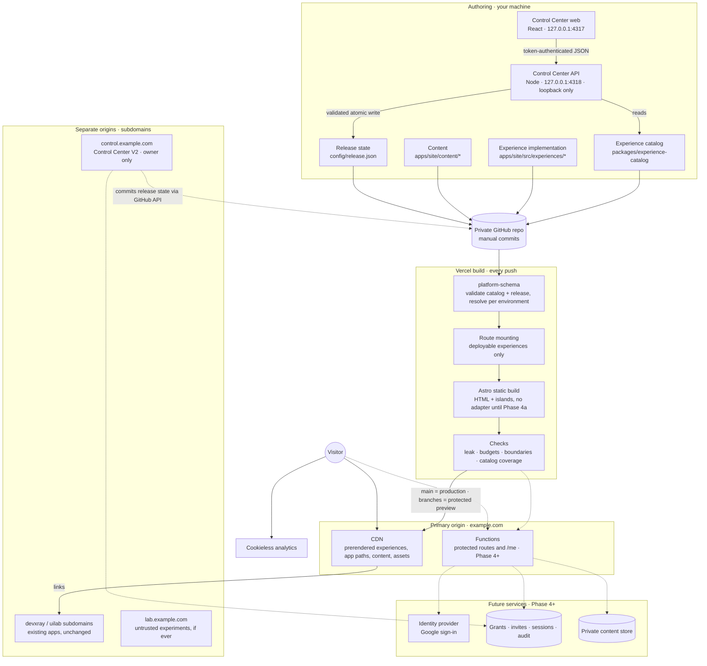
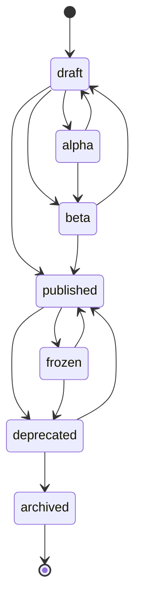

# Personal Universe — Architecture Blueprint

Oct 30, 2026 · @Achchutan

## Revision 2 — technical corrections

This pass makes the blueprint executable without changing its direction; every section below already reflects these corrections.

1. **Control Center V1 is executable:** a Vite + React frontend plus a loopback-only Node backend (Hono) that validates with `platform-schema` and writes `config/release.json` atomically; no Git execution, and the pending-changes diff is against the file as it was when the session started, not `HEAD` (4.0).
2. **New `packages/experience-catalog`:** experience metadata moves out of experience folders into a data-only package, so the Control Center never imports site code. Schema, metadata, implementation and release state now have four separate homes (5).
3. **Static routing for app experiences is decided:** prerendered, enumerated catch-all paths shared with the React router; UI state in query strings; Vercel rewrites only for unbounded path spaces; on-demand rendering only for authorization or personalisation (3.11).
4. **`ownedDependencies` is renamed `exclusiveImports`:** it restricts *who may import* a package; it does not isolate versions. The host app has one dependency graph and one lockfile; incompatible requirements trigger graduation.
5. **Discovery has three tiers:** globally public metadata (static), audience-specific discovery (on-demand `/me`, Phase 4b) and protected content (on-demand). Metadata of non-public experiences is itself treated as confidential, with a new leak check (3.5a).
6. **Acceptance criteria reconciled:** the Foundation checklist no longer depends on the Control Center UI or on external entries added in Phase 1; Phase 4a now includes adding the Vercel adapter (9, 8).
7. **No Vercel adapter in Phases 0–3:** Astro's Vercel guide says a static site needs the adapter only for extra Vercel services, so `vercel.json` headers and redirects apply to a plain static build. CSP comes from Astro (stable in Astro 6); `frame-ancestors` is sent as a `vercel.json` header because it cannot be set by a meta tag.
8. **Performance budgets per class:** content, interactive and immersive experiences get different budgets (3.12).
9. **Facts corrected:** Astro 6 was released on 10 March 2026 (official blog), not in February. Since September 2026 Vercel Authentication can protect production URLs on every plan, but it still requires a Vercel account and allows one external user on Hobby, so the audience design is unchanged. Plan limits are now listed separately from the decisions they constrain (Sources).

## 1. Executive architecture decision

Personal Universe is one Astro 6 application, statically rendered by default, deployed as one Vercel project from a private pnpm workspace; each experience is a self-contained folder whose *definition* lives in code and whose *release state* lives in one Git-tracked data file that a local Control Center edits. Authentication, runtime flags and the deployed Control Center are designed now and built only when the first real need appears. This blueprint supersedes the earlier review where they differ.

| Area | Decision |
| --- | --- |
| Framework | Astro 6 with `output: 'static'` and no adapter in Phases 0–3; the `@astrojs/vercel` adapter is added in Phase 4a with the first on-demand route. React 19 only inside islands. Node 22 LTS. |
| Rendering | Phases 0–3: zero on-demand routes; everything, including React app experiences, is prerendered HTML on the CDN. Phase 4+: on-demand only for protected experiences, audience-specific discovery (`/me`), invite and auth endpoints, and experience APIs. |
| Repository | One **private** GitHub repo; a pnpm workspace with two apps (`site`, `control`) and two packages (`platform-schema`, `experience-catalog`). One lockfile. No Turborepo. |
| Deployment | One Vercel project serves the primary domain. Separate origins only where a security boundary is needed: `control.<domain>` (Phase 4a), existing apps on their own subdomains, and `lab.<domain>` for untrusted experiments if one ever exists. |
| Experience model | An experience = an implementation folder in the site + a data-only **catalog entry** (identity, routes, capabilities, chrome, performance class, exclusive imports, declared flags and events) + a **release entry** (lifecycle, access, discoverability, flag values). A \~40-line build integration mounts only routes deployable in the current environment. |
| Release model | Four independent dimensions: lifecycle, access, discoverability, feature flags. Release channels are derived from lifecycle, not stored. Environments are local, preview and production only. |
| Control Center | V1 (Phase 1): a local React frontend plus a loopback-only Node backend that validates and writes `config/release.json`; committing stays manual. V2 (Phase 4a): the same frontend with a Git-commit backend, deployed on its own subdomain, owner-only. V3 (Phase 5): analytics and audit dashboards. |
| Existing apps | UI Lab and Dev X-Ray stay untouched in their own projects. They appear in the catalog as `external` experiences and are reachable at their own subdomains; path rewrites are not the default. |
| Content | Astro content collections with MDX, Git as the publishing workflow, static search index, RSS. No CMS. |
| Design | Experiences own layout, typography, theme and navigation. The platform supplies only accessibility tokens, the Beacon (identity mark plus command palette) and an optional colophon. |
| Security stance | Nothing non-public, including non-public titles and summaries, is ever in a production build in Phases 0–3. From Phase 4, protected content and audience-specific listings are rendered on demand after a server-side session and grant check and are never committed to the repo. |

**Implement now:** workspace, Astro site, schema and catalog packages, route-mounting integration, release state, CSS layering, tokens, Beacon, CI checks, `vercel.json` headers, docs.

**Design for now, build later:** on-demand rendering, middleware authorization, grants, invites, audit log, deployed Control Center, runtime flags, product analytics events.

**Deliberately defer:** search beyond static indexing, immersive homepage lens, graph view, graduation of any experience to its own deployment.

**Never, unless a real requirement appears:** Kubernetes, microservices, Module Federation, a third-party feature-flag vendor, session replay, a headless CMS, fingerprinting, a public admin path on the main origin.

## Agreement and Disagreement Review

I accept nine of the ten points, most with qualifications, and partly disagree with B: pure conventional routing cannot guarantee that draft experiences stay out of a production build, so a small, explicit route-mounting integration is the one abstraction worth adding on day one.

| Feedback | Verdict | Final decision |
| --- | --- | --- |
| A. Keep Astro + React islands | Agree, qualified | Astro 6 host with React islands and client-only React sub-apps; accept the limitations listed in ADR-001 |
| B. Avoid overengineering route discovery | Partly disagree | No filesystem scanning, no generator. Explicit typed registry plus a \~40-line integration that mounts deployable routes |
| C. One deployment is one release boundary | Agree, qualified | Required CI checks per PR, preview deploys, rollback runbook, and graduation criteria |
| D. Deployment isolation is not security isolation | Agree, qualified | Separate *origins* (subdomains) only where a security boundary is required; never rely on paths |
| E. Invitation links do not prove identity | Agree, qualified | Two grant types: capability links (bearer) and identity-bound grants (verified Google account) |
| F. Cookieless analytics still has obligations | Agree | Privacy page from the first analytics deploy; no fingerprinting, no replay |
| G. Visibility is not authorization | Agree, qualified | Lifecycle, access, discoverability and flags are separate fields; channels derived |
| H. Keep the kernel small | Agree | Kernel has a fixed module list; additions need two consuming experiences |
| I. Design the Control Center earlier | Agree, qualified | Separate app from day one; local-only V1 in Phase 1; deployed V2 only on its own origin |
| J. Independent design languages | Agree, qualified | Experiences own all presentation; platform owns accessibility tokens and the Beacon only |

### A. Keep Astro + React islands

Agree. Re-checked against the alternatives in ADR-001, Astro still uniquely combines zero-JS content, per-route rendering choice and server-side gating in one app. **Qualifications:** each island is a separate React root, so islands on one page cannot share React context (use a single larger island or a tiny store); there is one React version for the whole site; navigation between experiences is a full document load; and Astro is now a Cloudflare project, which is a vendor-neutrality risk to monitor, not a reason to switch.

### B. Avoid overengineering route discovery

Partly disagree. I agree that filesystem auto-discovery and a generator are premature; my earlier proposal had both, and they are removed. But conventional `src/pages` routing has a real flaw for this platform: Astro builds every page file it finds, and island JavaScript for a built page is emitted to `dist/`. There is no built-in, data-driven way to say "do not build this page in production" (verify in the Phase 0 spike). A lifecycle field that the build cannot act on is decoration. **Decision:** experiences are listed explicitly in `packages/experience-catalog` (one entry file and one index line each). A small integration reads the catalog and release state at config time and calls Astro's `injectRoute` only for experiences deployable in the current environment. Platform routes (404, RSS, sitemap) remain conventional files. **Revisit** if Astro gains native route exclusion.

### C. A single deployment has a shared release boundary

Agree, with a clarification: the boundary is mostly at *build* time. At runtime, static pages are independent files, so a bug in one experience's island cannot break another page. **Mitigations:** draft experiences are not mounted in production; required checks on `main` (schema, types, lint boundaries, tests, build, leak check, budgets); every branch gets a protected preview; a documented rollback to the previous production deployment; and graduation criteria (ADR-004) for experiences whose builds become slow or fragile.

### D. Deployment isolation is not security isolation

Agree, and the point goes further. A rewritten path shares the primary origin: cookies, `localStorage`, service-worker scope and same-origin `fetch` are all shared. Even a *subdomain* is a separate origin but the same *site*, so `SameSite` cookies do not stop cross-subdomain request forgery. **Decision:** separate origins for the Control Center, existing apps and any untrusted experiment; host-only `__Host-` cookies; CSRF tokens plus `Origin` checks on every state-changing request.

### E. Invitation links do not prove human identity

Agree. A capability link proves possession of the link, nothing more; forwarding it shares access. A Google sign-in with a verified email proves control of that account, which is the strongest identity this platform needs. **Decision:** capability grants are allowed only for low-sensitivity betas, are single-redemption (bound to the first browser that redeems them), short-lived and logged as "link L used", never as "person P". Anything personal requires an identity-bound grant.

### F. Analytics privacy

Agree. Cookieless analytics still processes IP addresses and user agents (at the vendor), still needs a privacy notice, and still needs a retention decision. India's DPDP Act and GDPR for EU visitors may apply; I have not researched their specific obligations for a personal site, so a privacy page is mandatory from the first analytics deploy and the legal check is an open question.

### G. Visibility is not authorization

Agree, and my original review partly violated it by folding several concepts into one `visibility` field. **Decision:** four stored dimensions (lifecycle, access, discoverability, flags). One qualification: "release channel" is *not* stored as a fifth field, because it would duplicate lifecycle and drift out of sync; channels are a derived view (Deliverable 3).

### H. Keep the shared platform kernel small

Agree. **Decision:** the kernel is a closed list of modules: registry, release-state resolution, route mounting, SEO head, Beacon and palette, colophon, tokens, `track()` facade, and (Phase 4) `authorize()`. A new kernel module needs two existing experiences that would use it.

### I. The Control Center should be designed earlier

Agree, with two qualifications that keep it consistent with H and D. First, the Control Center is not part of the kernel: it is a separate app that consumes the same schema package. Second, it is not deployed until it can be secured: V1 runs only on your machine and changes a Git-tracked file, so it needs no authentication; V2 is deployed only on its own subdomain behind owner sign-in.

### J. Independent design languages

Agree. **Qualification:** freedom stops at accessibility. Focus visibility, reduced-motion handling, contrast and keyboard access to the Beacon are tested on every experience, and an immersive experience may visually minimise the Beacon but must keep it keyboard-reachable.

### Corrections to the original review

- Astro middleware does **not** run per request for prerendered pages (it runs at build time), so Phase 0 security headers belong in `vercel.json`, not middleware.
- The repository should default to **private**: drafts of opinions, civic and political commentary, and betas are otherwise public in Git history.
- Alpha and beta are lifecycle stages, not environments.
- Cross-experience transitions should use native cross-document View Transitions, not Astro's client router, which would reintroduce SPA-style shared document state.

## 2. Final system architecture

Authoring, governance and build happen in Git and CI; visitors only ever touch the CDN until Phase 4, when a narrow on-demand path appears for protected content. Dashed links are designed now and built later.



### Layers

| Layer | Responsibility | Lives in | Exists from |
| --- | --- | --- | --- |
| Delivery | Serve static files from the CDN; apply `vercel.json` headers, redirects and clean URLs; from Phase 4a run functions for on-demand routes | Vercel project for `site` | Phase 0 |
| Schema | Zod schemas, types, pure resolvers and validators shared by every consumer | `packages/platform-schema` | Phase 0 |
| Catalog | Data-only metadata for every experience, internal and external | `packages/experience-catalog` | Phase 0 |
| Platform kernel | Route mounting, SEO head, Beacon and palette, colophon, tokens, `track()`, public discovery index; later `authorize()` | `apps/site/src/platform`, `apps/site/integrations` | Phase 0 |
| Experiences | Routes, layout, styles, components, islands, assets | `apps/site/src/experiences/<id>` | Phase 0 |
| Content | Long-form writing as Markdown or MDX with typed frontmatter, rendered by experiences | `apps/site/content` | Phase 2 (one entry in Phase 1) |
| Release configuration | Lifecycle, access, discoverability and flag values per experience | `config/release.json` | Phase 0 |
| Control Center | Read catalog and release state, show environment matrices, write release state | `apps/control/web`, `apps/control/server` | Phase 1 (local) |
| Future services | Identity, grants, invites, sessions, audit, private content | Managed services chosen in Phase 4 | Phase 4 |
| External apps | UI Lab, Dev X-Ray: separate repos, projects and origins | Their own repos | Already exist |

### Rendering flow

1. A push triggers a Vercel build. `VERCEL_ENV` tells the build whether it is `production` or `preview`; locally it is `development`.
2. `platform-schema` validates every definition and `release.json`, then resolves, per experience: is it mounted in this environment, is it listed, what is each flag's value.
3. The route-mounting integration injects routes only for mounted experiences. An unmounted experience's pages, islands and assets are never compiled.
4. Astro prerenders every mounted route. Islands hydrate only where an experience asks (`client:visible`, `client:idle`, `client:only`).
5. Checks run on `dist/`; any failure blocks the deployment.

### Request flow

- **Phases 0–3:** every request is a CDN file hit. There is no server code path, so there is nothing to attack except what is published.
- **Phase 4+:** requests for protected routes reach a function. Astro middleware loads the session, calls `authorize(subject, experience, action)`, writes an audit event and renders with `Cache-Control: private, no-store`, or returns 404.

### Data flow for governance

Control Center V1 writes `config/release.json` → you commit → a preview deployment shows the result → merging to `main` publishes. In V2 the deployed Control Center makes the same change as a Git commit through the GitHub API, so Git remains the single source of truth for release state. Only per-person data (grants, invites, sessions, audit) lives in a database, because it must change without a deploy and must never be in the repo.

### Observability layers

| Signal | Question it answers | Tool | Phase |
| --- | --- | --- | --- |
| Aggregate audience analytics | Which experiences are visited, from where | Vercel Web Analytics (cookieless; 50,000 events/month on Hobby) | 1 |
| Experience usage events | Resume downloads, simulator interactions, section reach | `track()` → PostHog in anonymous mode | 3 |
| Performance | Core Web Vitals per route | Vercel Speed Insights (10,000 events per 30 days on Hobby) plus Lighthouse CI | 1 |
| Errors | Client-side exceptions in islands | Error boundary per island; an error tracker only when an interactive experience is non-trivial | 3 |
| Security events | Sign-ins, invite redemptions, denials | Server-side events table | 4 |
| Administrative audit | Who changed release state or grants, when | Git history (V1); audit table (V2+) | 1 / 4 |

### Shell versus experience boundary

The platform shell is deliberately thin: an `<ExperienceRoot>` component that sets `data-experience`, the SEO head, the Beacon, the colophon (if the experience opts in) and the token stylesheet. Everything else is the experience's: its `<html>` theme, fonts, layout, navigation, components and CSS. Three chrome levels are offered: `full` (shared header and footer for simple pages), `minimal` (Beacon plus colophon) and `beacon` (Beacon only, for immersive work). CSS is ordered with `@layer platform.reset, platform.tokens, platform.chrome, experience`, so an experience always wins over platform defaults without `!important`, and because each page is its own document, one experience's CSS is never loaded on another's pages.

## 3. Experience specification

An experience has three parts with different owners and change rates: a **catalog entry** (what it is; data-only TypeScript in `packages/experience-catalog`; reviewed with code), an **implementation** (its folder in `apps/site/src/experiences/<id>`), and a **release entry** (who gets it and when; `config/release.json`; changed by the Control Center). The schemas for the first and third live in `packages/platform-schema`.

### 3.1 Definition schema

```ts
// packages/platform-schema/src/definition.ts
import { z } from 'zod';

export const Capability = z.enum([
  'content', 'interactive', 'visualization', 'geospatial',
  'multimedia', 'data', 'downloads', 'api', 'experimental',
]);

const Route = z.object({
  pattern: z.string().startsWith('/'),          // '/cloud', '/cloud/[...path]'
  // Path relative to apps/site/src/experiences/, e.g. 'cloud/routes/index.astro'.
  // A string, never an import, so the catalog stays free of site code.
  entrypoint: z.string().regex(/^[a-z0-9-]+\/.+\.(astro|ts)$/),
  render: z.enum(['static', 'on-demand']).default('static'),
});

const FlagDeclaration = z.object({
  description: z.string(),
  evaluation: z.enum(['build', 'request']).default('build'), // request = Phase 4
});

const Base = z.object({
  id: z.string().regex(/^[a-z][a-z0-9-]{1,39}$/),
  title: z.string().max(60),
  summary: z.string().max(160),
  capabilities: z.array(Capability).min(1),
  tags: z.array(z.string()).max(8).default([]),
  variantOf: z.string().optional(),
});

export const InternalExperience = Base.extend({
  kind: z.literal('internal'),
  routes: z.array(Route).min(1),
  chrome: z.enum(['full', 'minimal', 'beacon']).default('minimal'),
  colorScheme: z.enum(['light', 'dark', 'light-dark', 'custom']).default('light-dark'),
  performanceClass: z.enum(['content', 'interactive', 'immersive']),
  budgetOverrides: z.object({
    jsKb: z.number().optional(), cssKb: z.number().optional(), transferMb: z.number().optional(),
    reason: z.string().min(20),                  // an override must be justified
  }).optional(),
  // Packages that ONLY this experience may import. Enforced by CI.
  // Does NOT isolate versions: the site has one dependency graph and one lockfile.
  exclusiveImports: z.array(z.string()).default([]),
  flags: z.record(z.string(), FlagDeclaration).default({}),
  events: z.array(z.string()).default([]),
  ogImage: z.string().optional(),                // path relative to the experience folder
});

export const ExternalExperience = Base.extend({
  kind: z.literal('external'),
  url: z.string().url(),
});

export const ExperienceDefinition =
  z.discriminatedUnion('kind', [InternalExperience, ExternalExperience]);
export type ExperienceDefinition = z.input<typeof ExperienceDefinition>;
export const defineExperience = (d: ExperienceDefinition) => d;
```

```ts
// packages/experience-catalog/src/index.ts — imports only platform-schema
import { ExperienceDefinition } from '@pu/platform-schema';
import cloud from './entries/cloud';
import resume from './entries/resume';
import devxray from './entries/devxray';

export const catalog = [cloud, resume, devxray];   // one line per experience
export const parseCatalog = () => catalog.map((e) => ExperienceDefinition.parse(e));
```

### 3.2 Release-state schema

```ts
// packages/platform-schema/src/release.ts
export const Lifecycle = z.enum([
  'draft', 'alpha', 'beta', 'published', 'frozen', 'deprecated', 'archived',
]);

export const Access = z.discriminatedUnion('kind', [
  z.object({ kind: z.literal('public') }),
  z.object({ kind: z.literal('signed-in') }),                    // Phase 4
  z.object({ kind: z.literal('policy'), policy: z.string() }),   // Phase 4: 'recruiters'
  z.object({ kind: z.literal('owner') }),                        // Phase 4
]);

export const Discoverability = z.enum(['listed', 'unlisted']);

const FlagValue = z.object({
  preview: z.boolean(),
  production: z.boolean(),
  audience: z.string().optional(),   // Phase 4: policy name; request flags only
});

export const ReleaseEntry = z.object({
  lifecycle: Lifecycle,
  access: Access,
  discoverability: Discoverability,
  flags: z.record(z.string(), FlagValue).default({}),
  archivedTo: z.string().optional(),  // redirect target or snapshot path
  note: z.string().optional(),
});

export const ReleaseState = z.object({
  platform: z.object({ flags: z.record(z.string(), FlagValue).default({}) }),
  experiences: z.record(z.string(), ReleaseEntry),
});

// An experience with no release entry is treated as
// { lifecycle: 'draft', access: { kind: 'owner' }, discoverability: 'unlisted' }.
```

### 3.3 A complete example

```ts
// packages/experience-catalog/src/entries/cloud.ts
import { defineExperience } from '@pu/platform-schema';

export default defineExperience({
  kind: 'internal',
  id: 'cloud',
  title: 'Cloud Atlas',
  summary: 'How a request travels through a multi-region AWS architecture, interactively.',
  capabilities: ['interactive', 'visualization', 'content'],
  tags: ['aws', 'distributed-systems'],
  routes: [
    { pattern: '/cloud', entrypoint: 'cloud/routes/index.astro' },          // zero-JS intro
    { pattern: '/cloud/[...path]', entrypoint: 'cloud/routes/app.astro' },  // prerendered app paths
  ],
  chrome: 'beacon',
  colorScheme: 'custom',
  performanceClass: 'interactive',
  exclusiveImports: ['@xyflow/react', 'd3-geo'],
  flags: {
    'cost-simulator': { description: 'Monthly cost panel for the selected topology' },
  },
  events: ['topology_changed', 'failover_simulated'],
  ogImage: 'assets/og.png',
});
```

```json
// config/release.json (excerpt)
{
  "platform": { "flags": { "palette-search": { "preview": true, "production": false } } },
  "experiences": {
    "cloud": {
      "lifecycle": "published",
      "access": { "kind": "public" },
      "discoverability": "listed",
      "flags": { "cost-simulator": { "preview": true, "production": false } }
    },
    "cloud-next": {
      "lifecycle": "alpha",
      "access": { "kind": "owner" },
      "discoverability": "unlisted",
      "note": "Rewrite on WebGL; preview only until Phase 4"
    },
    "devxray": {
      "lifecycle": "published",
      "access": { "kind": "public" },
      "discoverability": "listed"
    }
  }
}
```

### 3.4 Lifecycle

Ideas are GitHub Issues, not registry entries, because an idea has no code. "Development" is merged into `draft`, and "Preview" is an environment, not a state. Seven states remain.



| Lifecycle | Meaning | Local | Preview | Production, Phases 0–3 | Production, Phase 4+ |
| --- | --- | --- | --- | --- | --- |
| `draft` | Work in progress | Mounted | Mounted | Not mounted | Not mounted |
| `alpha` | Early, restricted audience | Mounted | Mounted | Not mounted | Mounted, non-public access only |
| `beta` | Feature-complete, may change | Mounted | Mounted | Mounted only if access is public (open beta) | Mounted |
| `published` | Stable | Mounted | Mounted | Mounted if access is public | Mounted |
| `frozen` | Finished; no dependency updates | Mounted | Mounted | As published | As published |
| `deprecated` | Still reachable, being retired | Mounted | Mounted | Mounted, forced unlisted | Same |
| `archived` | Code deleted | — | — | Redirect or static snapshot only | Same |

Channels are derived, not stored: the **stable** channel is `published` and `frozen`, **beta** is `beta`, **alpha** is `alpha`. The Control Center groups by these.

### 3.5 Access and discoverability

**Access** decides who may receive the bytes; **discoverability** decides whether the platform advertises the experience. They are independent: an unlisted experience is public-access but unadvertised, and a policy-restricted experience may still be listed to people who hold the grant.

| Field value | Effect |
| --- | --- |
| `access: public` | Prerendered; anyone with the URL gets it |
| `access: signed-in \| policy \| owner` | Phase 4 only: every route must be `on-demand`; served after session and grant checks; never prerendered |
| `discoverability: listed` | Appears in home index, palette, sitemap, search index, RSS |
| `discoverability: unlisted` | Absent from all of those; pages carry `robots: noindex` and `referrer: no-referrer` meta tags |

### 3.5a Public metadata, audience-specific discovery and protected content

A static page is identical for every visitor, so the homepage, palette, sitemap, RSS and search index can only ever list what is safe for everyone. Anything that differs by audience must be rendered per request after authorization, and the *existence* of a non-public experience (its title and summary) is treated as protected too.

| Tier | Example | Rendering | Authorization | Phase |
| --- | --- | --- | --- | --- |
| Globally public metadata | Titles, summaries and OG images of public, listed, mounted experiences in home, palette, sitemap, RSS, search | Static, built from one function: `publicDiscoveryIndex(catalog, release, env)` | None | 0 |
| Public but unlisted | An unlisted experience's own page head | Static, on its own page only; `noindex` | None (anyone with the URL) | 0 |
| Audience-specific discovery | "Shared with you" list for a signed-in recruiter, including titles of restricted experiences | On demand: a `/me` route linked from the Beacon (`Cache-Control: private, no-store`) | Session, then `authorize()` per listed item | 4b |
| Protected experience content | The restricted essay or beta app itself | On demand per request | Session and grant per request | 4b |

**Decision:** audience-specific discovery lives on `/me`, not inside the static homepage. A server island on the homepage is possible later, but a separate page keeps caching unambiguous. **Enforcement:** the leak check fails the build if the exact summary (and the title, when it is longer than three words, to avoid false positives on generic titles) of any catalog entry that is not public-and-mounted in production appears anywhere in `dist/`.

### 3.6 Feature flags

- **Build flags** (Phase 1): resolved per environment at build time from `release.json`. Use them for unfinished features in a shipped experience. They are release management, not secrecy: assume an island behind an "off" build flag can still have its JavaScript emitted, so unreleased code that must stay secret belongs on a branch.
- **Request flags** (Phase 4): evaluated in middleware per request, may carry an `audience` policy, and are allowed only on on-demand routes. This is the only way a selected audience gets an advanced feature.
- **Platform flags**: the same model at `release.json` → `platform.flags`, for kernel features such as palette search.
- Never evaluate an access-relevant flag in the browser, and never adopt a flag vendor before request flags exist.

### 3.7 Environments, variants and "stable plus experimental"

| Environment | Built from | Who can reach it | Mounted |
| --- | --- | --- | --- |
| development | Your working tree | You, on localhost | Everything except archived |
| preview | Every pushed branch | You (Vercel Authentication); one external reviewer on Hobby, or a Vercel Shareable Link | Everything except archived |
| production | `main` | Everyone, per access rules | Per the lifecycle table |

Alpha and beta are not environments. A stable and an experimental version can coexist in two ways: **flags** for small differences inside one experience, or a **variant experience** (`cloud-next`, `variantOf: 'cloud'`, route `/cloud/next`) with its own lifecycle and access for large ones. Promotion of a variant means merging its code into the original and archiving the variant with a redirect. Before Phase 4, an alpha variant can only be shared through a protected preview.

### 3.8 Validation rules (enforced in CI and in the Control Center)

1. Every catalog entry parses; every release entry names a catalog id; ids and route patterns are unique; every internal entrypoint file exists, and every experience folder has exactly one catalog entry (catalog coverage).
2. No route may use reserved prefixes: `/_platform`, `/auth`, `/i`, `/me`, `/api` (except `/api/<experience-id>/` for that experience's own on-demand endpoints).
3. `alpha` requires non-public access; `deprecated` forces `unlisted`; `archived` requires `archivedTo`.
4. Non-public access requires every route to be `on-demand` once the platform's protected-rendering switch is on (Phase 4). Before then, signed-in and policy access are rejected, and owner access simply means "never mounted in production".
5. Request flags and `audience` are allowed only on on-demand routes.
6. The `experimental` capability requires a `/labs/` route prefix; `api` requires an on-demand route.
7. Packages in `exclusiveImports` may be imported only from that experience's folder. This controls ownership, not versions.
8. `@pu/experience-catalog` and `config/release.json` may be imported only by `.astro` frontmatter, the kernel and build code, never by island or other client code; anything an island receives as props is public.
9. A `budgetOverrides` entry needs a written reason and is listed in the PR checks output.

### 3.9 Layout and design ownership

Each experience ships its own `Layout.astro`, which wraps its pages in the platform's `<ExperienceRoot>` and then does whatever it wants: its own fonts, colour scheme (`light-dark`, `dark`, or a fully custom theme), navigation, and component library. Shared platform tokens cover only focus ring, motion preference, minimum contrast, Beacon size and spacing. Shared UI components are opt-in imports from `platform/ui`, and that folder starts empty.

### 3.10 Content model

Content is a platform-owned corpus rendered by experiences, not owned by one experience, because the same essay may appear in "thoughts", "engineering" and the homepage.

```ts
// apps/site/src/content.config.ts
const writing = defineCollection({
  loader: glob({ pattern: '**/index.{md,mdx}', base: './content/writing' }),
  schema: ({ image }) => z.object({
    title: z.string(),
    summary: z.string().max(200),
    kind: z.enum(['article', 'opinion', 'note', 'case-study', 'journey', 'research']),
    lifecycle: z.enum(['draft', 'published', 'deprecated']).default('draft'),
    publishedAt: z.coerce.date().optional(),
    updatedAt: z.coerce.date().optional(),
    tags: z.array(z.string()).max(6).default([]),
    cover: image().optional(),
    canonical: z.string().url().optional(),
  }),
});
```

- **Organisation:** one folder per entry (`content/writing/<slug>/index.mdx` plus its images and downloads), so assets travel with the text.
- **Drafts and publishing:** `lifecycle` defaults to `draft`. One function, `isPublishable(entry, env)`, decides inclusion for pages, RSS, sitemap and search; drafts render locally and in previews only. Publishing is a commit that flips `lifecycle` and sets `publishedAt`.
- **Tags and categories:** `kind` is the category (closed set); `tags` are open but capped; tag pages are generated.
- **Search:** a static index built from the generated HTML after the build (Pagefind or equivalent), so unbuilt drafts cannot be indexed. No hosted search service.
- **Feeds and SEO:** `@astrojs/rss` per experience and globally; canonical URLs; per-entry OG image generated at build time.
- **Related content:** computed at build time from shared tags.
- **Versioning:** Git is the history; `updatedAt` is shown; substantive revisions get a short revision note in the entry.
- **Images and downloads:** imported through `astro:assets` (optimised, hashed URLs). Only truly global files go in `public/`.
- **Protected writing:** public only until Phase 4. Restricted essays never enter this collection; they move to the private store and are rendered on demand.

### 3.11 Routing application experiences statically

**Strategy:** an app experience's addressable views are an enumerated list, shared by Astro's `getStaticPaths` and the React router, so every view is a real prerendered file. Transient UI state goes in the query string. No rewrites and no on-demand rendering are needed in Phases 0–3.

```ts
// apps/site/src/experiences/cloud/app/routes.ts — the single route table
import { regions } from './data/regions';

export const appRoutes = [
  { path: 'regions', title: 'Regions' },
  ...regions.map((r) => ({ path: `regions/${r.id}`, title: `Region ${r.name}` })),
  { path: 'failover', title: 'Failover simulator' },
];
```

```astro
---
// apps/site/src/experiences/cloud/routes/app.astro  (pattern: /cloud/[...path])
import Layout from '../Layout.astro';
import CloudApp from '../app/CloudApp';
import { appRoutes } from '../app/routes';

export function getStaticPaths() {
  return appRoutes.map((r) => ({ params: { path: r.path }, props: { title: r.title } }));
}
const { title } = Astro.props;
---
<Layout title={title}>
  <CloudApp client:only="react" basename="/cloud">
    <p slot="fallback">{title}: the interactive view loads here.</p>
  </CloudApp>
</Layout>
```

Inside `CloudApp`, a browser router with `basename: '/cloud'` defines the same paths (`regions`, `regions/:regionId`, `failover`), validates `regionId` against the same data, and has a `*` route that renders an in-app "not found" view. `/cloud` itself is the separate zero-JavaScript intro page, so the catch-all enumerates only non-empty paths and the two routes never collide.

| Case | What happens |
| --- | --- |
| Deep link to `/cloud/regions/ap-south-1` | A prerendered file exists; the CDN returns 200 with that view's title and description; React mounts and the router renders the matching view |
| Direct navigation and browser refresh | Identical to a deep link, because every enumerated view is a file |
| React-side navigation | `history.pushState`; no request to the server; the router updates `document.title` from the same route table |
| UI state (`/cloud/failover?region=ap-south-1&az=2`) | The static file is served regardless of the query string; the app reads state from it. Rule: a path for anything that deserves its own link preview, a query parameter for everything else |
| Unknown path on first load (`/cloud/regions/xyz`) | No file exists; Vercel serves the site's `404.astro` with a real 404 status |
| Unknown path reached client-side | The router's `*` route renders the in-app not-found view; links are generated from `appRoutes`, so this happens only for hand-typed URLs |

**URL shape:** Astro `trailingSlash: 'never'` with `build.format: 'file'`, and `cleanUrls: true` plus `trailingSlash: false` in `vercel.json`, so `/cloud/regions` is served from `cloud/regions.html` without redirects. This combination is confirmed in the Phase 0 spike.

**What would need more than static files:**

- *A Vercel rewrite* when the path space is unbounded or unknown at build time (user-entered ids, shared-state links): rewrite `/cloud/share/:rest*` to one static shell. The cost is that unknown ids return 200 with an in-app not-found view, so that shell must be `noindex`. Use it only for that sub-tree.
- *On-demand rendering* when a path's response depends on who is asking (authorization, `/me`) or must fetch data per request to return correct metadata and status codes. That waits for Phase 4.
- *A build-size limit:* if an experience would enumerate more than a few thousand paths, move that sub-tree to the rewrite approach rather than lengthening every build.

### 3.12 Performance budgets by class

Budgets are initial targets (my judgment), measured in CI on the experience's own assets; the Beacon and palette have their own budget of 15 KB of gzipped JavaScript, loaded when the browser is idle. The LCP, INP and CLS limits are at or inside Google's "good" Core Web Vitals thresholds (2.5 s, 200 ms, 0.1).

| Class | Experience JS before interaction (gzip) | CSS (gzip) | LCP (mobile) | INP | CLS | Lighthouse performance gate | Heavy assets |
| --- | --- | --- | --- | --- | --- | --- | --- |
| `content` | 0 KB | 30 KB | 2.0 s | 200 ms | 0.05 | 95, blocking | Images through `astro:assets` only |
| `interactive` | 150 KB | 50 KB | 2.5 s (the static fallback is the LCP element) | 200 ms | 0.1 | 85, blocking | Lazy chunks of 100 KB at most |
| `immersive` | 250 KB | 50 KB | 2.5 s for a static poster frame | 200 ms on UI controls | 0.1 | Advisory only | Declared transfer cap (default 8 MB) loaded after first paint; reduced-motion and low-power fallbacks required |

Accessibility is a blocking gate at 90 or above for every class.

## 4. Control Center specification

The Control Center is a separate app (`apps/control`): a React frontend and a small Node backend that read `@pu/experience-catalog` and `config/release.json` and validate every change with the same `@pu/platform-schema` functions the site build uses, so the dashboard and the deployment can never disagree about the rules. V1 runs only on your machine; it is deployed only when it can be protected on its own origin.

### 4.0 How V1 runs

| Part | Technology | Binds to | Responsibility |
| --- | --- | --- | --- |
| `apps/control/web` | Vite + React (a tool UI; no SEO, so no Astro) | `127.0.0.1:4317` (Vite dev server, proxies `/api`) | Screens, instant client-side validation preview |
| `apps/control/server` | Node 22 + Hono, run with `tsx` | `127.0.0.1:4318` only | The only code that touches the filesystem; authoritative validation and writes |

`pnpm control` starts both. The server generates a random session token at start and prints `http://127.0.0.1:4317/#token=…`; the frontend reads the token from the URL fragment (never sent to a server), keeps it in `sessionStorage`, and sends it as `X-Control-Token` on every API call.

**Local-server security.** A loopback server can still be reached by any web page open in your browser, so the server: binds to `127.0.0.1` only and refuses any other host; rejects requests whose `Host` header is not `127.0.0.1` or `localhost` on its ports (blocks DNS rebinding); requires the session token on every route except `/api/health`; requires an allowed `Origin` on every write; sends no CORS headers; and accepts only JSON bodies under 64 KB.

**API contract** (request and response schemas live in `platform-schema/src/control.ts`):

| Method and path | Request | Success | Purpose |
| --- | --- | --- | --- |
| `GET /api/health` | — | `{ ok, schemaVersion }` | Liveness, no token |
| `GET /api/catalog` | — | `{ experiences: ExperienceDefinition[], issues: Issue[] }` | Catalog as parsed; issues if it fails validation |
| `GET /api/release` | — | `{ state, revision, baselineRevision }` | Current file, its SHA-256 revision, and the revision when the session started |
| `GET /api/resolution?env=development\|preview\|production` | — | `{ env, items: Resolution[] }` | Environment matrix: mounted, listed, flag values, violations per experience |
| `POST /api/release/preview` | `{ patch, baseRevision }` | `{ valid, issues, resolutionDiff }` | Dry run of a change, including what production would look like |
| `PATCH /api/release` | `{ patch, baseRevision }` | `{ state, revision, resolutionDiff }` | Apply one change |
| `POST /api/release/revert` | `{ baseRevision }` | `{ state, revision }` | Restore the session baseline |
| `GET /api/release/diff` | — | `{ unifiedDiff, suggestedCommitMessage, commands }` | Diff against the session baseline plus the `git add` and `git commit` commands for you to run |

```ts
// packages/platform-schema/src/control.ts
export type ReleasePatch =
  | { op: 'transition'; experienceId: string; to: Lifecycle }
  | { op: 'setAccess'; experienceId: string; access: { kind: 'public' } | { kind: 'owner' } } // V1 subset
  | { op: 'setDiscoverability'; experienceId: string; value: Discoverability }
  | { op: 'setFlag'; scope: 'platform' | { experienceId: string }; flag: string; value: FlagValue }
  | { op: 'setNote'; experienceId: string; note: string | null };

export type ControlError = {
  error: {
    code: 'BAD_REQUEST' | 'MISSING_TOKEN' | 'FORBIDDEN_ORIGIN' | 'UNKNOWN_EXPERIENCE'
        | 'STALE_REVISION' | 'ILLEGAL_TRANSITION' | 'VALIDATION_FAILED'
        | 'CATALOG_INVALID' | 'WRITE_FAILED';
    message: string;
    issues?: { path: string; rule: string; message: string }[];
    current?: { state: ReleaseState; revision: string };   // with STALE_REVISION
  };
};
```

| Code | HTTP | Meaning and UI behaviour |
| --- | --- | --- |
| `BAD_REQUEST` | 400 | Request body failed its schema; a frontend bug |
| `MISSING_TOKEN` / `FORBIDDEN_ORIGIN` | 401 / 403 | Not from your Control Center tab; nothing happens |
| `UNKNOWN_EXPERIENCE` | 404 | The id is not in the catalog |
| `STALE_REVISION` | 409 | The file changed since the UI loaded it (for example you edited it in your editor); the UI shows the current state and asks you to redo the change |
| `ILLEGAL_TRANSITION` / `VALIDATION_FAILED` | 422 | Every failed rule is listed against the field it concerns |
| `CATALOG_INVALID` | 503 | The catalog itself fails validation; the UI becomes read-only until code is fixed |
| `WRITE_FAILED` | 500 | The write did not complete; the original file is untouched |

**Write path** (one request at a time, serialised by an in-process lock):

1. Parse the request body with its zod schema.
2. Read `config/release.json` from a fixed path resolved at start from the repository root (no client-supplied paths; refuse if it is a symlink). Compute its SHA-256; if it differs from `baseRevision`, return `STALE_REVISION`.
3. Apply the patch with `applyPatch(state, patch)` (a pure function in `platform-schema`), check `canTransition(from, to)`, then run `validateRelease(next, catalog, platformPhase)`, the same function the site build runs.
4. Serialise canonically: experience ids sorted, fixed field order, two-space indent, trailing newline, so Git diffs show only real changes.
5. Write to a temporary file in the same directory, `fsync`, then rename over `release.json` (atomic on the same filesystem), and keep the previous version as `config/.release.json.bak` (git-ignored).
6. Re-read, re-hash and return the new revision and the resolution diff.

The frontend runs steps 3 and 4 locally for instant feedback, but only the server's answer counts. The server re-reads the file before every response, and the frontend polls `GET /api/release` every few seconds, so edits made in an editor appear without a restart.

**Excluded from production by construction:**

1. No Vercel project points at `apps/control` in V1; the site project's root directory is `apps/site`.
2. `apps/site` may not depend on or import anything from `apps/control` (dependency rule in CI).
3. The server refuses to start if the `VERCEL` or `CI` environment variable is set, or if asked to bind to anything other than loopback.
4. Filesystem access sits behind a `ReleaseStore` interface (`read()`, `write(next, baseRevision)`). V1 ships `FileReleaseStore`; V2 replaces it with `GitHubReleaseStore`, which uses the file's Git blob SHA as the revision for the same compare-and-swap. The frontend does not change.

### 4.1 What V1 contains (Phase 1)

| Screen | Shows | Can change |
| --- | --- | --- |
| **Registry** | Every catalog entry: id, title, kind (internal or external), performance class, lifecycle, access, discoverability, derived channel, validation status | Nothing (filter and sort only) |
| **Experience detail** | Catalog entry (read-only); release entry; environment matrix from `GET /api/resolution` for development, preview and production; validation issues with the rule that failed | Lifecycle, discoverability, flag values, note |
| **Promote** | The proposed transition, every rule it passes or fails, and what production will look like after merge (`POST /api/release/preview`) | Applies the transition (`PATCH /api/release`) |
| **Content** | Every writing entry with lifecycle, dates and tags (read from frontmatter by the server) | Nothing in V1 (edit the file) |
| **Pending changes** | Diff against the session baseline, a suggested commit message and the commands to run | Revert to the baseline |
| **Preview links** | Local site URL, and the preview URL pattern for the current branch | Nothing |

V1 can set access only to `public` or `owner` (`owner` meaning "not released", which keeps an experience out of production until Phase 4); `signed-in` and `policy` stay unavailable until there is something to enforce them. Audiences, invitations, analytics and audit views are excluded. V1 never runs `git` for you: committing is the publishing act, and keeping it manual keeps it visible.

### 4.2 How an owner manages an experience in V1

1. Run `pnpm control` and open the Registry; `cloud-next` shows `alpha · owner · unlisted`, mounted in development and preview, not in production.
2. Open its detail page, choose **Promote → beta**. The page warns that `beta` with `owner` access will not ship to production before Phase 4, and offers "open beta (public, unlisted)" instead.
3. Accept; `release.json` changes; Pending changes shows the diff.
4. Commit on a branch and push. The protected preview shows the result; CI runs every check.
5. Merge to `main`; production now serves `/cloud/next` to anyone with the link, unlisted and `noindex`.
6. Later, **Promote → published** and set `listed`, or archive the variant with `archivedTo: '/cloud'` after merging its code into `cloud`.

### 4.3 Configuration model

| Kind of setting | Source of truth | Changed by | Takes effect |
| --- | --- | --- | --- |
| Catalog: routes, capabilities, chrome, performance class, exclusive imports, declared flags and events | `packages/experience-catalog/src/entries/<id>.ts` | Code change in a PR | Next deploy |
| Release state: lifecycle, discoverability, public or owner access, build-flag values | `config/release.json` | Control Center V1/V2, or a hand edit | Next deploy |
| Per-experience settings (copy, thresholds, defaults) | A `settings.json` in the experience folder, validated by a schema the experience exports | Hand edit (V1), Control Center (V3) | Next deploy |
| Grants, invites, sessions | Database | Control Center V2 | Immediately |
| Request-flag values with audiences | Database or a runtime config store | Control Center V2 | Immediately |
| Audit and security events | Database, append-only | Written by the server, never edited | — |

The dividing line: anything that is the same for every visitor and can wait two minutes for a deploy belongs in Git. Anything per person, or that must change without a deploy, needs a secured backend.

### 4.4 Evolution

- **V2 (Phase 4a):** the same frontend and the same API contract, deployed as a second Vercel project at `control.<domain>` with the server running as Vercel functions. `FileReleaseStore` is replaced by `GitHubReleaseStore`, which commits through the GitHub API with a fine-grained token scoped to this one repository, so Git history remains the audit trail for release decisions. Owner-only access (Google sign-in with an email allow-list, or Vercel Authentication on all deployments of that project; see open questions), host-only `__Host-` cookie, CSRF token and `Origin` check on every write, short sessions. Adds invitations and grants in Phase 4b.
- **V3 (Phase 5):** analytics per experience (pulled from the analytics provider's API), audit and security-event views, policy editing, per-experience settings forms generated from each experience's settings schema, and release scheduling if it is ever needed.

### 4.5 Look and behaviour

The Control Center is a tool, not an experience: dense tables, monospace ids, status chips, keyboard shortcuts, light and dark themes, no animation beyond feedback. It shares only the schema package and the accessibility tokens with the public site. It is never linked from the public site, never indexed, and in V2 sends `X-Robots-Tag: noindex` and `frame-ancestors 'none'`.

## 5. Repository structure

A pnpm workspace is justified from day one by a concrete need: the site build, the Control Center and the CI checks all consume the same schema and the same catalog, and the Control Center must not import site code. That is two shared packages with three consumers each. The workspace has **one lockfile**, and the site has **one dependency graph**: every experience inside it resolves the same version of each package. Turborepo is not justified; `pnpm --filter` and `pnpm -r` cover two apps.

```
personal-universe/                      # private GitHub repo
├── apps/
│   ├── site/                           # public Astro app (Vercel project: site)
│   │   ├── astro.config.ts             # static output, react, mdx, mountExperiences(); no adapter until 4a
│   │   ├── vercel.json                 # headers, cleanUrls, redirects for archived routes
│   │   ├── integrations/
│   │   │   └── mount-experiences.ts    # catalog + release state + env -> injectRoute
│   │   ├── public/                     # global public-only files: favicon, robots.txt
│   │   ├── content/writing/<slug>/index.mdx (+ images, downloads)
│   │   └── src/
│   │       ├── content.config.ts
│   │       ├── pages/                  # platform routes only: 404, rss.xml, sitemap
│   │       ├── platform/               # kernel (closed module list)
│   │       │   ├── root/               # <ExperienceRoot>, SEO head
│   │       │   ├── beacon/             # identity mark + command palette island
│   │       │   ├── colophon/
│   │       │   ├── tokens/             # layers.css, tokens.css
│   │       │   ├── discovery/          # publicDiscoveryIndex() for home, palette, sitemap, RSS
│   │       │   ├── analytics/          # track() facade
│   │       │   ├── release/            # flag(), isListed() for .astro templates
│   │       │   └── ui/                 # opt-in shared components (starts empty)
│   │       └── experiences/            # implementation only; no metadata here
│   │           ├── home/
│   │           ├── resume/
│   │           ├── writing/
│   │           └── cloud/
│   │               ├── Layout.astro
│   │               ├── routes/         # index.astro (intro), app.astro (catch-all)
│   │               ├── app/            # React app: CloudApp.tsx, routes.ts, data/
│   │               ├── components/
│   │               ├── styles/         # @layer experience, scoped to [data-experience=cloud]
│   │               ├── assets/
│   │               ├── settings.json   # optional
│   │               └── cloud.test.ts
│   └── control/                        # Control Center (V1 local only; V2 control.<domain>)
│       ├── web/                        # Vite + React frontend, 127.0.0.1:4317
│       └── server/                     # Node + Hono API, 127.0.0.1:4318
│           └── src/ (app.ts, security.ts, stores/file-release-store.ts)
├── packages/
│   ├── platform-schema/                # zod schemas, types, pure functions; depends on zod only
│   │   └── src/ (definition.ts, release.ts, resolve.ts, validate.ts, patch.ts, control.ts)
│   └── experience-catalog/             # data-only metadata; depends on platform-schema only
│       └── src/ (index.ts, entries/<id>.ts)
├── config/
│   └── release.json                    # release state + platform flags
├── tools/checks/                       # leak, budgets, metadata, boundaries, catalog coverage
├── docs/ (architecture.md, adr/, runbooks/)
├── .github/workflows/ci.yml
├── .env.example
├── pnpm-workspace.yaml
├── pnpm-lock.yaml                      # the single lockfile
├── package.json                        # packageManager pnpm, engines node 22
└── .nvmrc
```

| Concern | Lives in | May import | Imported by |
| --- | --- | --- | --- |
| Schema and validation | `packages/platform-schema` | `zod` only | Everything |
| Experience metadata | `packages/experience-catalog` | `platform-schema` only; no Astro, React or site code | Site build and kernel (server-side only), Control Center server, `tools/checks` |
| Route entrypoints and implementation | `apps/site/src/experiences/<id>` | Kernel, `platform-schema`, its own `exclusiveImports`; never another experience; island code never imports the catalog | Only the site, through injected routes |
| Release configuration | `config/release.json` (data) | — | Site build, Control Center server, `tools/checks` |
| Kernel | `apps/site/src/platform`, `apps/site/integrations` | Both packages | Experiences |
| Control Center | `apps/control` | Both packages | Nothing (never imported by the site) |
| Checks | `tools/checks` | Both packages; reads `apps/site/dist` | CI |

These rules are enforced by ESLint import restrictions plus a dependency-cruiser config in CI, not by convention.

### Adding an experience

1. Create the implementation folder `apps/site/src/experiences/atlas/` with `Layout.astro` and `routes/index.astro` (copy the nearest existing experience; a generator is deferred).
2. Create `packages/experience-catalog/src/entries/atlas.ts` with its catalog entry, and add one line to the catalog's `index.ts`.
3. Run `pnpm dev`. With no release entry, the experience defaults to `draft`: it mounts locally and in previews and cannot reach production. The catalog-coverage check fails if the folder and the entry do not match.
4. When it is ready, promote it in the Control Center, which edits `config/release.json`, then commit.

That is one implementation folder, one catalog file and one index line, and nothing else. **Introduce a generator** when you have added five experiences by copying and the copied skeleton has stopped changing; until then the skeleton is still being designed.

### Deployment model

- **One Vercel project for `apps/site`** (root directory set to `apps/site`, Node 22, pnpm via Corepack). `main` builds production; every branch builds a preview protected by Vercel Authentication.
- **The shared release boundary is real:** one build, one artifact, one atomic production release. A broken experience blocks merging, not production, because checks run before merge; a bad release is rolled back by promoting the previous deployment.
- **Independently deployed apps** (existing ones now, graduated ones later) connect under the primary domain in one of two ways. *Subdomain* (default): add `devxray.<domain>` to that app's own Vercel project; no code change, separate origin. *Path rewrite* (only with a reason): a rewrite in `apps/site/vercel.json` from `/devxray/:path*` to the other deployment; the app must support a base path, shares the primary origin, and an installable app's service-worker scope and manifest must be checked, which counts as modifying it.
- **The Control Center V2** is a second Vercel project from the same repo (root directory `apps/control`) on `control.<domain>`.

## 6. Architecture Decision Records

Ten decisions carry the architecture; each becomes a file in `docs/adr/` and is changed only by a superseding ADR.

### ADR-001 — Astro 6 as the host framework

- **Context:** mostly content and visual experiments, a minority of interactive apps, future server-side gating, a solo maintainer.
- **Decision:** Astro 6 with React islands and client-only React sub-apps for application-like experiences.
- **Alternatives:** *Next.js 16*: strongest for authenticated apps, but every page carries React, and it brings Server Component and caching-model complexity to small experiments. *Vite + React Router SPA*: one document and runtime for everything, client-rendered metadata, no server layer. *React Router 7 or TanStack Start in SSR mode*: viable, but React-everywhere like Next.js with a smaller ecosystem. *Eleventy or Hugo*: excellent for content, poor for React apps and server gating.
- **Trade-offs:** zero-JS content, per-route rendering choice and document-level isolation, at the cost of full-page navigation between experiences, separate React roots per island, one React version, and dependence on a Cloudflare-owned project.
- **Consequences:** application experiences mount a React sub-app on a catch-all route (`/cloud/[...path]`) with `client:only="react"` and their own client router; cross-island state uses a small store or a single larger island.
- **Revisit when:** more than half of experiences become authenticated, data-driven applications (Next.js becomes the better host), or Astro's Vercel support degrades.

### ADR-002 — Static by default; on-demand only for protected and API routes

- **Context:** static files cost nothing per request and have no attack surface; Vercel Hobby limits functions to 1M invocations and 4 active CPU-hours per month. Astro's Vercel guide states that a static Astro site needs the adapter only to use additional Vercel services such as Web Analytics or Image Optimization.
- **Decision:** `output: 'static'` with **no adapter in Phases 0–3**; headers, clean URLs and redirects come from `apps/site/vercel.json`; Vercel Web Analytics uses its component, which needs no adapter. Add `@astrojs/vercel` in Phase 4a with the first on-demand route. From then on, routes opt into on-demand rendering only for protected experiences, `/me`, invites, auth and experience APIs.
- **Alternatives:** the adapter from day one (my earlier plan: an extra build-output layer whose interaction with `vercel.json` would need verifying, for no benefit while everything is static); server output everywhere (needless cost and risk).
- **Trade-offs:** a deliberate deployment-shape change in Phase 4a; a CSP delivered by `<meta>` tag cannot carry `frame-ancestors`, so that directive is a `vercel.json` header.
- **Consequences:** Phases 0–3 have no runtime code path at all. Node 22 (required by Astro 6) is pinned in `.nvmrc`, `engines` and the Vercel project.
- **Revisit when:** Phase 4a starts (verify `vercel.json` headers and rewrites still apply alongside the adapter's build output, or move them to the adapter's `staticHeaders` and middleware), or Hobby's non-commercial terms stop fitting.

### ADR-003 — Private pnpm workspace: two apps, one package, no Turborepo

- **Context:** the site, the Control Center and CI must share schemas, rules and experience metadata without the Control Center importing site code; drafts and opinions must not be public before release.
- **Decision:** a private repository with `apps/site`, `apps/control`, `packages/platform-schema` and `packages/experience-catalog`, one pnpm lockfile.
- **Alternatives:** single package (the Control Center would import site internals or duplicate rules); Turborepo (task caching irrelevant at this size); public repo (drafts exposed in history).
- **Trade-offs:** slightly more setup; the code is not publicly browsable. If public code is valuable for recruiters, publish a curated mirror or a "how this site works" experience instead.
- **Consequences:** every experience in the site shares one resolved version of each dependency; Vercel deploys from a private personal-account repo.
- **Revisit when:** more than three apps exist or builds exceed \~5 minutes (consider task orchestration).

### ADR-004 — Experience = definition in code + release entry in data; explicit registry; minimal route mounting

- **Context:** experiences need clear boundaries; lifecycle must actually control what ships; the Control Center needs metadata without site code; no speculative framework.
- **Decision:** catalog entries in `packages/experience-catalog` (data only, explicit index), implementation folders in the site, `config/release.json` for release state, and a \~40-line integration that calls `injectRoute` only for experiences mounted in the current environment.
- **Alternatives:** definitions inside experience folders (the Control Center would have to import site code); conventional `src/pages` only (cannot exclude drafts from builds); filesystem auto-discovery (implicit publication); a generator (premature).
- **Trade-offs:** an experience's metadata and implementation live in two places, kept consistent by the catalog-coverage check; one small custom integration to own.
- **Consequences:** adding an experience is one folder, one catalog file and one index line. `exclusiveImports` records which packages belong to which experience; it does not isolate versions. **Graduation criteria:** an experience leaves the host when it needs a different framework or a version of a shared dependency the host cannot adopt, dominates build time, needs long-running or scheduled compute, embeds untrusted third-party code, or needs its own release cadence.
- **Revisit when:** Astro supports data-driven route exclusion natively, or the copied skeleton stabilises (add a generator).

### ADR-005 — Four release dimensions; channels derived; three environments

- **Context:** visibility, lifecycle, flags and authorization were being conflated.
- **Decision:** store lifecycle, access, discoverability and flag values separately; derive channels from lifecycle; environments are development, preview and production.
- **Alternatives:** a single `visibility` enum (conflates concerns); stored channels (duplicate lifecycle); alpha and beta deployments (more projects and domains for no security gain before Phase 4).
- **Trade-offs:** more fields to understand, offset by validation rules that reject incoherent combinations.
- **Consequences:** before Phase 4, only public-access experiences in beta or later reach production; alphas live in protected previews.
- **Revisit when:** a real need appears for scheduled releases or percentage rollouts.

### ADR-006 — Control Center as a separate app; V1 local and Git-backed

- **Context:** governance is wanted early; a deployed admin UI needs authentication that does not exist yet.
- **Decision:** `apps/control`, local-only in V1, editing `release.json`; V2 deployed only on `control.<domain>` with owner-only sign-in, writing release state as Git commits.
- **Alternatives:** an admin route inside the public site (same origin as every experiment); a hosted CMS (wrong shape, extra vendor); CLI only (works, but loses the environment overview).
- **Trade-offs:** V1 needs your machine; changes take a deploy to apply.
- **Consequences:** Git history is the release audit trail; the database holds only per-person data.
- **Revisit when:** you need to change release state away from your machine (that is the V2 trigger).

### ADR-007 — Presentation ownership and CSS isolation

- **Context:** experiences need radically different identities without breaking each other.
- **Decision:** document-per-page isolation; cascade layers `platform.reset, platform.tokens, platform.chrome, experience`; experience styles scoped by `data-experience`; tokens limited to accessibility and identity; native cross-document View Transitions.
- **Alternatives:** a shared design system (contradicts the vision); Shadow DOM per experience (heavy, hurts SEO tooling and fonts); Astro's client router (reintroduces shared document state).
- **Trade-offs:** no automatic visual consistency; repeated small styles across experiences.
- **Consequences:** an experience may use Tailwind, vanilla CSS or CSS Modules independently; Tailwind's base styles affect only that experience's documents.
- **Revisit when:** three or more experiences copy the same component (move it to `platform/ui` as opt-in).

### ADR-008 — Existing apps stay external, reached by subdomain

- **Context:** UI Lab and Dev X-Ray must not be redeveloped.
- **Decision:** register them as `external` experiences; serve them at `uilab.<domain>` and `devxray.<domain>` by adding domains to their existing Vercel projects.
- **Alternatives:** path rewrites (needs base-path support and shares the primary origin; for an installable app, service-worker scope and manifest changes); iframes (poor UX for full apps); migration into the monorepo (redevelopment).
- **Trade-offs:** URLs are subdomains rather than paths; analytics are per project.
- **Consequences:** zero changes to either codebase; real origin isolation.
- **Revisit when:** a path URL matters enough to justify a base-path change in that app.

### ADR-009 — Git-based content with collections and MDX

- **Context:** publish freely without a CMS.
- **Decision:** one `writing` collection with typed frontmatter and a draft-by-default lifecycle; static search index generated from built HTML; RSS; OG images at build time.
- **Alternatives:** headless CMS (cost, vendor, unnecessary for one author); Notion or Google Docs as source (fragile export, private-data risk).
- **Trade-offs:** publishing needs a commit; no mobile editing in V1.
- **Consequences:** drafts never reach production output because one function gates pages, RSS, sitemap and search.
- **Revisit when:** you want to publish from a phone regularly.

### ADR-010 — Identity, authorization and analytics are designed now, built later

- **Context:** future restricted audiences and audit needs; no current users.
- **Decision:** reserve route prefixes, schema fields, the `authorize()` interface and the `track()` facade now. In Phase 4 choose a managed identity provider (default) or a self-operated library; grants, invites, sessions and audit live in one small database; analytics stay cookieless and anonymous, with no replay.
- **Alternatives:** build auth now (no users to protect); vendor SDKs directly in experiences (lock-in, privacy drift).
- **Trade-offs:** some interfaces exist before their implementation.
- **Consequences:** introducing Phase 4 changes the kernel and on-demand routes, but no public experience.
- **Revisit when:** the first piece of genuinely private content needs sharing.

## 7. Security and isolation model

The initial architecture guarantees one thing strongly: nothing that is not meant to be public is in the production build. It does not provide runtime or security isolation between in-app experiences, and it does not protect anything by access control until Phase 4.

### 7.1 What one Astro app and one deployment can and cannot isolate

| Isolation | Achievable inside the host app? | Mechanism | Limit |
| --- | --- | --- | --- |
| Logical | Yes | Folder per experience; lint rule forbids cross-experience imports | A lint rule, not a sandbox |
| Component | Yes | Components live in their experience; `platform/ui` is opt-in | Discipline plus lint |
| CSS | Yes, structurally | Each page is its own document; experience CSS is only imported by its pages; cascade layers | Platform chrome shares each document; an experience can still override chrome on its own pages |
| Runtime | Partly | Islands load only on their pages; error boundary per island | Same origin: any experience's script can read `localStorage`, cookies without `HttpOnly`, and call same-origin endpoints |
| Dependency | Partly | `exclusiveImports` checked in CI; per-page bundles | One version of React, Astro and any shared package; conflicting majors force graduation |
| Build | No | Pre-merge checks catch failures early | One build, one artifact, one release |
| Security | No | — | Requires a separate origin |
| Deployment | No | — | Requires a separate project (graduation) |

### 7.2 Guarantees by phase

| Guarantee | Mechanism | From |
| --- | --- | --- |
| Drafts and non-public experiences are not compiled into production | Route mounting from release state; validation rules | Phase 0 |
| Draft writing never appears in pages, RSS, sitemap or search | One `isPublishable` gate; search built from output HTML | Phase 0 / 2 |
| A leak would be caught before deploy | Leak check: canary strings in every draft, non-public manifests, and any `.map` file fail CI if found in `dist/` | Phase 0 |
| Previews are not public | Vercel Authentication on preview URLs | Phase 0 |
| Security headers on every response | `vercel.json` headers plus Astro's CSP support | Phase 0 |
| Release decisions are attributable | Git history of `release.json` | Phase 1 |
| Protected content is served only after authorization | On-demand rendering, middleware session check, `authorize()`, `private, no-store` | Phase 4 |
| Access is revocable immediately | Server-side sessions and grants checked per request | Phase 4 |
| Every protected access is recorded | Server-written, append-only audit events | Phase 4 |

### 7.3 Data that must never be in a public bundle, file or build

Secrets and API keys (only server-side `astro:env` variables; nothing with a public prefix); draft or restricted content; non-public experience code; grant lists, invite tokens, email addresses; source maps; admin endpoints or their URLs in client code; analytics or vendor keys with write scopes; personal data of invitees.

### 7.4 Capability versus identity (Phase 4)

|  | Capability grant | Identity grant |
| --- | --- | --- |
| Proves | Possession of a link | Control of a verified Google account |
| Forwarding | Shares access | Useless without the account |
| Use for | Low-sensitivity betas where sign-in friction would kill the share | Anything personal, ongoing, or revocable per person |
| Controls | Single redemption bound to one browser, short expiry, use limit, labelled | Email allow-list per policy, session expiry |
| Audit says | "Link L redeemed" | "Account A accessed X" |

### 7.5 Adversarial review

| Threat | What happens | Mitigation | Residual risk |
| --- | --- | --- | --- |
| One experience breaks the build | Nothing merges or deploys | Required checks on PRs; drafts not mounted in production builds | A shared kernel change can break all experiences at once; keep it small and tested |
| Dependency conflict | Two experiences need different majors | `exclusiveImports`; npm aliasing as a stopgap | Real conflicts force graduation |
| CSS leakage | Chrome or platform styles altered | Layers, scoping, visual smoke test per experience | Low |
| Runtime performance | A heavy island slows its page | Per-experience budgets in CI; `client:visible` by default | Budgets measure size, not CPU; check heavy experiences manually |
| Public versus private assets | A private file placed in `public/` | Only global files in `public/`; leak check scans it | A file with no canary is not detected; review discipline |
| Accidental publication of a draft | Lifecycle mistakenly set to published | Promotion through the Control Center shows the production diff; PR review on preview | Human error remains possible; drafts with sensitive material should not be in the repo at all |
| Unauthorized access to beta or private experiences | Before Phase 4 they are not in production; after, server-side checks | Authorization test matrix in CI | Preview deployments include drafts; a leaked Vercel Shareable Link exposes the whole preview |
| Feature-flag bypass | A visitor enables an "off" build flag in devtools | Build flags are for release, not secrecy; request flags are server-evaluated | Unreleased code behind a build flag may still be downloadable |
| Admin endpoint exposure | An admin route on the public origin | No admin route on the primary origin, ever; V1 local only; V2 on its own subdomain | Misconfigured V2 auth; mitigate with allow-list and tests |
| Cookie and session boundaries | An experiment's XSS steals a session | `__Host-` host-only `HttpOnly` cookies; no session cookie on the primary origin until Phase 4b | Same-origin script can still *use* a session via requests; keep protected experiences free of third-party scripts |
| Cross-origin security | A subdomain forges requests (same site) | CSRF tokens and `Origin` checks; strict CORS (no wildcard with credentials) | Low |
| Embedding independent apps | Path-mounted app shares the origin | Subdomains by default; sandboxed iframes for untrusted embeds | Rewrites, if chosen later, share cookies and storage |
| Deployment and rollback | A bad release reaches production | Preview first; promote the previous deployment to roll back; release state reverts via Git | A rollback restores the old release state too; re-apply intended changes |

### 7.6 Untrusted experiments

An experiment is untrusted if it runs code you did not write and cannot review (third-party widgets, user-supplied content, experimental WebAssembly from unknown sources). It goes to `lab.<domain>` as its own project, or into an `<iframe sandbox="allow-scripts">` without `allow-same-origin`, which gives it an opaque origin. No such experiment exists today, so neither is built now.

## 8. Phased implementation roadmap

Your phase order holds with three changes: cookieless page analytics and a privacy page move into Phase 1 (you will want to know if recruiters open the resume from launch day); request-time feature flags move from Phase 3 to Phase 4, because without identity they add a server path for almost no benefit; and Phase 4 splits into **4a** (identity for one person, you, to deploy the Control Center) and **4b** (audiences), so the auth stack is proven on the simplest case first.

&#91;embedded content: roadmap · 7 phases, 6 gates\]

Each diamond is the gate that ends the phase to its left; dashed phases wait for the trigger written under their gate.

### Phase 0 — Foundation

- **Scope:** private repo, workspace, Astro site, schema and catalog packages, route mounting, release state, CSS layers and tokens, `ExperienceRoot`, environment handling, `vercel.json` headers, CI checks, docs and ADRs.
- **Dependencies:** a domain name; a Vercel account; GitHub.
- **Deliverables:** three throwaway experiences: sample-content (no JavaScript), sample-app (a React app on enumerated catch-all paths), and canary-draft (a draft whose content and catalog summary carry canary strings, proving exclusion).
- **Acceptance:** the Foundation checklist (Deliverable 9) passes.
- **Out of scope:** real experiences, homepage design, Control Center UI, analytics, any server route.

### Phase 1 — Platform experience

- **Scope:** Index-style homepage (headlines set in each experience's own typography), Beacon with command palette (navigation only), resume with downloadable PDF, one writing entry, one interactive experience, colophon, external entries for UI Lab and Dev X-Ray, Control Center V1, cookieless page analytics, privacy page, Speed Insights.
- **Dependencies:** Phase 0.
- **Deliverables:** four public experiences in production; Control Center V1 running locally.
- **Acceptance:** `/resume` ships no JavaScript beyond the Beacon; every route meets the budgets of its performance class (3.12); link previews show per-experience title and image; promoting an experience in the Control Center and merging changes production as predicted by its environment matrix.
- **Out of scope:** search, RSS, immersive homepage, custom events.

### Phase 2 — Publishing and discovery

- **Scope:** full writing collection, tag pages, related content, RSS, sitemap, per-entry OG images, static search index wired into the palette, canonical URLs.
- **Dependencies:** Phase 1.
- **Deliverables:** publish an essay with one folder and one commit; palette finds experiences and entries.
- **Acceptance:** a draft entry is absent from pages, RSS, sitemap and search in production and present in preview; a frontmatter error fails the build with a readable message.
- **Out of scope:** CMS, comments, newsletter.

### Phase 3 — Governance and observability

- **Scope:** Control Center polish (content view, promotion checks, archive flow with redirects and static snapshots); experience events through `track()` to anonymous analytics; island error reporting; documented rollback runbook; dependency update routine with frozen experiences skipped.
- **Dependencies:** real traffic from Phases 1–2.
- **Deliverables:** one dashboard answering resume downloads and interactive usage; an archived test experience whose URL still works.
- **Acceptance:** analytics adds no cookies and nothing to the critical rendering path; a rollback drill completes in under 10 minutes.
- **Out of scope:** identity, request flags, session replay, A/B testing.

### Phase 4a — Owner identity and Control Center V2

- **Scope:** identity provider decision (managed by default); Control Center deployed to `control.<domain>`, owner-only, writing release state via GitHub commits; protected-rendering switch in the platform; the Vercel adapter, with a check that vercel.json headers and redirects still apply; middleware and `authorize()` with the owner as the only subject.
- **Dependencies:** a need to manage releases away from your machine.
- **Deliverables:** V2 live; an owner-only canary experience on the primary origin rendered on demand.
- **Acceptance:** unauthenticated and non-owner requests to `control.<domain>` and to the canary return nothing useful; CSRF and `Origin` checks tested; the canary never appears in `dist/` or CDN cache.
- **Out of scope:** other users, invites.

### Phase 4b — Audiences, invitations and audit

- **Scope:** database for grants, invites, sessions and audit; capability and identity grants; policies such as `recruiters`, `friends`, `beta-cloud`; request flags with audiences; private content store; first restricted experience; the on-demand /me page for audience-specific discovery; audit and security-event views in the Control Center.
- **Dependencies:** Phase 4a; a real piece of content to share privately.
- **Deliverables:** issue, track and revoke an invite; see who opened what and when.
- **Acceptance:** the authorization matrix (anonymous, signed in without grant, granted, revoked, expired, forwarded capability link) passes in CI; revocation is effective on the next request.
- **Out of scope:** organisations, roles beyond owner and viewer, payments.

### Phase 5 — Advanced experiences

- **Scope:** graduations that meet ADR-004's criteria (separate projects behind subdomains or rewrites); observatory-style exploration lens and connected graph once there are 10–12 experiences; Control Center V3 dashboards and settings forms; experience APIs and scheduled work where needed.
- **Dependencies:** demonstrated need for each item.
- **Deliverables:** case by case.
- **Acceptance:** a graduated experience keeps its URL, analytics and access policy, and the host build no longer contains its code; the immersive lens has a fully accessible list fallback and meets the same performance budget as the Index.
- **Out of scope:** Kubernetes, microservices, Module Federation for the platform itself.

## 9. Foundation acceptance checklist

The foundation is ready for real experiences when every item below is demonstrated by a test, a CI job or a recorded manual check, not by intention.

- [ ] **Adding is cheap:** a new experience is one implementation folder, one catalog file and one index line; a throwaway experience goes from nothing to a preview URL in under 15 minutes; the catalog-coverage check fails if folder and entry disagree.
- [ ] **Layouts are independent:** two experiences with different fonts, colour schemes and no shared header render side by side; `beacon` chrome shows only the Beacon.
- [ ] **CSS does not leak:** a test experience sets aggressive rules inside its layer (`* { all: unset }`); a visual smoke test shows every other experience unchanged.
- [ ] **Content ships no JavaScript:** sample-content's built HTML contains no script apart from the Beacon island.
- [ ] **React loads only where needed:** React's runtime chunk is referenced only by pages that contain a React island.
- [ ] **Static app routing works:** for sample-app, every enumerated path returns 200 with its own title, a Playwright reload on a deep link restores the same view, client-side navigation issues no document request, an unknown path returns the site 404 with status 404, and a query string does not change which file is served.
- [ ] **Drafts are not published:** canary-draft's content canary and its catalog summary are absent from production `dist/`, present locally and in a preview.
- [ ] **Non-public access cannot ship yet:** setting a test experience to `policy` access fails validation with a clear message.
- [ ] **Release resolution is predictable:** `resolve()` unit tests cover every lifecycle × environment cell; a snapshot of the resolution for `config/release.json` in `production` matches the set of routes actually present in the production build.
- [ ] **Flags are predictable:** a build flag with `preview: true, production: false` renders in a preview build and not in a production build.
- [ ] **Public and private are separated:** `public/` holds only global public files; no `.map` files in `dist/`; no server-only variable referenced from client code; no island imports the catalog or release state (lint).
- [ ] **Metadata is complete:** every mounted route has a title, description, canonical URL and OG image; CI fails otherwise.
- [ ] **Boundaries are enforced:** an import from one experience into another fails lint; an `exclusiveImports` package imported elsewhere fails CI; the dependency graph shows `experience-catalog` depends only on `platform-schema`.
- [ ] **Budgets are enforced:** a deliberately oversized island in sample-content fails its `content` budget.
- [ ] **Headers are present:** production responses include CSP (Astro), HSTS, `X-Content-Type-Options`, `Referrer-Policy` and `frame-ancestors` (from `vercel.json`).
- [ ] **Previews are protected:** a preview URL opened in a private window asks for Vercel sign-in.
- [ ] **The external kind works:** a fixture external entry validates and renders as a link in a test page; the real UI Lab and Dev X-Ray entries are a Phase 1 deliverable, and neither of their repositories receives a commit.
- [ ] **Authorization can be added without redesign:** `authorize()` exists as a typed stub, protected rendering is a single switch, and reserved prefixes (`/auth`, `/i`, `/me`, `/_platform`) are rejected for experiences.
- [ ] **The repository is understandable:** `docs/architecture.md`, the ADRs and the "add an experience" runbook exist, and an experience can be added from the runbook alone.

## 10. First implementation sequence

Sixteen tasks take you from an empty repository to the first public release; tasks 1–11 are Phase 0 and end with the Foundation checklist, 12–16 are Phase 1. Each should be its own PR so the history explains the architecture.

- [ ] **1. Create the private repo and workspace.** `pnpm-workspace.yaml`, root `package.json` with `packageManager` and `engines.node` 22, `.nvmrc`, `.env.example`, `docs/architecture.md` and `docs/adr/001–010`.
- [ ] **2. Scaffold `apps/site` and run the spike.** Astro 6, TypeScript strict, React, MDX, `output: 'static'`, no adapter, `trailingSlash: 'never'`, `build.format: 'file'`. Spike and record in ADR-004: (a) no data-driven way to exclude a `src/pages` file; (b) `injectRoute` with entrypoints outside `src/pages` works in dev and build; (c) whether an island behind an "off" build flag still emits JavaScript; (d) on a Vercel preview, `cleanUrls` serves `/x/y` from `x/y.html` and unknown paths return 404.
- [ ] **3. Build `packages/platform-schema`:** definition, release and control schemas; `resolve.ts`, `validate.ts`, `patch.ts` (`applyPatch`, `canTransition`); unit tests for every rule and every lifecycle × environment cell.
- [ ] **4. Build `packages/experience-catalog`** with entries for the three sample experiences and one external fixture, plus the catalog-coverage check.
- [ ] **5. Add `config/release.json`** and a JSON Schema generated from the zod schema for editor autocompletion.
- [ ] **6. Write the `mount-experiences` integration.** Read `VERCEL_ENV`, the catalog and release state; inject only mounted routes; fail the build on any validation issue.
- [ ] **7. Kernel:** `ExperienceRoot`, SEO head, cascade layers and tokens, colophon, `publicDiscoveryIndex()`, `track()` as a no-op facade, `authorize()` as a typed stub.
- [ ] **8. Create the sample experiences:** sample-content (no JavaScript), sample-app (React app on enumerated catch-all paths with an in-app not-found route), canary-draft (draft with content and summary canaries).
- [ ] **9. Write `tools/checks`:** leak check (canaries, non-public summaries and titles, `.map` files), per-class budgets, metadata completeness, import boundaries including the no-catalog-in-islands rule, `exclusiveImports`.
- [ ] **10. Set up CI:** install, schema and catalog validation, typecheck, lint, unit tests, build, checks, then Playwright (routing, reload, 404, CSS leak) against the preview URL.
- [ ] **11. Connect Vercel and close Phase 0:** project root `apps/site`, Node 22, Vercel Authentication on previews, `vercel.json` headers and `cleanUrls`, the domain; run the Foundation checklist.
- [ ] **12. Control Center server:** Hono app on loopback, session token, Host and Origin checks, `FileReleaseStore`, all read endpoints and the write path, with contract tests for every error code including concurrent writes and stale revisions.
- [ ] **13. Control Center web:** Registry, Experience detail with environment matrix, Promote, Pending changes, Content; `pnpm control` starts both parts.
- [ ] **14. Beacon and command palette** (navigation only, from `publicDiscoveryIndex()`), and the Index homepage experience.
- [ ] **15. Resume experience** with downloadable PDF and OG image; catalog entries for UI Lab and Dev X-Ray as external experiences; their subdomains added in their own Vercel projects with no code change.
- [ ] **16. First public release:** enable Vercel Web Analytics and Speed Insights, publish the privacy page, delete sample-content and sample-app (keep canary-draft permanently for the leak check), promote the Phase 1 experiences in the Control Center, commit and merge.

## Sources and open questions

Platform facts were re-checked against official documentation on 30 October 2026. The table separates what a vendor currently allows from what this blueprint decides because of it, so a plan change shows exactly which decision to revisit.

| Current platform fact | Decision it constrains | If it changes |
| --- | --- | --- |
| Vercel Hobby is for non-commercial, personal use only | Hobby is acceptable for a personal platform | Any monetisation, sponsorship or client work: move to Pro ($20 per seat per month) or Cloudflare |
| Hobby includes 1M function invocations, 4 active CPU-hours, 100 GB fast data transfer per month; exceeding a limit usually pauses the feature for 30 days | Static by default; on-demand only where required | Heavier on-demand use would push toward Pro |
| Hobby includes 50,000 Web Analytics events per month and 10,000 Speed Insights events per 30 days | Cookieless page analytics plus Speed Insights in Phase 1 | Higher traffic: sample, or move analytics |
| Hobby allows 200 projects and 100 deployments per day | One site project now; separate projects for Control Center V2 and graduated apps later | — |
| Vercel Authentication can protect preview and, since September 2026, production URLs on every plan; viewers need Vercel accounts; Hobby allows one external user | Protected previews; not an audience system | A larger external allowance would still not replace app-level grants |
| Astro 6 (released 10 March 2026) requires Node 22+; its CSP API is stable | Node 22 pinned; CSP from Astro | — |
| Astro's Vercel adapter is needed for a static site only to use extra Vercel services | No adapter until Phase 4a | — |

- [Astro 6.0 release post](https://astro.build/blog/astro-6/): published 10 March 2026; Node 22 required; CSP API stable; Live Content Collections stable.
- [Astro Vercel adapter guide](https://docs.astro.build/it/guides/integrations-guide/vercel): adapter needed for static sites only for extra Vercel services; `staticHeaders` available for serverless output.
- [Vercel Hobby plan](https://vercel.com/docs/plans/hobby): non-commercial use, included usage, project and deployment limits.
- [Vercel Deployment Protection](https://vercel.com/docs/deployment-protection.md): Standard Protection versus All Deployments.
- [Vercel changelog: protect production deployments on every plan](https://vercel.com/changelog/protect-production-deployments-for-free-on-every-plan).
- [Vercel Authentication](https://vercel.com/docs/deployment-protection/methods-to-protect-deployments/vercel-authentication.md): one external user per Hobby account.
- [Vercel rewrites](https://vercel.com/docs/routing/rewrites?from=graph): same-application and external rewrites in `vercel.json`.
- [Next.js Multi-Zones](https://nextjs.org/docs/pages/guides/multi-zones) and [Next.js 16 release](https://nextjs.org/blog/next-16): context for the rejected alternative.
- [PostHog pricing](https://posthog.com/pricing.md) and [Clerk pricing explained](https://clerk.com/articles/clerk-pricing-explained): Phase 3 and Phase 4 candidates, re-check before choosing.

**Open questions (each has a default):**

1. **Route exclusion and `injectRoute`.** Default: no native exclusion exists and `injectRoute` with external entrypoints works; the task 2 spike confirms both, or retires the integration.
2. **Build-flag code emission.** Default: assume an island behind an "off" build flag still ships its JavaScript; the spike measures it, and the rule (flags are not secrecy) holds either way.
3. **Clean URLs and 404 status on Vercel** with `build.format: 'file'` and `cleanUrls`. Default: works as designed; verified on a preview in the spike before any real app experience is built.
4. **`vercel.json` alongside the adapter (Phase 4a).** Default: verify headers and redirects still apply; otherwise move headers to the adapter's `staticHeaders` and middleware.
5. **Owner access for Control Center V2.** Vercel Authentication on all deployments of the control project now costs nothing and you already have a Vercel account, which could replace custom owner sign-in. Default: use it for V2 if the server can verify the protected request reached it through Vercel's gate; keep CSRF and `Origin` checks either way.
6. **TypeScript catalog at config time.** Default: workspace packages export TypeScript source, Vite transpiles it for the site build, and the control server runs under `tsx`; switch to a build step if config loading fails.
7. **India DPDP Act obligations** for cookieless analytics and, later, invitee accounts. Default: privacy page, minimal data, short retention; get a proper answer before Phase 4b.
8. **Identity provider** for Phase 4b audiences. Default: managed, decided against then-current pricing.
9. **Domain name.** Needed before task 11.
