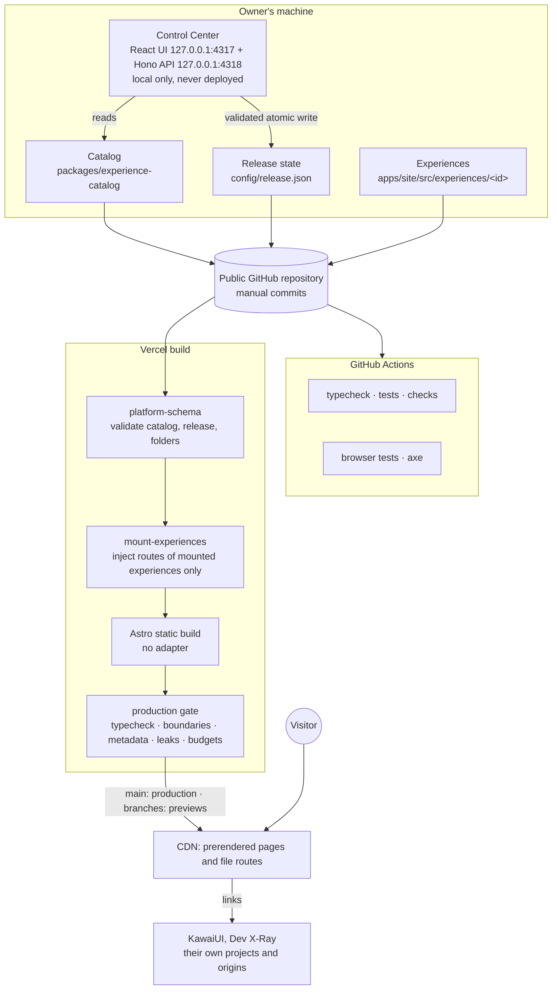

# Orrery — Architecture Blueprint

Revision 3 · 7 November 2026 · **proposed, pending the owner's approval** ([ADR-024](adr/adr-024-experience-contract.md))

Orrery (the workspace's internal name is Personal Universe) is one static Astro site that hosts independent experiences, each designed in its own way, under one set of rules for release, discovery, accessibility, security and quality. This blueprint describes the architecture as it stands, the agreement every experience works under ([Experience Contract](experience-contract.md)), and the order in which the platform grows next.

**Status words.** *Built* means the code exists and its tests pass; *deployed* means the live site at https://orrery-teal.vercel.app serves it; *designed* means it is specified here and not built; *proposed* means it waits for the owner's decision. Evidence for every status is in the [architecture review](architecture-review.md) of 7 November 2026.

## What changed from revision 2

Revision 2 (30 October 2026) was written before any code existed. It is preserved unchanged at [commit `c7ec5cd`](https://github.com/Achchutan-S/orrery/blob/c7ec5cd/docs/blueprint.md), including its platform facts and sources, which were not re-checked for this revision. Its founding decision context now lives in the ADR files it belongs to ([ADR-001](adr/adr-001-astro-host.md) to [ADR-010](adr/adr-010-identity-later.md), each under "Founding context"). Revision 3:

1. Describes the system that was built and deployed, not the one that was planned; facts that implementation changed are corrected (Astro 7, a public repository, two chrome values, `ogImage` as a route, a custom boundary checker, the Control Center's cookie session).
2. Adds the [Experience Contract](experience-contract.md) as the governing agreement between platform and experiences.
3. Separates **delivery** (public static or protected on-demand) from the four stored release dimensions, and states the security distinctions explicitly.
4. Replaces the revision 2 roadmap with a new sequence (architecture, design methodology, prototypes, Control Center, then identity) and keeps the unfinished revision 2 work as a separate backlog.
5. Adds a decision register (§ 12).

**Amended 7 November 2026** (architecture amendment pass, still proposed): independence is stated as creative and organisational, not a security boundary (§ 5.1); the Beacon's function is the platform's and its presentation the experience's (§ 3, § 5, decision D4); Phase 2 is split into 2A, methodology, and 2B, the local Design Laboratory (§ 11); experience-owned assets and fonts have explicit requirements ([contract § 3.6](experience-contract.md#36-experience-owned-assets-and-fonts)); publishing a new experience has explicit accessibility and CI prerequisites ([contract § 8.5](experience-contract.md#85-prerequisites-for-publishing-a-new-experience)); the security limitations are listed in one place (§ 6.3). The proposed decisions D10, D11, D12, D14 and D16 remain open; D13 and D15 are unchanged.

**Section map.** Code comments and older documents cite revision 2 by section number ("blueprint 3.12", "blueprint 3.8 rule 8"). Those numbers refer to revision 2:

| Revision 2 | Topic | Now |
| --- | --- | --- |
| § 1, Agreement review | executive decision, feedback review | § 1, § 2; history in revision 2 |
| § 2 | system architecture, layers, shell boundary | § 2, § 3 |
| § 3.1–3.3 | definition and release schemas, example | [contract § 2](experience-contract.md#2-experience-identity); the schema source |
| § 3.4–3.7 | lifecycle, access, discovery tiers, flags, environments | § 6 |
| § 3.8 | validation rules | [contract § 4](experience-contract.md#4-platform-integration); `validate.ts` |
| § 3.9 | layout and design ownership | § 5; [contract § 3](experience-contract.md#3-visual-autonomy) |
| § 3.10 | content model | § 12 decision D14 |
| § 3.11 | static routing for app experiences | revision 2 (unchanged); [contract § 4.3](experience-contract.md#43-errors-and-fallbacks) |
| § 3.12 | performance budgets | § 10; [contract § 8](experience-contract.md#8-quality-gates) |
| § 4 | Control Center | § 7; [Control Center README](../apps/control/README.md) |
| § 5 | repository structure | § 2 |
| § 6 | ADR-001 to ADR-010 | each ADR file's "Founding context" ([adr/](adr/README.md)) |
| § 7 | security and isolation | § 9 |
| § 8 | phased roadmap | § 11 |
| § 9, § 10 | Foundation checklist, first sixteen tasks | [tracker.md § History](tracker.md#history) |

**Phase labels.** Code, accepted ADRs and the Journal use revision 2's phase numbers, which no longer match § 11. The code keeps its labels (for example the validation rules `access-phase-4` and `on-demand-phase-4`, and `PHASE_0` in `platform-schema`; the switch they refer to is `PlatformOptions.protectedRendering`), and accepted ADRs are not edited. Read them through this table:

| Revision 2 label | What it covered | In this revision |
| --- | --- | --- |
| Phase 0 | Foundation: workspace, schema, catalog, kernel, checks, CI, deployment | done ([tracker](tracker.md)) |
| Phase 1 | analytics, privacy page, Speed Insights, custom domain | carried-over backlog (§ 11) |
| Phase 2 | writing collection, per-entry link-preview images, search, RSS, sitemap, the Markdown processor choice | carried-over backlog (§ 11) |
| Phase 3 | `track()` events, archive flow, rollback drill | events: Platform intelligence; the rest: carried-over backlog (§ 11) |
| Phase 4, 4a, 4b | owner sign-in, the adapter and on-demand rendering, a deployed Control Center, audiences and grants | Identity and protected access (§ 11) |

## 1. Purpose and principles

**Purpose.** A personal platform for independent work: writing, interactive explanations, tools, visual experiments and a resume, each free to look and behave like its own creation, all reachable, releasable and trustworthy in the same way.

**Principles**

1. **Static first.** Every page is a prerendered file on a CDN. A server path appears only when a response must differ by who is asking.
2. **Experiences are sovereign inside `<body>`.** The platform owns the document, the boundaries and the guarantees, including the Beacon's function; the experience owns everything a visitor sees, including how the Beacon is presented ([contract § 3.5](experience-contract.md#35-the-beacon-platform-function-experience-presentation)).
3. **The platform owns outcomes, not looks.** Accessibility, metadata, security and performance are platform requirements; typography, colour, layout and motion are not.
4. **Release state decides what is built, never what is private.** The repository is public. Keeping something off the website is not keeping it secret.
5. **One definition of the rules.** `platform-schema` holds every rule; the build, the checks and the Control Center call the same functions.
6. **A small kernel.** A kernel module needs two experiences that use it; a schema option needs one consumer and the code that reads it.
7. **Verify, do not assert.** A capability is described as working only when a test, a check or a recorded manual check shows it.
8. **Accessibility is not negotiable.** Freedom stops at keyboard access, focus, structure, motion, contrast and reflow, and a new experience is not published until its accessibility is verified.
9. **Independence is not isolation.** Experiences are independent in design and ownership; they share one repository, build, origin, CSP and kernel, so independence is never treated as a security boundary.

## 2. Current system architecture

### 2.1 Workspace

| Path | Role | May import |
| --- | --- | --- |
| `packages/platform-schema` | zod schemas and pure functions: definitions, release state, resolution, validation, patches, Control Center contract | `zod` only |
| `packages/experience-catalog` | data-only entries, one file and one index line each | `platform-schema` only |
| `config/release.json` | lifecycle, access, discoverability, flag values; JSON Schema generated | — |
| `apps/site` | Astro 7 static site: kernel (`src/platform`), experiences, the `mount-experiences` integration, the 404 page | both packages, Astro, React, MDX |
| `apps/control` | Control Center server and UI, local only | both packages (UI: `platform-schema` only) |
| `tools/checks` | boundaries, metadata, leaks, budgets, smoke test, deployment build gate, release JSON Schema | both packages |

One pnpm lockfile, one dependency graph for the site, Node `>=22.23.4 <23` everywhere ([ADR-021](adr/adr-021-platform-integrity.md)). All boundaries are enforced by `pnpm check:boundaries`.

### 2.2 Build flow

1. A push builds on Vercel; `VERCEL_ENV` says production or preview, and a deployment build without it fails ([ADR-016](adr/adr-016-vercel-deployment.md)).
2. `validatePlatform()` checks the catalog, release state and folder coverage; any issue fails the build.
3. `mount-experiences` calls `injectRoute` only for experiences mounted in that environment. An unmounted experience's pages, scripts and files are never compiled.
4. Astro prerenders every mounted route; islands hydrate only where an experience asks.
5. For production, the build gate runs typecheck, boundaries, metadata, leaks and budgets and stops at the first failure.

At runtime every request is a CDN file hit. There is no server code path in production.

### 2.3 Verified capabilities (7 November 2026)

| Capability | Status |
| --- | --- |
| Catalog, release state, resolution per environment, route mounting | built, deployed |
| Validation rules (reserved prefixes, lifecycle rules, phase-gated access and rendering, route ownership, `ogImage` routes, exclusive imports) | built, tested |
| Kernel: `ExperienceRoot`, `SeoHead`, cascade layers and tokens, Beacon and palette, colophon, discovery index, `flag()` | built, deployed |
| Experience-owned Beacon presentation | designed ([contract § 3.5](experience-contract.md#35-the-beacon-platform-function-experience-presentation)); only the default presentation is built |
| Experience-owned web fonts and in-page images as hashed assets | designed ([contract § 3.6](experience-contract.md#36-experience-owned-assets-and-fonts)); rejected by the output allowlist today (decision D11) |
| `track()`, `authorize()` | stubs: no-op and deny-all |
| Experiences in production: Index, Journal, resume, Skills Archive, sample-content, sample-app; external links to KawaiUI and Dev X-Ray | deployed |
| Fixtures never in production: `canary-draft`, `sample-hostile` | built, verified absent |
| Checks: boundaries, metadata, leaks, budgets; production build gate | built, gating Vercel production builds |
| CI: typecheck, tests, checks, browser tests with axe | passing on `c7ec5cd` |
| Security headers and CSP | deployed, verified by the smoke test |
| Control Center V1 (local release editor) | built, tested, local only |
| Automated accessibility checks | built, passing; manual checklist not performed |
| Writing collection, RSS, sitemap, search, analytics, privacy page, custom domain | not built |
| Design methodology, skills and registry (Phase 2A); Design Laboratory (Phase 2B) | not built; one earlier exploration is recorded in [design/platform-identity.md](design/platform-identity.md) |
| Identity, authorization, protected delivery | designed, not built |

## 3. Platform and experience responsibilities

| Area | Platform | Experience |
| --- | --- | --- |
| Identity | id rules, registration, uniqueness, coverage | its catalog entry: id, title, summary, capabilities |
| Routes | canonical paths, reserved prefixes, mounting, the 404 page | its routes, under its own prefix; its in-app views and not-found view |
| Lifecycle and release | the four dimensions, resolution per environment, validation | nothing in code; release state is changed by the owner |
| Discovery | the Index, the Beacon's palette, `publicDiscoveryIndex()` | `section`, `headline`, `tags`; its own internal navigation |
| Access | declarations, validation, the future `authorize()` boundary | nothing until protected rendering exists |
| Navigation and orientation | the Beacon's function and guarantees on every page; the colophon when chosen | the Beacon's presentation (once D4's mechanism exists); all of its own navigation |
| Accessibility | the outcomes, the focus ring, motion clamping, automated checks | meeting every outcome in its own design (contract § 5) |
| SEO and metadata | title, description, canonical, robots, Open Graph, link-preview card | its own `ogImage` route, page titles and descriptions |
| Performance | budgets per class, measurement on every build | choosing its class honestly; staying inside it or justifying an override |
| Assets and fonts | the output allowlist, leak checks, budgets | its own files in its own folder: licensed for a public repository, self-hosted, stripped of private metadata, within budget |
| Security | CSP, headers, leak checks, boundaries, the public-repository rule | no private material; no inline scripts or styles; no third-party code |
| Build and deployment | the integration, gates, CI, Vercel configuration, smoke test | building offline and deterministically; its tests; meeting the publishing prerequisites before release |
| Visual identity, type, colour, tokens, layout, materials, motion, media, content, responsive behaviour | none | all of it |

## 4. The Experience Contract

The [Experience Contract](experience-contract.md) is the agreement between Orrery and each experience. It lists what every experience must provide (registration, routes, metadata, accessibility, errors and fallbacks, build compatibility), what it may do (its whole presentation, optional capabilities), which platform services it may use, its isolation rules, the quality gates and how exceptions are approved, and how the contract itself changes.

How it relates to the other sources:

- The **schema** (`platform-schema`) is the machine-checked part of the contract. Where the two differ, the schema is what the build enforces, and the contract must be corrected.
- **ADRs** record why a rule exists. A contract change that reverses a decision needs a superseding ADR.
- The **add-experience runbook** is the procedure; the contract is the agreement the procedure satisfies.
- The **design methodology** (Phase 2A) decides what an experience looks like; the contract decides only what it must satisfy. They never reference each other's internals (D9).

Contract version 1.0 describes today's platform. Its known gaps (§ 11 of the contract: a mechanism for Beacon presentation, experience-owned fonts and images, budget overrides, WebAssembly, accessibility coverage) are deliberately not fixed in advance; each waits for the first experience that needs it. The contract stays proposed until the owner accepts it.

## 5. Design autonomy and platform cohesion

**Autonomy.** Each experience brings its own design language end to end. The platform has no theme, no component library, no colour or type tokens and no layout. Shared components stay opt-in and appear only when three experiences copy the same one ([ADR-007](adr/adr-007-presentation-ownership.md)).

**Cohesion without uniformity.** What makes Orrery feel like one place is behaviour, not appearance:

- one Beacon on every page: the same way back, the same palette and the same keyboard behaviour, presented in each experience's own visual language;
- one Index that sets each headline in a face that echoes the experience's own, without loading its fonts;
- honest "what opening this costs" lines from the performance class;
- the same focus ring everywhere, the same accessibility floor, the same metadata;
- consistent, readable addresses under each experience's own prefix.

**Isolation that makes autonomy safe.** One document per page, cascade layers with the experience layer last, scoping by `data-experience`, and a permanent hostile fixture that proves one experience's CSS cannot reach another's pages (contract § 7.3).

### 5.1 What independence does and does not mean

Experiences own their visual identity, assets, typography, layout and interactions, and the boundary checks stop them from depending on each other. They still share one public repository, one build and dependency graph, one origin, one Content Security Policy and one platform kernel. These isolation mechanisms keep styles and imports apart; none of them is a security boundary. A script on one experience's page can read every same-origin page and storage; a vulnerable shared package reaches every experience that uses it; a CSP directive added for one experience applies to all. Anything that needs real isolation runs on a separate origin (§ 8.2, [contract § 7](experience-contract.md#7-isolation-and-dependencies)).

**Design work is separate from building.** Choosing a direction, critiquing it and recording why is the design methodology's job (Phase 2A); exploring directions visually is the Design Laboratory's (Phase 2B). Building to the contract is the experience's job. The methodology produces briefs and records; it never becomes a theme the platform imposes.

## 6. Catalog, lifecycle, discoverability and access

### 6.1 Five concepts, four stored

| Concept | Values | Stored in | Decides |
| --- | --- | --- | --- |
| Lifecycle | `draft`, `alpha`, `beta`, `published`, `frozen`, `deprecated`, `archived` | release state | maturity; which environments build it |
| Discoverability | `listed`, `unlisted` | release state | whether the platform advertises it |
| Access | `public`, `signed-in`, `policy` (named policy), `owner` | release state | who may receive the bytes |
| Build flags | `{ preview, production }` per declared flag | release state | small differences inside one experience |
| Delivery | public static, or protected on demand | derived from access and the protected-rendering switch | how the bytes travel |

Release channels (stable, beta, alpha) are derived from lifecycle, never stored ([ADR-005](adr/adr-005-release-dimensions.md)). Environments are development, preview and production.

The vocabulary used in planning maps onto the schema without a migration: *authenticated* is `signed-in`; *allowlisted* and *group-restricted* are both `policy` with a named policy (a policy is an allow-list of identities or a group); *owner-only* is `owner`.

### 6.2 What ships where (today: protected rendering off)

| Lifecycle | Development and preview | Production |
| --- | --- | --- |
| `draft`, `alpha` | built | not built |
| `beta`, `published`, `frozen` | built | built if access is `public` |
| `deprecated` | built | built if access is `public`; always unlisted |
| `archived` | not built | not built (`archivedTo` is required; the redirect or snapshot it names is not implemented) |

Listed means: built in that environment, `listed`, `public` and not deprecated. An experience with no release entry is an owner-only, unlisted draft. `signed-in` and `policy` access, on-demand routes and request flags fail validation while protected rendering is off ([ADR-010](adr/adr-010-identity-later.md)).

### 6.3 Security distinctions

- **Unlisted is not private.** An unlisted experience is public to anyone with its address; it is only absent from discovery and asks search engines not to index it.
- **Draft is not private.** A draft is absent from production builds. Its source is in the public repository and in every preview build.
- **Not built is not private.** Omitting an experience from production keeps it off the website; its committed files remain readable on GitHub and in Git history ([ADR-022](adr/adr-022-link-previews-smoke-and-public-repository.md)).
- **A sign-in screen is not authorization.** Only a server-side check per request, before any protected byte is sent, protects anything. A client-side check, a hidden link or a static page behind a JavaScript gate protects nothing.
- **Owner access is not authentication.** `owner` means "never built in production". No sign-in exists and nothing checks who is asking; locally and in previews the experience is present.
- **Preview protection is a convenience.** Vercel Authentication on previews keeps casual visitors out; a leaked shareable link exposes the whole preview, drafts included.
- **The Control Center is local-only.** It edits a file on the owner's machine; it controls what is built, not who may see it, and it has no deployed form.
- **Nothing private can be delivered today.** No identity system, authorization, protected route or private content store exists. Until the Identity phase builds them (§ 6.4), anything that must stay private stays out of the repository.

### 6.4 The protected-access model (designed, not built)

Protected experiences need things a static site cannot provide. The model, to be built in the Identity phase (§ 11):

| Element | Design |
| --- | --- |
| Identity | a managed identity provider; the owner first, then invited people; a verified account is the strongest identity the platform needs |
| Subjects | anonymous, or an account |
| Groups and policies | named policies (`recruiters`, `friends`, `beta-<id>`), each an allow-list of accounts or a group; `access: { kind: 'policy', policy }` names one |
| Grants | identity-bound grants for anything personal; capability links (bearer, single redemption, short-lived) only for low-sensitivity betas |
| Enforcement | middleware loads the session and calls `authorize(subject, experience, action)` on every request to a protected route; denied requests get a 404 |
| Delivery | protected routes are on-demand only, never prerendered, sent with `Cache-Control: private, no-store`; protected content lives in a private store, never in the repository |
| Revocation | grants and sessions are checked per request, so revoking takes effect on the next request |
| Auditing | server-written, append-only events: sign-in, grant redemption, access, denial; "link L used" is never recorded as "person P" |
| Discovery for audiences | an on-demand "shared with you" page (`/me`), never the static Index, which is identical for every visitor |

The schema already reserves the access kinds, `render: 'on-demand'`, request flags and the route prefixes (`/auth`, `/i`, `/me`, `/api`, `/_platform`) so this arrives without a migration. `authorize()` exists as a deny-all stub so an accidental early caller is refused.

## 7. Control Center

### 7.1 Today (V1, built)

A local tool: a React UI on `127.0.0.1:4317` and a Hono API on `127.0.0.1:4318`, one process, never deployed ([Control Center README](../apps/control/README.md), [ADR-017](adr/adr-017-control-center-server.md), [ADR-018](adr/adr-018-control-center-ui.md)). It shows every catalog entry with its release entry, channel and resolution in all three environments; it changes lifecycle (only along allowed transitions), access (`public` or `owner`), discoverability, declared flag values and notes, each previewed with its production effect and confirmed before a write; it shows pending changes against the session baseline with the commit commands. It never runs Git or a shell, and the release file is written only through `FileReleaseStore`. The catalog is read-only: it changes in code.

### 7.2 The publishing workflow and who owns each step

| Step | Platform | Control Center | Experience package | Future protected services |
| --- | --- | --- | --- | --- |
| 1. Create or import | coverage and validation rules | later: scaffold a draft folder and catalog entry from a template, as a previewed local write (Phase 4) | its implementation | — |
| 2. Identity, route, metadata | schema | shows them; edits only through the scaffold | catalog entry | — |
| 3. Visual direction, audience | — | later: shows the linked design record (read-only) | the design it implements | — |
| 4. Lifecycle, discoverability, access | resolution and validation | edits release state (built) | — | enforcement of non-public access |
| 5. Preview in isolation and in Orrery | preview builds | links to the local and preview URLs | its pages | — |
| 6. Validation and gates | checks, CI, build gate | shows validation (built) and, later, the latest check results from a report file | its tests | — |
| 7. Approve and publish | Vercel build of `main` | shows the diff and commands (built); the owner commits | — | — |
| 8. Monitor access and signals | — | later: dashboards | `track()` calls | audit log, analytics |

### 7.3 Constraints on its evolution

- It stays local until the owner can sign in to it on its own origin (Identity phase). No admin path ever exists on the site's origin.
- It never runs a shell or Git. Anything it cannot do by writing a validated file, it shows as a command for the owner to run.
- Every write is previewed, confirmed and never retried automatically.
- It uses only `platform-schema` rules; it never has a second model of the release.
- It grows one screen at a time, each with a consumer: no administrative product ahead of need.

## 8. Delivery architecture

### 8.1 Public static (today)

`output: 'static'`, no adapter. `apps/site/vercel.json` provides clean URLs, the 404 status, security headers (HSTS, `nosniff`, referrer policy, permissions policy, `frame-ancestors 'none'`, COOP) and immutable caching for hashed assets; Astro emits a hashed `<meta>` CSP. Experience files (PDFs, images, downloads) are routes built only where their experience is mounted ([ADR-020](adr/adr-020-resume-assets.md)). Production is `main`; every other branch is a protected preview that also builds drafts.

### 8.2 Protected on-demand (designed)

When the first protected experience exists: add the Vercel adapter, verify the `vercel.json` headers still apply, turn on `protectedRendering`, and serve only protected routes on demand through middleware and `authorize()`. Public pages stay prerendered. Separate origins are used wherever a security boundary is needed: the deployed Control Center on its own subdomain, external apps on theirs, and any untrusted experiment on a separate origin or in a sandboxed iframe without `allow-same-origin`.

## 9. Security and privacy boundaries

| Layer | Decided by | What it can keep from the public |
| --- | --- | --- |
| The website | `config/release.json`, resolved at build time | unreleased experiences, non-public metadata, off flags' rendered UI (not their code) |
| The repository | GitHub visibility (public today) | nothing: every committed file is readable |
| Git history | every pushed commit | nothing: removed files remain in earlier commits until the owner rewrites history |
| Previews | Vercel Authentication | casual access only |
| The Control Center | the owner's machine | everything; it is never deployed |
| Protected store (future) | server-side authorization per request | protected content, grants, invitee data |

**Guarantees today:** nothing unreleased is compiled into production (route mounting, tested); the leak check fails the build on unreleased routes, canaries, non-public titles, summaries and prose, unexpected output files, source maps and off-flag UI; experiences cannot import each other; browser code cannot import the catalog or release state; strict CSP with no `'unsafe-inline'`; no runtime code path.

**Not guaranteed:** privacy of anything committed; runtime isolation between experiences on the same origin (any script can read same-origin storage and fetch any page); version or supply-chain isolation between experiences (one dependency graph); per-experience security policy (one CSP for every page). Experience independence (§ 5.1) is not a security boundary.

**Rule for the future:** anything that must stay private is never committed. Protected content arrives with the Identity phase and lives outside the repository.

## 10. Performance, accessibility and quality strategy

**Performance.** Budgets per performance class (`content`, `interactive`, `immersive`) cover JavaScript, the Beacon, CSS, fonts, images, lazy chunks and transfer on every page, plus per-kind limits for files no page loads ([ADR-023](adr/adr-023-audit-closure.md)). An experience picks its class honestly and justifies any override in its catalog entry. Lighthouse and Core Web Vitals are measured by hand, not in CI.

**Accessibility.** Outcomes, not a design system (contract § 5). The platform makes the focus ring and CSS motion clamping non-overridable and runs axe, structure, reflow, text-spacing, forced-colour and keyboard checks in CI on the pages its suites list. Two gaps matter before new experiences arrive: page coverage is hand-listed (contract gap G7, decision D12), and the manual checklist has never been performed. Both are therefore explicit prerequisites for publishing a new experience ([contract § 8.5](experience-contract.md#85-prerequisites-for-publishing-a-new-experience), P1 and P2).

**Quality gates.** Typecheck, boundaries, validation, metadata, leaks and budgets gate every Vercel production build. Unit and browser tests run in CI on every push, but CI does not gate deployment: Vercel builds `main` in parallel and `main` has no branch protection (tracker decision 7, decision D16). Until that changes, a passing CI run on the publishing commit and a passing preview smoke test are prerequisites the owner checks by hand (contract § 8.5, P3 and P4).

**Strategy.** Add a gate when a real mistake shows it is needed or a contract requirement cannot be checked otherwise; measure before setting limits; record every exception where it is made.

## 11. Roadmap

Each phase lists what it needs, what it delivers and how it ends. A phase starts only when its dependencies are met.

### Phase 1 — Architecture and Experience Contract (this phase)

- **Scope:** review the architecture against the code; write the Experience Contract; revise this blueprint; record decisions.
- **Deliverables:** [experience-contract.md](experience-contract.md), this revision, [architecture-review.md](architecture-review.md), [ADR-024](adr/adr-024-experience-contract.md), and the amendment pass of 7 November 2026.
- **Exit criteria:** the owner accepts or amends the contract and the decisions marked *now* in § 12, and decides D10 (or defers it explicitly); ADR-024 becomes accepted. D11, D12, D14 and D16 may stay open, each with its own trigger.
- **Out of scope:** any code, schema, release or design change.

Phase 2 has two parts. Phase 2A is documents and agent skills: it describes how design work is done. Phase 2B is the first piece of tooling: a place to look at directions. Phase 2A does not build a Design Laboratory, and its documents are not one.

### Phase 2A — Design methodology, skills and aesthetic registry

- **Depends on:** Phase 1 accepted (the contract defines what a design must satisfy).
- **Scope:** an Art Director methodology (how a direction is found: subject, audience, references, several directions, critique, selection); an Experience Builder methodology (how a selected direction becomes an experience that meets the contract); critique and iteration workflows; an Art Director skill and an Experience Builder skill that apply the two methodologies when an agent does design or build work (alongside the vendored `frontend-design` and `web-design-guidelines`); an aesthetic registry as creative memory: one record per direction explored, with its references, the reasoning, what was selected or rejected and why, and the experience it led to.
- **Where it lives:** documents under `docs/design/`; the skills under `.claude/skills/`. Neither is imported by code or read by the build or the catalog. The repository is public, so the methodology, the skills and every registry record are public too.
- **Deliverables:** the two methodology documents; the two skills; the registry with its first records (the three platform-identity directions in [design/platform-identity.md](design/platform-identity.md) and the Skills Archive's direction); one full dry run of the workflow on a written brief, recorded in the registry.
- **Exit criteria:** a brief can go through exploration, critique and selection using only the documents and skills; the registry records both the selected and the rejected directions of the dry run.
- **Out of scope:** any rendering or experimentation environment (Phase 2B), platform themes, shared component libraries, building experiences, code changes.

### Phase 2B — Design Laboratory (local visual experimentation)

- **Depends on:** Phase 2A (the laboratory serves the methodology; the registry is where its results are recorded).
- **Scope:** a local-only environment where directions from the registry are sketched and compared visually in a browser: type, colour, composition, motion and the Beacon's presentation side by side at several viewport sizes, in light, dark and forced colours, with reduced motion on and off.
- **Constraints:** local only, like the Control Center; never deployed, never mounted in a production build, and never imported by an experience or the kernel. Where it lives (a separate local app or draft experiences under `/labs/`) is its first decision, recorded by ADR. Sketches it holds are public once committed.
- **Exit criteria:** at least one registry direction from the 2A dry run is rendered and compared in the laboratory and the comparison is recorded in its registry record; the production leak check shows nothing from the laboratory in `dist/`.
- **Out of scope:** publishing anything, platform themes, a component library, changes to the contract.

### Phase 3 — Independent experience prototypes

- **Depends on:** Phases 2A and 2B (each prototype starts from a registry record whose direction was explored in the laboratory); decisions D11, D12 and D16 decided by the owner, whichever way, before the first prototype is built, so the prototypes know how fonts, images, accessibility coverage and deployment gating will work.
- **Scope:** at least three draft experiences in radically different directions (for example atmospheric sky, immersive landscape, precision minimalism), each built from its own registry record (Phase 2A, explored in Phase 2B) to contract 1.x. Platform changes happen only through approved contract minor versions, as the prototypes need them (gaps G1–G5).
- **Exit criteria:** each prototype passes every gate in its own class without importing another experience; the Index, the Beacon's function and metadata work unchanged for all of them; the `immersive` class is exercised and its budgets confirmed or corrected by ADR; a side-by-side review recorded in the registry says where autonomy and cohesion held and where the contract needed to change. Publishing any prototype is a separate owner decision and requires the publishing prerequisites ([contract § 8.5](experience-contract.md#85-prerequisites-for-publishing-a-new-experience)).
- **Out of scope:** Control Center changes, identity, publication by default.

### Phase 4 — Control Center evolution

- **Depends on:** Phase 3 (by then there are seven experiences built by copying, which is the threshold revision 2 set for a generator, and the creation steps are known from practice).
- **Scope:** create and register a draft experience from a template as a previewed local write; show identity, metadata and the linked design record; show validation and the latest check results from report files the CLI writes; lifecycle and discoverability (built); access declarations limited to what the schema enforces; the publishing workflow ending in the owner's commit.
- **Exit criteria:** a new draft experience can be created from the Control Center and reach a preview build with no hand-edited platform files; the Control Center still never runs a shell or Git; every write is previewed and confirmed; contract and browser tests cover each new screen.
- **Out of scope:** deployment of the Control Center, authentication, analytics dashboards.

### Future phases — Identity, protected access and platform intelligence

- **Identity and protected access** (revision 2's Phases 4a and 4b). *Trigger:* the first piece of content that must be shared privately, or the need to manage releases away from the owner's machine. *Scope:* identity provider, the adapter and on-demand rendering, `authorize()`, the deployed Control Center on its own origin (owner only), then groups, policies, grants, invitations, revocation, the audit log and the private content store. *Exit criteria:* the authorization matrix (anonymous, signed in without a grant, granted, revoked, expired, forwarded capability link) passes in CI; protected content never appears in `dist/`, the CDN cache or the repository.
- **Platform intelligence.** *Trigger:* real traffic and a question it should answer. *Scope:* `track()` to an anonymous, cookieless analytics service with a privacy page; Core Web Vitals; audit and analytics views in the Control Center; search; graduation of experiences that outgrow the build.

### Carried over from revision 2 (not scheduled)

Work revision 2 planned for its Phases 1–3 that is not done. None of it blocks Phases 2–4, and any item can be picked up when it has a reason:

| Item | Revision 2 phase | Note |
| --- | --- | --- |
| Cookieless page analytics, privacy page, Speed Insights | 1 | needs the privacy page first; DPDP question open |
| Custom domain and subdomains for KawaiUI and Dev X-Ray | 1 | blocked on choosing a domain |
| Writing collection, tag pages, RSS, sitemap, search | 2 | see decision D14 |
| Archive flow with redirects or snapshots | 3 | `archivedTo` validated, not implemented |
| Rollback drill, dependency routine | 3 | runbook exists; drill not recorded |
| Manual accessibility checklist for the published experiences | audit F12 | outstanding; for new experiences it is a publishing prerequisite (contract § 8.5, P2) |
| CI as a deployment gate | tracker decision 7 | decision D16; until then a manual publishing prerequisite (P3) |

## 12. Decision register

*Now* means decided by accepting this revision (documentation only, no code). *Later* means the direction is set and implementation waits for its trigger. *Proposed* means it needs the owner's decision.

| # | Question | Current state | Recommended direction | Reasoning | Alternatives considered | Consequences | When |
| --- | --- | --- | --- | --- | --- | --- | --- |
| D1 | How much visual freedom does an experience have? | Everything inside `<body>`; platform imposes focus ring, CSS motion clamp, Beacon, colophon if chosen, a small reset | Keep: total freedom inside the contract's accessibility outcomes; no platform theme | Proven by six unrelated designs and the hostile fixture | a shared design system (contradicts the purpose); per-experience Shadow DOM (heavy, hurts fonts and tooling) | No automatic visual consistency; cohesion comes from behaviour (§ 5) | now |
| D2 | Are shared UI components optional or mandatory? | None exist | Optional forever; an opt-in kernel folder only after three experiences copy the same component | A mandatory library would become a theme | a starter component set (premature, would shape every design) | Small duplication between experiences is accepted | now |
| D3 | Who owns design tokens? | Experiences, under their own prefixes; platform `--pu-*` for focus, motion, target size, spacing | Experience-owned entirely; the platform set stays limited to integration tokens and gains no colour or type tokens | Colour and type are the experience's identity | platform semantic colour tokens (would pull every design toward one palette) | The `--pu-space-*` scale is optional; experiences may ignore it | now |
| D4 | How is platform chrome configured per experience? | `chrome: 'minimal' \| 'beacon'`; the Beacon has one default presentation, identical everywhere | Keep two values. The Beacon's function and guarantees (contract § 3.5, B1–B8) stay the platform's; its presentation (placement, colour, type, size, material, treatment) is the experience's. The mechanism (Beacon custom properties and placement values, or an experience-rendered trigger wired to the platform palette) is chosen with the first prototype that needs it (contract G1); never allow removing or hiding the Beacon | Navigation back to Orrery is a platform guarantee; one fixed look across unrelated designs is not | one fixed treatment everywhere (fights every design); unrestricted CSS overrides with no tested guarantees; a "none" chrome (loses orientation) | The guarantees are tested for every presentation, not only the default; ADR-019 item 6 already anticipates the option | direction now; mechanism later (Phase 2B explores it, Phase 3 builds it) |
| D5 | How does an experience declare capabilities? | A closed `capabilities` list, read only by two validation rules | Keep a closed list; add a value only with the rule that consumes it; no capability negotiation or plugin registry | Declarations nothing reads are decoration | capability-driven feature loading (no consumer) | `events` and `variantOf` stay as reserved or validation-only fields | now |
| D6 | How are experience CSS and JS isolated? | One document per page, cascade layers, scoping, CSP-hashed scripts, boundary checks | Keep; add a layering check only if a real mistake happens (contract G8) | Current mechanisms are proven by tests | Shadow DOM; iframes per experience; CSS Modules mandated | Runtime isolation on one origin remains absent (§ 9) | now |
| D7 | How do access policies evolve without pretending static output is secure? | `public` and `owner` usable; `signed-in`, `policy`, on-demand rejected | Keep the reserved kinds; map authenticated, allowlisted and group-restricted onto them; protected means on-demand, server-authorized, never committed (§ 6.4) | The schema already carries the model; a static page can never be protected | an "unlisted = private" shortcut (insecure); client-side gates (insecure) | No schema migration needed for the Identity phase | later (Identity phase) |
| D8 | Is the catalog schema sufficient? | Covers every current experience | Sufficient for Phases 2 and 3; expected additive changes: Beacon options (G1), more budget overrides (G4). No contract-version field | Every change so far was additive; one repository means migrations travel with the change | a versioned schema with per-experience opt-in (unneeded in one build) | Breaking changes are major contract versions with migrations in the same change | now |
| D9 | How do design methodology and implementation stay separate? | Design notes in `docs/design/`; experiences in `apps/site` | Methodology, skills and registry are documents (Phase 2A); the laboratory is a local tool (Phase 2B); the catalog never references design records; an experience may link to its record from a comment or README | Keeps the platform from turning design records into a theme catalogue | a `design` field in the catalog (couples build data to creative notes) | The Control Center can show a linked record later only by convention | now |
| D10 | How should the roadmap and phase labels change? | Revision 2 phases 0–5, partly done; code says "Phase 4" for identity | New sequence (§ 11); legacy labels kept in code and mapped here | Renaming rule ids and messages is churn with no behaviour change | renumber code and ADRs (rewrites history-like records) | Readers need the mapping in this document's header | proposed (ADR-024) |
| D11 | How can experiences own fonts and images? | Allowlist rejects hashed font and image assets; workarounds: system stacks, the platform face, image routes, an `astro.config.ts` entry. The requirements any route must meet are in contract § 3.6 | Allow content-hashed fonts and images emitted from a mounted experience's own folder; keep the byte, base64 and prose protections for unreleased files, and prove each asset belongs to a mounted experience and is budgeted | Visual autonomy needs real type and imagery without editing platform files | per-experience entries in `astro.config.ts` (breaks "one folder, one entry, one line"); everything as routes (no hashing, no immutable caching) | A leaks change with tests; budgets already count both | proposed; to be decided before Phase 3 |
| D12 | How is accessibility coverage guaranteed for new experiences? | Hand-written page lists in the browser suites | Derive the pages from the build, as the smoke test derives routes | A contract requirement that is not checked for new pages is a promise, not a gate | keep hand lists (new experiences silently uncovered) | Browser runs grow with the site; until decided, coverage of a new experience is added by hand (contract § 8.5, P1) | proposed, before Phase 3 |
| D13 | Which kernel modules may experiences rely on? | Any file under `src/platform` is importable | The supported surface in contract § 6.2; everything else internal | Lets the kernel change without breaking experiences | a barrel module (no need yet) | Documentation only | now |
| D14 | Who owns long-form content? | Revision 2 planned a platform `writing` collection; none exists. The Journal and the Archive own their content in their folders | Content belongs to the experience that presents it; a shared collection appears only when two experiences present the same corpus | Matches what was built; the kernel rule applies to content too | the revision 2 collection by default (no second consumer yet) | ADR-009 would be superseded by a new ADR if accepted; RSS, sitemap and search wait for a reason | proposed |
| D15 | What may the Control Center become? | Local release editor | Phase 4 scope in § 11; local until the Identity phase; never a shell, never Git | Keeps the tool honest and small | a deployed admin now (needs identity first); a CMS (wrong shape) | Check results reach it as report files written by the CLI | later (Phase 4) |
| D16 | Should CI gate deployment? | Vercel builds `main` in parallel with CI | Require CI before production (branch protection or Vercel's deployment checks) | Unit and browser tests do not gate production today | rely on the build gate only (misses tests) | A GitHub or Vercel dashboard change by the owner; until decided, a passing CI run on the publishing commit is checked by hand (contract § 8.5, P3) | proposed, before Phase 3 |

## 13. Deferred decisions and non-goals

**Deferred, with their triggers**

- Identity provider and pricing: the Identity phase. Revision 2's open questions for that phase stay open: whether `vercel.json` headers still apply alongside the adapter (otherwise the adapter's `staticHeaders` and middleware), and whether Vercel Authentication can gate a deployed Control Center if the server can verify the request came through it.
- Custom domain: when one is chosen (needed for the KawaiUI and Dev X-Ray subdomains).
- Analytics vendor and privacy obligations (India's DPDP Act, GDPR): before any analytics, and again before invitee accounts.
- Making the repository private or rewriting history: the owner's decision (tracker decisions 5 and 6).
- The Control Center's cookie port scope (audit F20): the owner's decision.
- Lighthouse or Core Web Vitals gates in CI: when lab runs show regressions worth catching.
- Graduation of any experience: when one meets ADR-004's criteria.

**Non-goals**

- A platform visual theme, design system or mandatory component library.
- Microservices, Kubernetes, Module Federation, a headless CMS, a feature-flag vendor, session replay, fingerprinting, Turborepo.
- An admin path on the site's origin, ever.
- A database or server before a protected experience needs one.
- Describing anything as private because it is unlisted, a draft or unbuilt.
