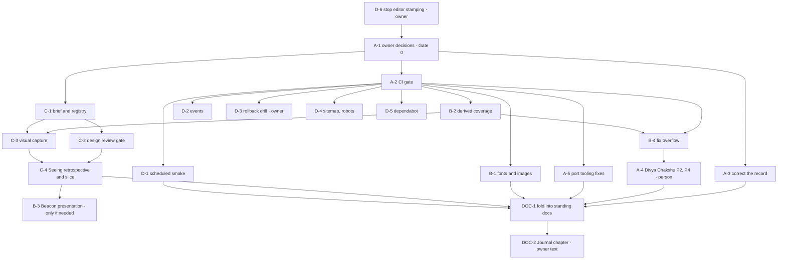

# Orrery — Platform Audit and Next-Phase Readiness

Audit date: 13 November 2026 · Audited baseline: `main` at `b9555cc` (equal to `origin/main`, clean working tree) · Auditor: Claude Code (audit only; nothing but this file was created or changed)

> **Note on this file's location.** `AGENTS.md` § Documentation rules says "no per-task reports" and "status and evidence go in the tracker". This report was requested explicitly by the owner at this path, so it exists as an exception. Task DOC-1 in the backlog folds its durable findings into `docs/tracker.md` and the ADRs; after the implementation programme finishes, the owner can delete this file or keep it as the programme's record.

**How to read the evidence labels.** *Observed* means I ran a command or read a file in this session and the result is quoted or summarised. *Interpretation* is my reading of observed facts. *Recommendation* is what I propose. Anything I could not check is listed in [Appendix G](#g-unverified-assumptions) and [Appendix H](#h-environmental-limitations).

---

## 1. Executive summary

**The engineering platform is stable and honest. The creative process that was supposed to stop another "Seeing" does not exist. Access control and analytics are designed, deliberately not built.**

1. **Phase 0 (Stabilisation): verified, with governance debt.** On `b9555cc` every pipeline passed locally in this session: frozen lockfile, typecheck, 320 unit and integration tests (319 pass, 1 intentional skip), all four repository checks, and 99 browser tests. Hosted CI passed both jobs on the same commit. Production is byte-identical to a local production build of `main` (33 pages and 13 hashed assets compared). No secrets, no known dependency advisories, no draft material in production. What is not stable is the paperwork: the blueprint (revision 3), the Experience Contract (1.0), ADR-024 and ADR-025 are all still **proposed**; the tracker still says Divya Chakshu is "prepared, not committed" although it has been live since 8 November; and Divya Chakshu was published without the manual accessibility check (P2) and the recorded preview smoke test (P4) that the project's own contract § 8.5 requires.

2. **Phase 1 (Creative infrastructure): not complete; essentially not started.** The repository's own tracker says so: "Phase 2A — Design methodology, Art Director and Experience Builder skills, aesthetic registry, one dry run: **not started**". There is no creative brief template, no art-direction document, no reference-gathering step, no critique workflow, no aesthetic registry, no design review gate and no visual-evidence procedure. What exists is one historical design note (`docs/design/platform-identity.md`), two vendored generic skills and one sentence in `AGENTS.md`. The platform does guarantee that a new experience cannot *inherit* a platform look (there is none to inherit, and this is tested). It does nothing to make a new experience *good*, and it has no way to say "technically complete, aesthetically rejected" except the owner declining to merge. `feat/seeing` is the proof: 119 files, every gate reported green, and the only record of the rejection is the commit message "seeing tried but should be better".

3. **Phase 2 (Platform capabilities): lifecycle and discovery are real; access, analytics and observability are stubs by design.** The release lifecycle, catalog, route mounting, leak scan, budgets, Index, Beacon and palette are implemented, tested and deployed. Authentication, authorization, protected content, analytics, error visibility and performance monitoring are **not present**: `authorize()` denies everything and has no callers, `track()` is an empty function, and no sitemap, `robots.txt`, RSS or search index exists. This matches the accepted ADR-010 ("designed now, built later"); it is a correct deferral, not a defect, but none of it may be described as implemented.

4. **Two concrete defects found.** (a) Divya Chakshu scrolls sideways in production at tablet and small-laptop widths (90 px of overflow at 768 px, 8 px at 1280 px), which no test covers. (b) CI does not gate production: on 3 November commit `f49d6dc` failed the hosted browser job and Vercel deployed it anyway. `main` has no branch protection and the repository has never had a pull request.

5. **Verdict.** The repository is ready for an implementation programme. It is **not** ready for a new experience to be built until the creative process (workstream C) exists and the publishing gate (workstream A) is real. The programme in § 18 has 19 tasks in five workstreams; four small owner decisions block its start (§ 20, Gate 0).

---

## 2. Audit scope and methodology

**Scope.** The whole repository at `b9555cc`; the remote branch `origin/feat/seeing` at `441e642` (read through `git show` and `git diff` only, never checked out); the production deployment at https://orrery-teal.vercel.app; the public GitHub API for CI, status, branch protection and pull requests; the two external projects' reachability.

**Method.**

1. Reconnaissance: `git` state, branches, history, workspace manifests, CI workflow, Vercel configuration.
2. Read every governing document in full: `AGENTS.md`, `docs/blueprint.md`, `docs/experience-contract.md`, `docs/architecture-review.md`, `docs/tracker.md`, `docs/adr/README.md`, ADR-024, ADR-025, `docs/add-experience.md`, `docs/accessibility.md`, `docs/deployment.md`, `docs/design/platform-identity.md`, the Divya Chakshu and Seeing READMEs. ADR-001 to ADR-023 were read through the index and the architecture review, not line by line.
3. Read the implementation: all of `packages/platform-schema/src` (definition, release, resolve, validate, control, patch), the catalog index and entries, `apps/site/integrations/mount-experiences.ts`, `apps/site/astro.config.ts`, `apps/site/vercel.json`, every kernel module under `apps/site/src/platform`, the 404 page, the Index route, `tools/checks/src/leaks.ts`, `budgets.ts` (accounting and tables), `deploy-build.ts`, `hygiene.test.ts`, and the page lists of the browser suites. The Control Center was assessed through its README, its contract in `platform-schema/src/control.ts` and its passing tests, not a line-by-line review.
4. Ran the project's own pipelines (Appendix B, C).
5. Verified production by HTTP, by byte comparison with a local production build, by the project's smoke test, and by driving the live site in headless Chromium at 1280 × 800 and 360 × 740.
6. Confirmed the working tree was unchanged afterwards (`git status --porcelain` empty before this file was written).

**Not done.** No real device, GPU, screen reader or Lighthouse run. No Vercel dashboard access. No line-by-line review of experience internals (shaders, the Skills Archive, the resume generator). See Appendix G and H.

**A naming problem the reader must know about.** The audit brief uses "Phase 0 Stabilisation / Phase 1 Creative infrastructure / Phase 2 Platform capabilities". The repository uses two different, older schemes: blueprint revision 2's Phases 0–5 (still in code comments and accepted ADRs) and revision 3's Phases 1, 2A, 2B, 3, 4 (in the tracker). None of the three line up. This report uses the brief's names and maps them:

| Brief | Closest repository term | Repository's own status |
| --- | --- | --- |
| Phase 0 — Stabilisation | Revision 2 "Phase 0 Foundation" plus the engineering audit (F01–F23, ADR-021 to ADR-023) | done except items in tracker § Open work |
| Phase 1 — Creative infrastructure | Revision 3 "Phase 2A methodology, skills, registry" and "Phase 2B Design Laboratory" | **not started** (tracker § Roadmap phases) |
| Phase 2 — Platform capabilities | Spread over the kernel (built), revision 3 "Phase 4 Control Center evolution", "Identity and protected access", "Platform intelligence" and the carried-over backlog | mixed; see § 7 |

*Interpretation:* the belief that Phases 1 and 2 were "completed" does not come from the repository. No document in it claims so.

---

## 3. Repository and deployment snapshot

| Fact | Value | Evidence |
| --- | --- | --- |
| Current branch | `main` | `git branch -a -vv` |
| `main` head | `b9555cc` "Add DS-VR", 8 November 2026 12:58 +0530 | `git log` |
| `main` vs `origin/main` | identical | `git branch -vv` |
| Working tree | clean; no stashes; no tags | `git status --porcelain`, `git stash list`, `git tag` |
| History | 13 commits, linear, no merge commits | `git log --graph --all` |
| Other branches | `feat/seeing` at `441e642` (local = remote), 1 commit ahead of `main`, 0 behind | § 9 |
| Pull requests | none, ever | GitHub API `pulls?state=all` returned 0 |
| Repository visibility | public; default branch `main`; `main` not protected | GitHub API |
| Toolchain | Node 22.23.4 (`.nvmrc`), pnpm 10.34.9 (`packageManager`), TypeScript 6.0.3, Astro 7.4.7, React 19.3.1, Vite 8.3.6, Hono 4.13.16, zod 4.6.7, Playwright 1.65.0 | manifests |
| Workspace | 6 packages: `@pu/site`, `@pu/control`, `@pu/platform-schema`, `@pu/experience-catalog`, `@pu/checks`, root | `pnpm-workspace.yaml` |
| Tracked files | 251 | `git ls-files` |
| Catalog | 11 entries: 9 internal (`index`, `journal`, `sample-content`, `sample-app`, `skills`, `divya-chakshu`, `resume`, `canary-draft`, `sample-hostile`), 2 external (`kawaiui`, `devxray`) | `packages/experience-catalog/src/index.ts` |
| Released to production | `index`, `journal`, `sample-content`, `sample-app`, `skills`, `divya-chakshu`, `resume`; external links `kawaiui`, `devxray` | `config/release.json`; build log `production: mounted …` |
| Never in production | `canary-draft`, `sample-hostile` (draft, owner, unlisted) | `config/release.json`; live 404 |
| Production URL | https://orrery-teal.vercel.app | — |
| Production = `main`? | yes, by content | § 10 |
| Hosted CI on `b9555cc` | both jobs success (run 42458956688, 8 November 2026) | GitHub API |
| Vercel status on `b9555cc` | success, 8 November 2026 07:29 UTC | GitHub commit status |

---

## 4. Current architecture overview

*Observed; matches `docs/blueprint.md` § 2.*

```
packages/platform-schema      zod schemas + pure functions (definition, release, resolve, validate, patch, control contract). Imports zod only.
packages/experience-catalog   one data-only entry per experience + one index line. Imports platform-schema only.
config/release.json           lifecycle, access, discoverability, flag values per experience. JSON Schema generated.
apps/site                     Astro 7, output: 'static', no adapter.
  integrations/mount-experiences.ts   validatePlatform() then injectRoute() for mounted experiences only
  src/platform/               kernel: root (ExperienceRoot, SeoHead), tokens, beacon, colophon, discovery, release, analytics (stub), access (stub)
  src/experiences/<id>/       one folder per experience
  src/pages/                  404 only
apps/control                  local-only Control Center (Hono API 127.0.0.1:4318, React UI 127.0.0.1:4317)
tools/checks                  boundaries, metadata, leaks, budgets, smoke, deploy-build gate, release schema generator
```

**Build flow.** `VERCEL_ENV` selects the environment (`buildEnvironment()` in `resolve.ts`; a deployment build without it throws). `planMount()` validates catalog, release state and folder coverage and returns routes only for mounted experiences. An unmounted experience is never compiled. For production, `tools/checks/src/deploy-build.ts` runs `typecheck → check:boundaries → build → check:metadata → check:leaks → check:budgets` and any failure fails the Vercel build.

**Runtime.** Every request is a static file from Vercel's CDN. There is no server code, no function, no database, no cookie, no third-party request. CSP: Astro's hashed `<meta>` policy (`default-src 'self'`, no `'unsafe-inline'`) plus header directives from `apps/site/vercel.json`.

**What makes experiences independent.** One document per page; cascade layers `platform.reset, platform.tokens, platform.chrome, experience`; scoping by `[data-experience='<id>']`; a boundary checker that refuses cross-experience imports; no platform theme, component library, colour or type tokens.

**What they share.** One public repository, one build and dependency graph, one origin, one CSP, one kernel. The documents say plainly that this is not a security boundary (blueprint § 5.1, contract § 7).

*Interpretation:* the architecture is small, coherent and proportionate. I found no premature abstraction in the kernel. The over-reach is in the schema, which reserves several values nothing uses (§ 8.1).

---

## 5. Phase 0 assessment — Stabilisation

**Verdict: stable enough to build on. Four governance items must close first (Gate 0).**

| # | Area | Finding | Status | Evidence |
| --- | --- | --- | --- | --- |
| 1 | Branch integrity | `main` linear, equals `origin/main`; one side branch, cleanly ahead by one commit, no divergence | verified | § 9 |
| 2 | `main` state | `b9555cc`, all pipelines green locally and on hosted CI | verified | Appendix C |
| 3 | Uncommitted, untracked | none; ignored only: `node_modules`, `dist`, `.astro`, `test-results`, `.notebook/`, `docs/claude-skills/private/` | verified | `git status --porcelain --ignored` |
| 4 | Branches vs `main` | `feat/seeing` only | verified | § 9 |
| 5 | History and merges | 13 commits, no merges, no PRs, direct pushes to `main`; commit messages are terse ("Add DS-VR" published Divya Chakshu) | verified; weak traceability | `git log`; GitHub API |
| 6 | Release configuration | `config/release.json` valid; 11 entries match 11 catalog entries; canonical serialisation | verified | `check:metadata` passed |
| 7 | Production consistency | production content equals a local production build of `main` | verified | § 10 |
| 8 | Blueprint compliance | implementation matches blueprint revision 3 § 2, with drift listed in § 11 | verified with gaps | § 11 |
| 9 | Contract compliance | all 9 internal experiences render through `ExperienceRoot`, style in `@layer experience`, use no inline `style=`, `is:inline`, `set:html` or `client:only` | verified by grep and by passing checks | Appendix B |
| 10 | Dependency health | `pnpm audit`: "No known vulnerabilities found". 9 packages behind latest, 7 of them patch or minor; exact versions pinned everywhere; one `overrides` (esbuild) and one `packageExtensions` entry, both commented with a removal condition | healthy | `pnpm audit`, `pnpm outdated -r` |
| 11 | Frozen lockfile | `pnpm install --frozen-lockfile --lockfile-only` exit 0; CI and Vercel both install with `--frozen-lockfile` | verified | Appendix B |
| 12 | Pipelines | typecheck 0 errors (95 Astro files plus four `tsc` projects); 320 tests, 319 pass, 1 skipped by design; `pnpm check` four green lines; browser 87 + 12 pass | verified | Appendix C |
| 13 | Secrets and leaks | no secret patterns in tracked files; `.env*` ignored except `.env.example`, which holds names only; leak scan "67 files scanned, nothing unreleased"; private skills inventory ignored and absent from history | verified | § 12 |
| 14 | Deployment configuration | `apps/site/vercel.json` in code; all seven security headers observed on the live site with the configured values | verified | § 10 |
| 15 | Documentation accuracy | stale in five places | **gap** | § 11 |

**Why the verdict is not unconditional (observed facts):**

- **S1. Governing documents are unaccepted.** `docs/blueprint.md` line 3, `docs/experience-contract.md` line 3, ADR-024 and ADR-025 all read "proposed, pending the owner". `AGENTS.md` says that where the proposed blueprint differs from an accepted ADR, the ADR governs. So the contract that every experience is reviewed against has no formal standing, and ADR-025 describes checker changes that are already merged and running in production builds.
- **S2. Divya Chakshu was published outside the contract's own prerequisites.** The `config/release.json` note for `divya-chakshu` reads "contract § 8.5 prerequisites P2–P4 to be met by the owner before this reaches main". It reached `main` in `b9555cc`. P3 (hosted CI) was met after the fact (run 42458956688). P2: `docs/accessibility.md` § Results has no row; "nothing here is manually verified". P4: no preview smoke run is recorded anywhere. The README also says "Not yet checked on a real GPU or phone".
- **S3. The tracker is wrong about the live site.** `docs/tracker.md` "Live (checked 7 November 2026)" has no Divya Chakshu row, names `0934115` as latest, and under Open work says Divya Chakshu is "prepared, not committed". `README.md` § Live also omits it.
- **S4. CI is not a gate.** Run 41582947609 on `f49d6dc` ("Publish resume"): job "Browser (Playwright and axe)" failed at step "Browser tests"; the commit's Vercel status is "success" 29 seconds later. That commit went to production with a failing browser suite. Blueprint decision D16 has been open since 7 November.

---

## 6. Phase 1 assessment — Creative infrastructure

**Verdict: not present as a process. Score 1 of 5.**

### 6.1 What exists (observed)

| Item | Where | What it is |
| --- | --- | --- |
| A design-autonomy architecture | blueprint § 5; contract § 3; ADR-007 | Guarantees the platform imposes no look. Tested by `sample-hostile` and the CSS isolation suite. |
| One recorded exploration | `docs/design/platform-identity.md` | Subject, audience, three directions (Ephemeris, Specimen sheet, Instrument maker's catalogue), a selection with reasons. Written for the platform's own pages in task 7. It is the only document in the repository with this shape. |
| Two vendored skills | `.claude/skills/frontend-design`, `.claude/skills/web-design-guidelines` (pinned in `skills-lock.json`) | Generic tools, three tracked files in total. Neither knows anything about Orrery or about a particular experience. |
| One instruction | `AGENTS.md` § Design | "Use the `frontend-design` skill for UI work and audit with `web-design-guidelines`. No templated hero/card/gradient defaults without a reason." |
| A plan | blueprint § 11 Phases 2A, 2B, 3 | Describes the methodology, skills, registry and laboratory that should exist. Status in the tracker: not started. |
| Per-experience READMEs | `divya-chakshu/README.md`; on the branch, `seeing/README.md` § "Direction (Stage 2 decisions)" | Written after the fact; engineering-first. Seeing's has five lines of creative direction. |
| Screenshots | `apps/site/test-results/` (ignored) | Browser suites write screenshots as a side effect. No procedure reads them. |

### 6.2 The fourteen criteria

| # | Criterion | Status | Evidence and gap |
| --- | --- | --- | --- |
| 1 | Concept definition and creative briefs | Not present | No template, no `docs/design/` brief for any experience. Divya Chakshu and Seeing have none. |
| 2 | Art-direction documentation | Not present | Only the platform-identity note. |
| 3 | Visual research and reference gathering | Not present | No reference folder, moodboard, or record of references for any experience. Contract § 3.6 (licensing) would also constrain where references may be committed in a public repository; nothing addresses that. |
| 4 | Visual exploration and prototyping | Documented but not implemented | Phase 2B Design Laboratory: "not started; nothing built". |
| 5 | Distinct design-language development | Partially implemented (outcome only) | Six shipped experiences do look unrelated (contract § 3.2). That is the result of individual effort, not of a process. |
| 6 | Typography, composition, imagery, hierarchy | Not present as guidance; constrained in practice | D11 is undecided, so experience-owned web fonts and in-page images have no supported route. Divya Chakshu uses "system font stacks only (decision D11)". Seeing worked around it by serving 25 font files through its own file routes. *Interpretation:* an immersive, art-directed platform whose experiences cannot ship a typeface without a workaround is constraining exactly the quality it wants. |
| 7 | Interaction and motion principles | Not present | Only the accessibility floor (reduced motion) exists. |
| 8 | Responsive design expectations | Partially implemented | Reflow at 320 px is tested. Nothing between 320 px and desktop is expected or checked; § 10 found the consequence. |
| 9 | Accessibility and performance requirements | Fully implemented as requirements; partially enforced | Contract § 5, § 8; budgets. Manual checklist never performed for any experience. |
| 10 | Creative review and approval procedures | Not present | No review step, no reviewer role, no record. P6 ("the owner approves the release-state change") is the only approval and it is about release, not quality. |
| 11 | Preview and release separation | Fully implemented | No release entry means draft; drafts build in preview only; verified live (`/seeing` and `/canary-draft` answer 404). |
| 12 | Experience-specific identity preservation | Fully implemented technically | Layers, scoping, boundary checks, hostile fixture. The Beacon is the one imposed visual (gap G1): one fixed dark pill on every experience, `!important`. |
| 13 | Design quality gates | Not present | Every gate in contract § 8.1 is technical. None concerns design. |
| 14 | Ability to reject technically complete but aesthetically unsuccessful work | Not present | See 6.3. |

### 6.3 The Seeing experiment as evidence

*Observed.* `feat/seeing` adds 119 files and 7,757 lines: an opening, nine chapters, a ten-way "reframing" room, a map, five comparisons, a lab and a sources page; 25 WOFF2 files and two images with licence records; 165 lines of unit tests and 291 lines of browser tests. Its tracker row (on the branch) says "implemented, locally verified, not committed … Typecheck, unit tests, browser suites and `pnpm check` pass locally". The commit message is "seeing tried but should be better".

*Interpretation.* Everything the platform can measure said yes. The owner said no. Between those two there is nothing in the repository: no brief stating what "good" meant, no references to compare against, no intermediate checkpoint where a direction could have been stopped after one chapter instead of nine, no written critique saying what failed, and no record that would stop the next attempt from failing the same way. The work was specified, built and tested as an engineering deliverable. The scale is itself a symptom: nine chapters "each art-directed on its own" were built before any one of them was approved.

### 6.4 The central question

> Can someone introduce a completely new experience into Orrery and develop it from concept to release without accidentally inheriting a generic visual identity?

**From the platform: yes.** There is no platform theme, component, colour or typeface to inherit. The only inherited visuals are the focus ring, the Beacon pill and, if chosen, a one-line colophon. This is enforced and tested.

**From the process: no.** Nothing between "one folder, one catalog file, one index line" and "publish" asks what the experience should look like, why, or whether it does. The default path is `docs/add-experience.md`, ten steps, none of them creative. An agent following it will produce whatever its defaults produce, limited to system font stacks, and every gate will pass. A generic identity is not inherited from Orrery; it is inherited from the absence of direction.

> Is there a reliable method of evaluating the rendered result against its original creative ambition?

**No.** There is no recorded ambition to evaluate against, no captured renders kept for review, and no review step. Screenshots exist only as ignored test artefacts.

---

## 7. Phase 2 assessment — Platform capabilities

Status vocabulary: **Full** (implemented, tested, deployed), **Partial**, **Prototype**, **Documented** (not implemented), **Absent**, **Deferred** (intentionally, with an accepted decision).

### A. Experience lifecycle

| Capability | Status | Evidence |
| --- | --- | --- |
| Draft experiences | Full | No release entry resolves to `draft / owner / unlisted` (`defaultReleaseEntry()` in `release.ts`); built in development and preview, never production; `canary-draft` proves it on every build and live (404). |
| Preview experiences | Full | `isDeployable()` returns true for every non-archived lifecycle outside production; Vercel built a preview of `441e642`. Preview protection is a dashboard setting, not verified here. |
| Released experiences | Full | `published` + `public` mounts in production; seven live. |
| Alpha and beta | Partial | Schema, transitions and resolution exist and are unit-tested. No experience has ever used either. `alpha` requires non-public access, so until protected rendering exists it is equivalent to `draft`. |
| Frozen, deprecated | Partial | Implemented and unit-tested (`deprecated` forces `unlisted`); never used. No visitor-facing "deprecated" notice exists. |
| Archived or withdrawn | Partial | `archived` unmounts everywhere and requires `archivedTo`, but nothing reads `archivedTo`: no redirect, no snapshot (blueprint § 6.2 says so). Withdrawal today means setting access to `owner`; `published → draft` is not an allowed transition (`TRANSITIONS` in `patch.ts`). The route then becomes the generic 404. |
| Release metadata | Partial | `note` is free text. No published date, no author of the change, no history beyond Git. |
| Versioning | Absent | No version field per experience. Contract § 9.1 decides against a per-experience contract version (D8). *Interpretation:* fine for now. |
| Catalogue consistency | Full | `validatePlatform()` fails the build on duplicate ids, duplicate or reserved routes, orphan folders, missing entrypoints, symlinks, unknown release entries, undeclared flags. 45 schema tests. |
| Safe rollback or withdrawal | Partial | `docs/deployment.md` § Rollback documents Vercel Instant Rollback, `git revert` and the leak procedure. No drill has ever been recorded (blueprint § 11 carried-over table). The Control Center previews the production effect of every release change before writing. |

### B. Access control

| Capability | Status | Evidence |
| --- | --- | --- |
| Public versus restricted content | Public only | Every byte in production is public by construction. "Restricted" today means "not built". |
| Authentication architecture | Documented; Deferred | Blueprint § 6.4; ADR-010 accepted. No identity provider chosen. No code. |
| Authorization boundaries | Stub | `apps/site/src/platform/access/authorize.ts` returns `{ allowed: false, reason: 'not-implemented' }`; no callers (`grep` confirms). |
| Google OAuth readiness | Absent | No provider, adapter, callback route, session store or environment variable. The route prefixes `/auth`, `/i`, `/me`, `/api`, `/_platform` are reserved by `RESERVED_PREFIXES` in `validate.ts`; that is the whole of the readiness. |
| Server-side versus client-side enforcement | Correctly refused | There is no server. `signed-in` and `policy` access and `render: 'on-demand'` fail validation while `protectedRendering` is false (rules `access-phase-4`, `on-demand-phase-4`). No client-side gate exists anywhere; I found no hidden-link or JavaScript-gated "private" page. |
| Protected routes and content | Absent | — |
| Access-denial behaviour | Absent | An unmounted route answers the site 404; designed behaviour for denied requests is also 404 (blueprint § 6.4). |
| Privacy and security considerations | Documented well | Blueprint § 6.3 and § 9; contract § 7. The limits are stated accurately and repeatedly. |

*Interpretation:* the platform does not pretend to protect anything. That is the right state. The risk is social, not technical: `access: { kind: 'owner' }` reads like protection and is not. The documents say so; the Control Center UI wording was not checked.

### C. Analytics and observability

| Capability | Status | Evidence |
| --- | --- | --- |
| Experience-level visit metrics | Absent | No analytics script, endpoint or vendor; CSP `connect-src 'self'` would block one. |
| Catalogue discovery metrics | Absent | — |
| External-link tracking | Absent | External links are plain `<a href>`. |
| Restricted-content access awareness | Absent; Deferred | Audit log designed in blueprint § 6.4. |
| Usage events | Stub | `track()` in `apps/site/src/platform/analytics/track.ts` is an empty function. Four call sites, all in `divya-chakshu/client/boot.ts` (`sequence`, `enter`, `sight`, `replay`). The catalog's `events` field, meant to declare them, is unused. |
| Privacy considerations | Documented | Blueprint § 13: vendor and DPDP/GDPR obligations to be decided "before any analytics". No privacy page. |
| Error visibility | Absent | No error reporting. A WebGL failure in Divya Chakshu falls back silently, by design, and nobody learns of it. |
| Production diagnostics | Partial | `pnpm smoke` is a real, catalog-derived HTTP check of a deployment, run by hand. No uptime check, no scheduled run. |
| Performance monitoring | Build-time only | Budgets on every build. No field data, no Speed Insights, no Lighthouse in CI. |

*Interpretation:* infrastructure readiness is one function signature. Nothing is implemented. Per blueprint § 11 the trigger is "real traffic and a question it should answer"; no such question is recorded.

### D. Discovery and navigation

| Capability | Status | Evidence |
| --- | --- | --- |
| Index experience | Full | `/` renders exactly `publicDiscoveryIndex()`; lead, "Worth the detour", sections; the leak check fails if it links an unlisted experience or omits a listed one. Live: 8 entries, 6 hosted, 2 external. |
| Beacon navigation | Full (function); one presentation | Present on every page and the 404; verified live at both viewport sizes. Presentation is fixed (gap G1). |
| Search | Partial | The palette filters 9 destinations by title, id, kind, section, host and tags. There is no content search. Verified live: "divya" → 1 result; "zzzz" → "No destination matches."; "gita" + Enter navigates. |
| Keyboard shortcuts | Full | ⌘K / Ctrl+K open and close; arrows wrap; Enter follows a real link; Escape returns focus to the button (verified live for four open/close paths). |
| Experience metadata | Full | Title, description, canonical, robots, Open Graph on every page; `check:metadata` gates production. |
| Categories and sections | Full | Closed enum of five sections; three in use on the live Index plus the lead and detour slots. |
| Tags | Partial | Free text, used for the palette filter and "Also on *tag*" marginalia. No tag pages. |
| Cross-experience navigation | Partial | Beacon, palette, Index marginalia. No "next" or related links inside experiences (by design: experiences own their navigation). |
| Sitemap, `robots.txt`, RSS | Absent | `/sitemap.xml`, `/robots.txt`, `/rss.xml` answer 404 live. Unlisted pages carry `noindex`. *Interpretation:* with seven public pages a missing sitemap costs little, but it is the cheapest discovery gap to close. |
| Mobile usability | Partial evidence | Live at 360 × 740: no sideways scroll on 8 pages, one `h1`, Beacon and palette work by touch. No real phone. |
| Empty and error states | Full | Index "Nothing is published here yet."; palette empty state; 404 page with `noindex`, `no-referrer` and a link to the Index. |

### E. Platform extensibility

| Capability | Status | Evidence |
| --- | --- | --- |
| Adding a new experience | Partial | Three declared steps (folder, catalog file, index line), but `docs/add-experience.md` step 8 then requires hand edits to pinned lists in `tools/checks/src/metadata.test.ts`, `apps/site/test/pipeline.test.ts` (`folders`, `PAGES`) and the browser suites. The Seeing branch touched 8 files outside its own folder and catalog entry to add one draft. |
| Adding new experience types | Partial | Two kinds (`internal`, `external`). Three performance classes; `immersive` is now exercised by Divya Chakshu. A new emitted file kind needs a `FILE_BUDGETS` entry and, as Seeing found, a smoke-test media type. |
| Reusing infrastructure without visual uniformity | Full | § 6.4. |
| Feature flags | Full (build flags) | Declared in the catalog, valued in release state, read by `flag()`; off-flag UI is leak-scanned by `data-pu-flag`. One flag exists (`sample-app:inspector`). Request-time flags and audiences are reserved and rejected. |
| Alpha and beta experiences | Partial | See A. |
| Configuration management | Full | One release file, strict schema, generated JSON Schema, canonical serialisation, Control Center with previewed, revision-checked writes. |
| Extending the catalogue safely | Full | Validation plus the leak scan. |

---

## 8. Repository-wide technical findings

### 8.1 Architecture

- **T1. Boundaries are enforced, not conventional.** `pnpm check:boundaries`: "163 source files, 15 in browser code, no boundary crossed". Known limit, documented in ADR-014: static import strings only.
- **T2. Reserved-but-unused schema surface.** `events` (nothing reads it; Divya Chakshu calls `track()` without declaring events), `variantOf` (validated, unused), `exclusiveImports` and `budgetOverrides` (consumed by checks, set by no entry), access kinds `signed-in` and `policy`, `render: 'on-demand'`, `FlagDeclaration.evaluation: 'request'`, `FlagValue.audience`, capabilities `geospatial`, `data`, `api`. *Interpretation:* each is small and documented as reserved, and the rule "add a value only with the code that reads it" (D5) arrived after they did. Not worth removing; worth not adding to.
- **T3. Three phase vocabularies.** Rule ids `access-phase-4`, `on-demand-phase-4`, the constant `PHASE_0`, comments citing "blueprint 3.8 rule 8" (revision 2 numbering). The blueprint carries a mapping table. Decision D10 (keep the labels) is still proposed. A fourth vocabulary arrived with the audit brief.
- **T4. One real coupling cost: hand-maintained lists.** Catalog-pinned lists in tests are the largest friction in adding an experience and the reason accessibility coverage of new pages is opt-in (contract gap G7, decision D12).
- **T5. D11 workaround is now precedent.** Seeing serves fonts and images through parameterised file routes (`/seeing/fonts/[face]/face.woff2`) so the output allowlist accepts them. It works, but files are not content-hashed, so they get revalidating instead of immutable caching, and Vite prints unresolved-`url()` warnings. If D11 stays undecided the workaround becomes the convention.
- **T6. Build output is not byte-reproducible for island pages.** Eight `sample-app` pages differ between two builds of the same commit only in `astro-island uid="…"`. Harmless; it means "identical to production" needs a normalising comparison.

### 8.2 Code quality

- No `TODO`, `FIXME`, `HACK`, `@ts-ignore`, `@ts-expect-error`, `eslint-disable` or `any` in tracked source (one match is a test asserting the resume contains none). *Observed by `git grep`.*
- TypeScript strict across four `tsc` projects and `astro check`; zero errors, warnings and hints.
- No linter or formatter is configured (ADR-014 chose a custom boundary checker over ESLint). Style is consistent by hand. *Interpretation:* acceptable at this size.
- Error handling: kernel throws at build time with messages naming the cause (`SeoHead`, `flag()`, `mount-experiences`). Runtime error handling exists where there is runtime code (the island error boundary; Divya Chakshu's WebGL fallbacks).
- No duplicated dependencies: React, zod, Playwright and axe versions are identical wherever declared.
- Unused dependencies: none found by reading manifests against imports of the kernel and tools; experience-level imports were not exhaustively checked.

### 8.3 Accessibility and responsive behaviour

- Automated coverage is broad for the pages it lists (axe in light and dark at two sizes, structure, reflow at 320 and 640 px, text spacing, forced colours, keyboard).
- **T7. `browser.test.ts` `ROUTES` is a hand-written list of 8 paths.** The Skills Archive and Divya Chakshu have their own suites. A new experience is unchecked until someone writes one.
- **T8. No manual accessibility check has ever been performed** (`docs/accessibility.md` § Results is empty) for seven published experiences, one of them a WebGL scroll experience with synthesised audio.
- **T9. Divya Chakshu overflows sideways between phone and wide desktop** (§ 10). The reflow test checks 320 px and 640 px only on listed pages, and Divya Chakshu's own suite checks 320 px.

### 8.4 Hygiene

- **T10. Editor stamping still live.** The tracker says a notes extension stamps `noteId` front matter into Markdown files it opens; `hygiene.test.ts` fails if one is committed. `.notebook/` exists in the working directory (ignored). Any Markdown file opened in that editor, including this one, may be stamped.

---

## 9. Git and branch reconciliation

| Branch | Purpose | Relationship to main | Valuable changes | Recommended action |
| --- | --- | --- | --- | --- |
| `main` (`b9555cc`) | Production | — | — | Baseline. Protect it (task A-2). |
| `feat/seeing` (`441e642`), local and remote identical | "A History of Seeing": owner-only draft experience, rejected on aesthetic grounds | 1 commit ahead, 0 behind; a fast-forward would apply cleanly | **Experience code** (111 files under `apps/site/src/experiences/seeing/`, its catalog entry, two test files): not production quality by the owner's judgement. **Tooling fixes independent of the experience** (4 small changes, below): worth keeping. **Evidence**: the first worked example of experience-owned fonts and images, with licence records. | Do **not** merge. Keep the branch as the reference for the creative retrospective (task C-4) and for D11 (task B-1). Port the four tooling changes to `main` on their own (task A-5). Decide the branch's fate after C-4: restart from a brief, or delete. |

**Tooling changes stranded on `feat/seeing`** (*observed in `git diff main origin/feat/seeing`*):

1. `tools/checks/src/smoke.ts`: adds `webp: ['image/webp']` to `MEDIA`.
2. `tools/checks/src/smoke.ts`: the query-string probe (`?pu-smoke=1`) runs only when the first enumerated view is an HTML page, not a file route. Without this, any experience whose dynamic route emits files fails the smoke test.
3. `apps/control/test-browser/control.test.ts`: the "first row sorted by name" assertion is derived from the catalog instead of hard-coding `canary-draft`. Without this, adding any experience whose title sorts before "Canary draft" breaks the Control Center browser suite.
4. `tools/checks/src/smoke.test.ts` (+8 −1 lines): the matching test changes.

The remaining edits outside the experience folder (pinned lists in `pipeline.test.ts`, `release.test.ts`, `index.test.ts`, `metadata.test.ts`, the tracker row, the catalog index line) exist only to register `seeing` and should not be ported.

**Branch facts.**

- `441e642` has a Vercel preview deployment (commit status "Vercel: success", 12 November 2026 18:27 UTC). It has **no hosted CI run**: `.github/workflows/ci.yml` triggers on pull requests to `main`, pushes to `main` and manual dispatch only. The branch's "all green" is a local claim I did not reproduce (I did not check the branch out).
- Seeing has no entry in `config/release.json` on the branch, so even merged it would stay out of production. `/seeing` and `/seeing/gothic` answer 404 on the live site.
- The branch is public on GitHub; the experience's source, draft text and assets are readable there now.
- Divya Chakshu is entirely on `main` (commit `b9555cc`, with ADR-025 and its checker changes). Nothing of it is stranded.
- No other branch, stash or tag exists.

---

## 10. Production verification

All observed on 13 November 2026.

**Routes** (`curl`, status and content type):

| Path | Result |
| --- | --- |
| `/`, `/journal`, `/journal/today`, `/divya-chakshu`, `/resume`, `/skills`, `/skills/guide`, `/sample-app`, `/sample-content` | 200 `text/html` |
| `/resume/resume.pdf` | 200 `application/pdf` (216,985 bytes) |
| `/resume/og.png`, `/og.png` | 200 `image/png` |
| `/favicon.svg` | 200 `image/svg+xml` |
| `/canary-draft`, `/sample-hostile`, `/seeing`, `/seeing/gothic`, `/kawaiui`, `/devxray`, `/no-such-page` | 404, the site's Not found page |
| `/robots.txt`, `/sitemap.xml`, `/rss.xml` | 404 |
| `/journal/`, `/journal.html` | 308 → `/journal` |
| https://kawaiui.vercel.app/, https://devxray-one.vercel.app/ | 200 |

**Headers on `/`:** `strict-transport-security: max-age=63072000; includeSubDomains`, `x-content-type-options: nosniff`, `referrer-policy: strict-origin-when-cross-origin`, the `permissions-policy` and `content-security-policy` values from `vercel.json`, `x-frame-options: DENY`, `cross-origin-opener-policy: same-origin`, `cache-control: public, max-age=0, must-revalidate`. All match `apps/site/vercel.json`.

**Production equals `main`.** After `pnpm check` built `apps/site/dist` from `b9555cc`, every HTML page in it (33) was fetched from production and compared with the local file after replacing the local origin with the production origin: 25 identical; 8 (`sample-app/states*`) differ only in the random `astro-island uid`. All 13 files under `_astro/` have the same SHA-256 locally and in production. The Index lists the same 8 destinations as `publicDiscoveryIndex()` for production.

**Project smoke test.** `pnpm smoke https://orrery-teal.vercel.app --env production --external`: exit 0, `✔ smoke (production, vercel): orrery-teal.vercel.app serves what the production release state promises`. This covers every catalog route, the 404s, media types, every `vercel.json` header, clean-URL redirects, caching, flags, the canary and both external sites.

**Live browser session** (headless Chromium from the repository's Playwright 1.65.0; 1280 × 800 and 360 × 740 with touch):

- 8 pages each: correct status, exactly one `h1`, Beacon link present, "Go to" button visible after script.
- Palette: opens by Ctrl+K (desktop) and by tap (phone); 9 options; filter, empty state and Enter-to-navigate work; Escape and Ctrl+K both return focus to `button.pu-beacon-open`.
- Console: no errors except the expected 404 document on `/no-such-page`.
- No CSP violation was reported in the console on any page.

**Defect P-1 — Divya Chakshu horizontal overflow.** On `/divya-chakshu`, `document.documentElement.scrollWidth` exceeds `clientWidth` and `window.scrollTo(500, 0)` moves the page:

| Viewport width | scrollWidth | Sideways scroll possible |
| --- | --- | --- |
| 360 | 360 | no |
| 768 | 858 | yes, 90 px |
| 1280 | 1288 | yes, 8 px |
| 1440 | 1440 | no |
| 1920 | 1920 | no |

`body` has `overflow-x: clip`; the root element has `overflow-x: visible`. No element's bounding box extends past the viewport, so the cause is not a simple wide element; it was not diagnosed further (audit only). This breaks the contract's reflow outcome on a published page at ordinary tablet and laptop widths.

**Observation P-2 (low confidence).** The 360 × 740 screenshot of `/divya-chakshu` taken at the `load` event shows the scene and controls but no visible text in the first viewport. This may be an intended fade-in. Not verified on a device.

**Unexplained P-3.** The `/` response carries `last-modified: Tue, 10 Nov 2026 19:48:53 GMT`, two days after the last push to `main` and after Vercel's success status for `b9555cc`. Content equals `main`, so nothing is wrong with what is served; a redeploy from the dashboard is the likely cause. Not verifiable without dashboard access.

---

## 11. Architecture and ADR reconciliation

**Authority.** `AGENTS.md` § Sources of truth names one document per subject. In practice: accepted ADRs (001–023) govern; blueprint revision 3 and contract 1.0 are proposed and describe the built system more accurately than any accepted document; the schema is what the build enforces.

**ADR status** (from `docs/adr/README.md`): 001–023 accepted, with recorded partial supersessions (001 version pin by 011; 012 choices 4 and 7 by 021; 014 limit 1 by 022; 016 decision 5 by 021; 003 "private" contradicted in practice, recorded in 022; 009 accepted but not built, with D14 proposing to supersede it). **024 and 025 proposed.**

| Subject | Documented expectation | Actual implementation | Gap | Recommended action |
| --- | --- | --- | --- | --- |
| Blueprint status | Revision 3 "proposed, pending the owner" (`docs/blueprint.md` l.3) | It is the only accurate architecture document and is what `AGENTS.md` points at | Governing document has no standing | Owner accepts or amends (Gate 0, task A-1) |
| Experience Contract | 1.0 "proposed" (`docs/experience-contract.md` l.3; ADR-024) | Used as the review standard for Divya Chakshu and Seeing | Same | Same |
| ADR-025 lazy chunks and page-script names | "proposed (8 November 2026)" | Merged in `b9555cc`; `tools/checks/src/budgets.ts` and `leaks.ts` run it on every production build | Implementation ahead of its decision | Accept ADR-025 (A-1) |
| Divya Chakshu release | Tracker: "prepared, not committed"; P2, P3, P4, P6 open | Committed `b9555cc`, CI green, live, listed | Tracker stale; P2 and P4 never met | Update tracker (A-3); perform P2 and P4 retroactively (A-4) |
| Live table | `docs/tracker.md` § Live "checked 7 November", latest `0934115`; `README.md` § Live | Seven experiences live at `b9555cc` | Divya Chakshu missing in both | A-3 |
| Blueprint § 2.3 "Experiences in production" | Lists six; "`immersive` class has never been exercised" (also contract § 8.2, review R5) | Divya Chakshu is `immersive` and live (4.1 KB JS, 12.9 KB lazy) | Out of date | A-3 |
| Contract § 3.2 "six experiences built so far" | Six | Seven | Out of date | A-3 |
| Contract § 8.5 publishing prerequisites | P1–P6 MUST be met and recorded before the publishing commit reaches `main` | Not met for Divya Chakshu (P2, P4); predates all other experiences | The rule exists on paper only | A-4, A-2 |
| Decision D16 / tracker decision 7, CI as a gate | "proposed, before Phase 3" | Vercel deploys in parallel; `f49d6dc` deployed with a failed browser job; `main` unprotected | Open, with a recorded incident | A-2 |
| Decision D11 fonts and images | "proposed; to be decided before Phase 3" | Undecided; Divya Chakshu avoided fonts; Seeing built a route workaround | Blocking creative quality | B-1 |
| Decision D12 derived accessibility coverage | "proposed, before Phase 3" | Hand lists | Open | B-2 |
| Decision D4 / gap G1 Beacon presentation | Experience-owned by contract § 3.5; "mechanism later" | One `!important` presentation in `platform.css` | Documented, not built | B-3 |
| Phase 2A design methodology | Blueprint § 11: methodology docs, two skills, registry, dry run | Nothing | Not started | Workstream C |
| Phase 2B Design Laboratory | Local visual lab | Nothing | Not started | Defer (see § 17); C-3 covers the need more cheaply |
| ADR-009 Git content collections | Accepted | Not built; Journal and Archive own their content | D14 proposes superseding | Owner decides D14 (A-1); if accepted, write the superseding ADR |
| `archivedTo` | Required for `archived` (`validate.ts` rule `archived-target`) | Nothing reads it | Validated, inert | Defer; document as inert (already in blueprint § 6.2) |
| Catalog `events` | "reserved" (contract § 2.1) | Divya Chakshu calls `track()` with four event names, none declared | Small inconsistency | D-2 |
| ADR-003 private repository | Accepted "private" | Public (ADR-022 records it) | Known; tracker decisions 5 and 6 open | Owner decision; not in this programme |
| Journal chapter 8 "Ahead" | Published content | Describes revision 2's roadmap (Phases 1–5) | Public page contradicts the current plan | DOC-2, after A-1 |
| Phase labels | Three schemes | — | Confusing | Owner decides D10 (A-1); DOC-1 adds the brief's names to the mapping table if they are to be used |
| Architecture review "Astro 7.4.4" | `docs/architecture-review.md` | `astro` 7.4.7 in `apps/site/package.json` | Trivial; a dated review is allowed to age | None |
| `AGENTS.md` "no per-task reports" | Rule | This report | Exception requested by the owner | DOC-1 |

**Implementation ahead of documentation:** ADR-025's changes; Divya Chakshu's publication; the `immersive` class in use.
**Planned and silently dropped:** none found. Everything unbuilt is listed in blueprint § 11 "Carried over" or § 13.
**Obsolete documents:** none wholly. `docs/design/platform-identity.md` describes task 7 and says so in its first line.

---

## 12. Security assessment

**Posture (interpretation): strong for a static site, because there is almost nothing to attack, and the documents do not overclaim.**

| Area | Finding | Evidence |
| --- | --- | --- |
| Secret exposure | None found. Pattern scan of tracked files for keys, tokens, private-key headers and vendor key prefixes matched only prose and the Control Center's session-token code and tests. | `git grep` (Appendix B) |
| Environment variables | `.env.example` holds four names, no values; `.gitignore` ignores `.env` and `.env.*`. The build reads `VERCEL_ENV`, `VERCEL_PROJECT_PRODUCTION_URL`, `PU_DEPLOYMENT`. "No application secrets exist" (README) is consistent with the code. | files read |
| Public repository leakage | Known and documented: release state keeps drafts off the site, not off GitHub. Git history contains files later removed: five skill sources removed in `c7ec5cd`, `prompt.md` removed in `f209de4`, earlier resume text (tracker decision 6). `docs/claude-skills/private/` is ignored and has no history (`git log --all -- docs/claude-skills/private` empty). The Seeing draft is public on its branch. | `git log --diff-filter=D` |
| Authentication, authorization | None exist; none are faked. § 7 B. | — |
| Unsafe rendering | No `set:html`, `is:inline` or inline `style=` in any experience. The kernel uses `is:inline set:html` once, for a constant string whose hash is in the CSP (`SeoHead.astro`, `LAYER_ORDER`). External URLs are `https:`-only by schema, so `javascript:` cannot reach an `href`. | grep; `definition.ts` |
| External navigation | External links open in the same tab, with visible and screen-reader "external site" labelling; COOP `same-origin` set. | live HTML |
| CSP | `default-src 'self'`; hashed scripts and styles; no `'unsafe-inline'`, `'unsafe-eval'` or `'wasm-unsafe-eval'`; `frame-ancestors 'none'` by header. Browser suite asserts no violations and that an injected inline script is blocked. | live `<meta>`; tests passed |
| Dependency vulnerabilities | `pnpm audit`: none known. No Dependabot or Renovate configuration; `.github/` holds only `workflows/ci.yml`. | Appendix B |
| CI supply chain | Actions pinned to commit SHAs; `permissions: contents: read`; `persist-credentials: false`; no secrets used. | `ci.yml` |
| Build-time versus runtime | All logic is build-time; runtime is static files. Feature flags are not secrecy (off-flag island code can ship; documented in ADR-004). | — |
| Generated assets | The resume PDF and link-preview images are generated from `content.ts` and served as routes. A private-terms test exists but is **skipped** unless `PU_PRIVATE_TERMS` is set (it was skipped in this run and is always skipped in CI). | `resume.test.ts` l.81 |
| Control Center | Binds 127.0.0.1 only; refuses to start under `CI` or `VERCEL`; HttpOnly SameSite=Strict cookie; Host and Origin checks; 76 tests pass. Known accepted-pending risk: cookie not port-scoped (audit F20). | README; tests |
| Preview protection | A Vercel dashboard setting ("Standard Protection"). Not verified in this audit. | — |
| Process | Direct pushes to an unprotected `main` deploy to production with only the build gate between; unit and browser tests are advisory. | § 5 S4 |

**Weaknesses, in order:** (1) no deployment gate on tests; (2) the private-terms check never runs in CI; (3) no automated dependency update or advisory alerting; (4) preview protection unverified; (5) history contains removed material (owner's standing decision).

---

## 13. Performance assessment

Measured by `pnpm check:budgets` on the production build of `b9555cc` (gzip level 9, KB = 1024 bytes). These are build-output sizes, not field or lab timings. **No Lighthouse or Core Web Vitals measurement exists in the repository and none was made in this audit.**

| Experience | Class | JS | CSS | Fonts | Lazy | Transfer (worst page) | Budget (transfer) |
| --- | --- | --- | --- | --- | --- | --- | --- |
| platform (404) | platform | 0.0 | 2.8 | 33.3 | 0 | 39.6 | 120 |
| index | content | 0.0 | 3.8 | 33.3 | 0 | 42.1 | 160 |
| journal | content | 0.0 | 4.0 | 33.3 | 0 | 43.2 | 160 |
| resume | content | 0.0 | 3.8 | 33.3 | 0 | 44.5 | 160 |
| sample-content | content | 0.0 | 2.3 | 0 | 0 | 6.5 | 160 |
| sample-app | interactive | 71.2 | 2.7 | 0 | 0 | 78.1 | 330 |
| skills | interactive | 1.6 | 10.7 | 0 | 0 | 33.0 | 330 |
| divya-chakshu | immersive | 4.1 | 5.7 | 0 | 12.9 | 22.2 | 430 |

The Beacon script is 1.0 KB on every page (budget 15). "56 page limits and 67 emitted files, all within budget."

- **JavaScript shipped:** zero on content pages apart from the 1 KB Beacon. React (about 64 KB) loads only on `sample-app` pages; the pipeline test asserts `astro-island` appears nowhere else.
- **Hydration:** one island in the whole site.
- **Fonts:** one self-hosted variable WOFF2 (33.3 KB), preloaded, `font-display: swap`, with metric-adjusted fallbacks emitted by Astro's Fonts API, which limits layout shift. Only platform pages, Index, Journal and resume load it.
- **Images:** no page loads a raster image; `` dimensions are enforced by the budget check.
- **Caching:** `/_astro/*` immutable for a year; HTML revalidates.
- **Budget realism (interpretation):** every experience uses under 30% of its transfer budget; Divya Chakshu uses 5%. The budgets are far looser than anything built so far, so they will not catch a regression until it is very large. Seeing, with 25 font files, would have been the first real test of the 110 KB per-page font budget.
- **Not measured:** frame rate, shader compile time and battery cost of Divya Chakshu on real hardware (README: SwiftShader only); time to first paint; layout shift in the field.

---

## 14. Testing and quality assessment

| Layer | Where | Count (this run) | Meaningful? |
| --- | --- | --- | --- |
| Schema unit tests | `packages/platform-schema/src/*.test.ts` | 45 pass | Yes: every validation rule and resolution case. |
| Catalog and release tests | `packages/experience-catalog/src/*.test.ts` | 20 pass | Yes; contain pinned id lists that must be hand-edited per experience. |
| Checker tests | `tools/checks/src/*.test.ts` | 87 pass | Yes: passing and failing fixtures for boundaries, leaks, budgets, metadata, smoke, Node policy, hygiene, deploy steps. |
| Control Center | `apps/control/**.test.ts` | 76 pass | Yes: every endpoint and error code, Host/Origin/session, atomic store. |
| Site integration | `apps/site/test/*.test.ts` | 92: 91 pass, 1 skipped | Yes: real production and preview builds in temporary directories. Skip: private-terms check without `PU_PRIVATE_TERMS`. |
| Site browser | `apps/site/test-browser/*.test.ts` | 87 pass | Yes: axe, keyboard, routing, CSP, CSS isolation, flags, per-experience suites. |
| Control Center browser | `apps/control/test-browser/control.test.ts` | 12 pass | Yes. |
| Repository checks | `pnpm check` | 4 green | Gate Vercel production builds. |
| Deployment smoke | `pnpm smoke` | manual | Catalog-derived; not scheduled, not in CI. |

**Strengths.** Tests exercise real builds and real output, not mocks. Failure paths are tested. The canary fixture makes the leak guarantee falsifiable on every build.

**Critical areas with no automated protection.**

1. **Tests do not gate production** (S4).
2. **New experience pages are not covered unless hand-added** (T7).
3. **Responsive behaviour between 640 px and desktop** (P-1).
4. **Visual regression**: screenshots are written and discarded; an unintended visual change to any page passes every test.
5. **Real-device behaviour of the WebGL experience.**
6. **Design quality**: nothing (§ 6).
7. **Private terms in generated assets** in CI (skipped).
8. **Deployed state after a production deploy**: smoke is manual.

---

## 15. Quality scorecard

Scale: 0 absent · 1 conceptual · 2 early implementation · 3 functional but incomplete · 4 mature and verified · 5 production-ready, demonstrably enforced and maintainable.

| Dimension | Score | Evidence | Files | Verified by | Known limitations | To reach the next score |
| --- | --- | --- | --- | --- | --- | --- |
| Architecture integrity | **4** | Boundaries, one rule definition, small kernel, static-only; matches blueprint r3 | `packages/platform-schema/src/*`, `apps/site/integrations/mount-experiences.ts`, `tools/checks/src/boundaries.ts` | `check:boundaries`, 45 schema tests, pipeline tests | Governing blueprint and contract unaccepted; reserved unused schema; three phase vocabularies | Accept blueprint, contract, ADR-024/025 (A-1); decide D10 |
| Git and release integrity | **3** | Clean linear `main`; production = `main`; release file validated | `config/release.json`, `.github/workflows/ci.yml` | byte comparison; GitHub API | No branch protection; no PRs; CI failure deployed once; terse commit messages; branch CI never runs | A-2 (protect `main`, CI on branches, required checks) |
| Experience lifecycle | **3** | Draft, preview, published real and tested; transitions enforced | `release.ts`, `resolve.ts`, `patch.ts`, `apps/control` | resolve and patch tests; live 404s | alpha/beta/frozen/deprecated never used; archive inert; no rollback drill; publishing prerequisites unenforced | A-2, A-4, D-3 |
| Creative infrastructure | **1** | A plan (blueprint § 11 2A/2B) and one historical note | `docs/design/platform-identity.md`, `.claude/skills/` | reading; tracker "not started" | No brief, direction, review, registry or lab | C-1, C-2 (reaches 3); C-3, C-4 (reaches 4 after one experience passes through) |
| Visual quality governance | **0** | No gate, criterion, reviewer or record anywhere | — | grep of docs and CI | — | C-2, C-3 |
| Access control | **1** | Designed (blueprint § 6.4); deny-all stub; validation refuses fake protection | `apps/site/src/platform/access/authorize.ts`, `validate.ts` | validate tests | Nothing implemented; intentionally deferred (ADR-010) | Not in this programme (§ 17, § 21) |
| Analytics and observability | **1** | `track()` no-op with four callers; manual smoke test | `apps/site/src/platform/analytics/track.ts`, `tools/checks/src/smoke.ts` | reading; smoke run | No data of any kind | D-1 (scheduled smoke) reaches 2; analytics deferred |
| Discovery and navigation | **4** | Index and Beacon full, tested, live; palette verified on production | `apps/site/src/experiences/index/`, `apps/site/src/platform/beacon/`, `discovery/index.ts` | browser suite; live session | No sitemap/robots; palette is navigation, not search; Beacon presentation fixed | D-4 (sitemap, robots); B-3 |
| Developer experience | **3** | One-command pipelines; precise docs; fast failure messages | `AGENTS.md`, `docs/add-experience.md`, root `package.json` | ran everything | Adding an experience needs edits to about 8 shared files; no scaffold; phase naming confusion | B-2 (derived lists) |
| Automated testing | **4** | 419 tests across unit, integration, browser; real builds; canary | all `*.test.ts` | ran all | Not a deployment gate; hand-listed coverage; no visual regression | A-2, B-2 |
| Security | **4** | No secrets; strict CSP verified live; pinned actions; honest threat statements | `apps/site/vercel.json`, `astro.config.ts`, `leaks.ts` | scans, live headers, tests | Tests not gating; private-terms check skipped in CI; no dependency automation; preview protection unverified | A-2, D-5 |
| Performance | **3** | All pages far inside budgets; zero-JS content pages | `tools/checks/src/budgets.ts` | `check:budgets` | Build sizes only; no lab or field data; budgets too loose to bite; immersive untested on hardware | A-4 (device check); one recorded Lighthouse pass per experience (C-3) |
| Documentation | **3** | Accurate, candid, well-structured; evidence vocabulary | `docs/` | cross-read against code | Key documents proposed; tracker, README, blueprint § 2.3, contract § 3.2 stale; public Journal chapter outdated | A-1, A-3, DOC-1, DOC-2 |
| Extensibility | **3** | Catalog + folder model works; new class exercised; flags real | `packages/experience-catalog/`, `definition.ts` | Seeing diff as a worked example | Fonts and images unsupported (D11); Beacon unstyleable (G1); hand lists | B-1, B-2, B-3 |

---

## 16. Critical gaps and risks

### P0 — Critical: resolve before further development

| ID | Finding | Why critical |
| --- | --- | --- |
| G-01 | Blueprint r3, contract 1.0, ADR-024 and ADR-025 are unaccepted (S1) | Every later task cites them; ADR-025's code is already live. |
| G-02 | CI and browser tests do not gate production; `main` unprotected; recorded incident `f49d6dc` (S4) | The next implementation session will make many changes; without a gate a red suite ships. |
| G-03 | No creative process exists (§ 6) | Building another experience now repeats Seeing. |
| G-04 | Tracker and README misstate what is live (S3) | The tracker is the declared source of truth for status; the next session will start from a false baseline. |

### P1 — High: resolve in the next implementation programme

| ID | Finding |
| --- | --- |
| G-05 | Divya Chakshu published without P2 (manual accessibility) and P4 (preview smoke); never run on a real GPU or phone (S2). |
| G-06 | Divya Chakshu sideways overflow at 768–1280 px (P-1). |
| G-07 | D11 undecided: experience-owned fonts and images have no supported route (T5). |
| G-08 | D12 undecided: accessibility and structure coverage is opt-in per experience (T7); pinned lists make adding an experience an 8-file edit (T4). |
| G-09 | Tooling fixes stranded on `feat/seeing` (§ 9). |
| G-10 | No manual accessibility check for any published experience (T8). |
| G-11 | No design review record or visual evidence kept for any experience (§ 6.4). |

### P2 — Medium: valuable, not blocking

| ID | Finding |
| --- | --- |
| G-12 | Beacon presentation fixed (G1/D4); one dark pill on every art-directed experience. |
| G-13 | No sitemap or `robots.txt`. |
| G-14 | Smoke test manual; nothing checks production after a deploy. |
| G-15 | Private-terms test always skipped in CI. |
| G-16 | No dependency update automation. |
| G-17 | Rollback never drilled. |
| G-18 | Journal chapter "Ahead" publicly describes an abandoned roadmap. |
| G-19 | `track()` events undeclared; `events` field unused. |
| G-20 | Editor `noteId` stamping still active (T10). |

### P3 — Low: optional

| ID | Finding |
| --- | --- |
| G-21 | Phase labels in code (`PHASE_0`, `*-phase-4`). |
| G-22 | Reserved unused schema surface (T2). |
| G-23 | Island uid makes builds non-reproducible byte for byte (T6). |
| G-24 | Budgets much looser than real usage. |
| G-25 | Control Center cookie not port-scoped (audit F20, owner decision pending). |
| G-26 | Git history contains removed material (tracker decision 6). |

---

## 17. Things explicitly not worth building yet

Each has no consumer today. Building it now is infrastructure for its own sake.

| Do not build | Why not | Build when |
| --- | --- | --- |
| Authentication, Google OAuth, sessions, `authorize()` implementation, the Vercel adapter, on-demand rendering | Nothing private needs sharing; a static site cannot protect anything and the current design refuses to pretend. ADR-010 is accepted. | The first piece of content that must be shared with named people. |
| A database, grants, invitations, audit log | Same. | With identity. |
| A deployed Control Center | Needs identity and its own origin. | With identity. |
| Analytics, a privacy page, Speed Insights | No recorded question that traffic data would answer; privacy obligations undecided; CSP change for every page. | A specific question plus a vendor decision. |
| Error reporting service | One island and one WebGL page; fallbacks are designed. | Real users report failures that cannot be reproduced. |
| Content search | Nine destinations; the palette filter suffices. | Roughly 25+ experiences or a long-form corpus. |
| RSS, tag pages, a shared writing collection | No second consumer (D14). | Two experiences present the same corpus. |
| The Design Laboratory as a separate app (Phase 2B) | Preview builds of draft experiences already give a place to look at directions; a new local app is a second Control Center to maintain. Task C-3 uses drafts plus captured screenshots instead. | The draft-based review loop proves insufficient after two experiences. |
| An experience scaffold or generator in the Control Center (Phase 4) | Blueprint's own threshold is seven experiences built by copying; B-2 removes most of the copying cost first. | After B-2, if adding one still takes more than the three declared steps. |
| A shared component library or platform design tokens | Non-goal by ADR-007 and D1–D3; would cause exactly the uniformity the project exists to avoid. | Never by default; three experiences copying one component. |
| Lighthouse or Web Vitals gates in CI | No baseline; flaky on shared runners. | After recorded manual runs show a regression class worth catching. |
| Visual regression testing as a CI gate | Pixel diffs on WebGL and font rendering are noisy; the need is human review of renders, which C-3 provides. | A page breaks visually twice without anyone noticing. |
| Renaming phase labels in code, removing reserved schema values | Churn without behaviour change. | Never, unless a rule is otherwise being rewritten. |
| Turborepo, CMS, microservices, Module Federation, per-experience Shadow DOM or iframes | Listed non-goals; no need has appeared. | — |
| Archive redirects or snapshots | Nothing has been archived. | The first archived experience. |
| Custom-domain work | No domain owned (tracker decision 1). | A domain is bought. |

---

## 18. Prioritised implementation backlog

Nineteen tasks in five workstreams. "Prod" = changes what production serves. Task ids are stable; the next session must not renumber them.

### Workstream A — Governance and release integrity

**A-1 · P0 · Owner decisions (Gate 0)**
- *Objective:* give the governing documents standing and close the decisions the programme depends on.
- *Why:* G-01, G-07, G-08, G-02.
- *Areas:* status lines of `docs/blueprint.md`, `docs/experience-contract.md`, `docs/adr/adr-024-experience-contract.md`, `docs/adr/adr-025-lazy-chunk-detection.md`, `docs/adr/README.md`; `docs/blueprint.md` § 12 rows D10, D11, D12, D14, D16; `docs/tracker.md` § Decisions.
- *Dependencies:* none. **This is the owner's task, not the agent's.**
- *Requirements:* the owner states, in writing in the session: accept or amend blueprint r3 and contract 1.0; accept ADR-024 and ADR-025; decide D10 (recommended: keep labels), D11 (recommended: allow), D12 (recommended: derive), D14 (recommended: content belongs to experiences), D16 (recommended: require CI). The agent then records each decision; for D14, if accepted, writes the superseding ADR for ADR-009.
- *Acceptance:* no "proposed" status remains on those four documents; each of D10, D11, D12, D14, D16 reads "decided" with a date; ADR index matches.
- *Tests:* `pnpm test` (hygiene) still passes.
- *Manual:* the owner reads the diff.
- *Risks:* the agent must not accept on the owner's behalf. If the owner declines a recommendation, dependent tasks change (noted per task).
- *Prod:* no. *ADR:* status changes; one new ADR if D14 accepted. *Sequencing:* first.

**A-2 · P0 · Make CI a real gate**
- *Objective:* a commit cannot reach production with a failing typecheck, test, check or browser job.
- *Why:* G-02.
- *Areas:* `.github/workflows/ci.yml` (add `push` for all branches or keep PR-only and require PRs); GitHub branch protection on `main` (owner, dashboard or `gh api`); optionally Vercel's "deployment checks" or `ignoreCommand`; `docs/deployment.md` § Production build gate; `docs/repository-checks.md` § CI; `docs/experience-contract.md` § 8.1 and P3; new ADR.
- *Dependencies:* A-1 (D16).
- *Requirements:* (1) branch protection on `main`: pull request required, both CI jobs required, no force push; (2) CI runs on every pull request to `main` (already true); (3) decide and document whether direct pushes stop entirely (recommended) — the Vercel production build then only ever sees commits that passed CI at PR time; (4) do not add secrets to CI.
- *Acceptance:* a test pull request with a deliberately failing test cannot be merged; `GET /repos/…/branches/main` reports `protected: true`; documents updated; contract P3 changes from "manual" to "enforced".
- *Tests:* none new in code; the throwaway PR is the test and is closed unmerged.
- *Manual:* the owner applies the protection (the agent has no admin token and must not ask for one) and confirms.
- *Risks:* solo-owner friction; mitigated by allowing the owner to merge their own PRs once checks pass. Vercel still builds previews for every branch (unchanged).
- *Prod:* no (process). *ADR:* yes (implements D16). *Sequencing:* after A-1; before any task that changes code.

**A-3 · P0 · Correct the record**
- *Objective:* the tracker, README and documents describe the audited baseline.
- *Why:* G-04.
- *Areas:* `docs/tracker.md` (§ Live: add `divya-chakshu`, latest commit and CI run 42458956688; § Open work: rewrite the Divya Chakshu row as "published `b9555cc`; P2 and P4 outstanding"; add `feat/seeing` as an unmerged, rejected draft); `README.md` § Live; `docs/blueprint.md` § 2.3 (seven experiences; `immersive` exercised); `docs/experience-contract.md` § 3.2 and § 8.2; `docs/architecture-review.md` is a dated review and is not edited.
- *Dependencies:* A-1 (the documents may be amended while still proposed, but it is cleaner after).
- *Acceptance:* every statement about what is live matches `config/release.json` and the live site; `pnpm test` passes (hygiene).
- *Tests:* existing. *Manual:* owner reads. *Risks:* editor `noteId` stamping (see D-6). *Prod:* no. *ADR:* no. *Sequencing:* independent after A-1; parallel with A-2.

**A-4 · P1 · Close Divya Chakshu's publishing debt**
- *Objective:* meet contract § 8.5 P2 and P4 for the one experience published after the rule existed, and record a real-device check.
- *Why:* G-05, G-10.
- *Areas:* `docs/accessibility.md` (add Divya Chakshu rows to the manual checklist, section F; fill § Results only with what a person did); `docs/tracker.md`.
- *Dependencies:* B-4 should land first so the check is made on the fixed page.
- *Requirements:* the agent writes the checklist rows (keyboard through every control, VoiceOver through the sequence list and verse text, reduced motion, sound on and off, 200% and 400% zoom, a real phone and a real GPU). **A person performs them.** The agent runs `pnpm smoke <preview-url> --env preview` if given a preview URL and bypass secret, otherwise records the command for the owner.
- *Acceptance:* a dated row in § Results signed by a person; smoke output recorded in the tracker; or, explicitly, a tracker entry saying the owner accepts the gap.
- *Tests:* none. *Manual:* all of it. *Risks:* the agent must never write a result row itself. *Prod:* no. *ADR:* no. *Sequencing:* after B-4.

**A-5 · P1 · Port the tooling fixes from `feat/seeing`**
- *Objective:* land the four experience-independent changes listed in § 9.
- *Why:* G-09.
- *Areas:* `tools/checks/src/smoke.ts`, `tools/checks/src/smoke.test.ts`, `apps/control/test-browser/control.test.ts`.
- *Dependencies:* A-2.
- *Requirements:* re-implement by hand from `git diff main origin/feat/seeing -- <those three files>`; do not merge or cherry-pick the branch commit (it is one commit containing the whole experience). Keep the smoke test's WebP change only together with a test.
- *Acceptance:* `pnpm test`, `pnpm test:browser` pass; a unit test covers a file-route dynamic view not being probed with a query string.
- *Tests:* as stated. *Manual:* none. *Risks:* low. *Prod:* no. *ADR:* no. *Sequencing:* independent after A-2; parallel with B and C.

### Workstream B — Experience enablement

**B-1 · P1 · Experience-owned fonts and images (D11)**
- *Objective:* an experience can import a WOFF2 or image from its own folder in CSS or through `astro:assets` and ship it, hashed and immutable-cached, without touching platform files.
- *Why:* G-07; the largest technical constraint on visual quality.
- *Areas:* `tools/checks/src/leaks.ts` (`ASTRO_ASSET` and step 4 allowlist), `tools/checks/src/leaks.test.ts`, `tools/checks/src/budgets.ts` (already counts fonts and images; verify hashed names), `tools/checks/src/smoke.ts` (`MEDIA`), `docs/experience-contract.md` § 3.4, § 3.6, gaps G2, G3; `docs/add-experience.md` step 6; new ADR.
- *Dependencies:* A-1 (D11 = allow), A-2.
- *Requirements:* keep the three proofs in contract § 3.6: every emitted asset belongs to an experience mounted in that build; no unreleased experience's bytes (raw or base64) in production; every asset counted by a page budget or `FILE_BUDGETS`. Because Vite's hashed output name does not carry its owner, prove ownership by content hash against the source files of mounted experiences (the scan already hashes every source file). Add a fixture: a font in `canary-draft` must fail the scan if it appears; a font in a released fixture must pass.
- *Acceptance:* a released experience with one imported WOFF2 and one imported image passes `pnpm check`; the same files in an unreleased experience fail `check:leaks`; an unreferenced asset fails `check:budgets`; live headers on a preview show `immutable` for the hashed files.
- *Tests:* new cases in `leaks.test.ts` and `budgets.test.ts`; a pipeline test using `sample-content` or a new minimal fixture.
- *Manual:* preview smoke.
- *Risks:* weakening the allowlist; mitigated by the hash-ownership proof and failing fixtures. Budget override for fonts (gap G4) is **not** part of this task.
- *Prod:* no visible change (no released experience uses it yet). *ADR:* yes. *Sequencing:* after A-2; parallel with B-2 and C. If the owner rejects D11: replace this task with "document the file-route pattern from Seeing as the supported route" and add the caching header rule.

**B-2 · P1 · Derive page coverage and pinned lists from the build (D12)**
- *Objective:* adding an experience needs no edit to shared test files, and every built page gets the generic accessibility and structure checks automatically.
- *Why:* G-08.
- *Areas:* `apps/site/test-browser/browser.test.ts` (`ROUTES`, `PAGES`), `apps/site/test/pipeline.test.ts` (`PAGES`, `folders`), `tools/checks/src/metadata.test.ts`, `packages/experience-catalog/src/release.test.ts` and `index.test.ts` (pinned id lists), `docs/add-experience.md` step 8, `docs/experience-contract.md` § 5 "Coverage today", § 8.4, P1, gap G7, `docs/accessibility.md`.
- *Dependencies:* A-1 (D12 = derive), A-2.
- *Requirements:* enumerate HTML pages from the built `dist/` (as `smoke.ts` derives routes from the catalog); run axe (light and dark, two sizes), one-`h1`/one-`main`/heading order, reflow, text spacing, forced-colours focus and no-CSP-violation on every page of the production build and on draft pages of the preview build. **Add reflow widths 768 and 1024** (finding P-1). Keep experience-specific suites for interactions. Allow a per-page sampling rule for large dynamic sets (for example one page per route pattern plus the first and last) so the suite stays inside CI's 25-minute limit; record the rule. Keep the fixed invariants (`canary-draft` and `sample-hostile` never in production).
- *Acceptance:* a throwaway draft experience with only a folder, catalog entry and index line passes `pnpm test` and is visited by the browser suite with no other file edited; the new reflow widths fail on Divya Chakshu before B-4 and pass after.
- *Tests:* the suites themselves; one meta-test asserting the derived list is non-empty and includes every mounted experience.
- *Manual:* none.
- *Risks:* CI time; flaky axe on WebGL pages (keep Divya Chakshu's own waits). *Prod:* no. *ADR:* yes, short (implements D12). *Sequencing:* after A-2; before B-4 is ideal (it provides the failing test).

**B-3 · P2 · Beacon presentation mechanism (D4, G1)**
- *Objective:* an experience can re-tone and place the Beacon without weakening guarantees B1–B8.
- *Why:* G-12.
- *Areas:* `apps/site/src/platform/tokens/platform.css` (`platform.chrome`), `apps/site/src/platform/beacon/Beacon.astro`, `packages/platform-schema/src/definition.ts` (optional `beacon` placement field, only if needed), contract § 3.5, browser tests.
- *Dependencies:* **C-4** (must be driven by a real experience's direction; the contract says "chosen with the first prototype that needs it"). Do not build speculatively.
- *Requirements:* prefer the smaller of the two shapes in contract § 3.5: a documented set of `--pu-beacon-*` custom properties (ink, ground, line, accent, radius) read with fallbacks, plus a closed set of placement values; keep size, focus ring, visibility and z-order `!important`. Test B1–B8 for each placement and for a hostile palette (contrast must still pass or the properties are clamped).
- *Acceptance:* one experience sets its own Beacon colours and corner; all Beacon tests pass for it and for the default; `sample-hostile` still cannot break it.
- *Tests:* extend the Beacon suite. *Manual:* forced colours, 400% zoom. *Risks:* contrast failures through custom colours. *Prod:* only for the experience that opts in. *ADR:* yes. *Sequencing:* after C-4; skip entirely if C-4's direction does not need it.

**B-4 · P1 · Fix Divya Chakshu's horizontal overflow**
- *Objective:* no sideways scroll at any width from 320 px up.
- *Why:* G-06.
- *Areas:* `apps/site/src/experiences/divya-chakshu/styles/divya.css` (likely), `apps/site/test-browser/divya-chakshu.test.ts`.
- *Dependencies:* A-2. B-2 first if possible.
- *Requirements:* diagnose the cause (root `overflow-x: visible` with `body { overflow-x: clip }`; 90 px at 768, 8 px at 1280, none at 360, 1440, 1920; no element box exceeds the viewport, so look at fixed or sticky layers, `100vw` widths and scrollbar-gutter arithmetic). Fix in the experience's own stylesheet; do not touch the kernel.
- *Acceptance:* `scrollWidth === clientWidth` at 320, 360, 768, 1024, 1280, 1440; test added.
- *Tests:* reflow assertions at those widths. *Manual:* part of A-4. *Risks:* visual change to a published experience; capture before and after screenshots for the owner. *Prod:* **yes**. *ADR:* no. *Sequencing:* independent after A-2.

### Workstream C — Creative infrastructure

This workstream is documents, skills and a review procedure. It builds no application. It deliberately collapses the blueprint's Phase 2A and the useful part of 2B into four tasks.

**C-1 · P0 · The creative brief and direction record**
- *Objective:* every new experience starts from a written brief and an approved direction that say what "good" means before code exists.
- *Why:* G-03.
- *Areas:* new `docs/design/creative-process.md` (the method: brief → references → two or three directions → critique → selection → slice → review → build → final review); new `docs/design/registry/README.md` and a template `docs/design/registry/_template.md`; first records written retroactively for `platform-identity` (convert the existing note's three directions), `skills`, `divya-chakshu`; `AGENTS.md` § Design and the sources-of-truth table; `docs/add-experience.md` (a step 0).
- *Dependencies:* A-1.
- *Requirements:* the brief template has fixed, short sections: subject and thesis; audience and the one thing they should feel or understand; references (links and a sentence each on what is taken from it; no third-party images committed unless licensed, per contract § 3.6); what it must not look like; typography, colour, composition, imagery, motion and sound intentions, each stated as a decision with a reason; responsive intent at phone, tablet and desktop; the Beacon's place; **acceptance statements written as things a reviewer can look at and answer yes or no** (for example "the first viewport contains no card, hero gradient or centred headline over an image"; "body text is set in X at no less than Y"; "the scene reads as Z in a still screenshot with motion off"). The record keeps rejected directions and why. Follow blueprint decision D9: the catalog never references records; an experience's README links to its record.
- *Acceptance:* the three retroactive records exist; a reader can tell from a record alone what the experience was meant to be and what was rejected.
- *Tests:* hygiene only. *Manual:* owner approves the template. *Risks:* turning into ceremony; mitigated by a one-page limit per brief. *Prod:* no. *ADR:* no (it implements blueprint § 11 Phase 2A; note the simplification in the tracker). *Sequencing:* after A-1; parallel with A-2, B.

**C-2 · P0 · The design review gate**
- *Objective:* technically complete work can be formally rejected, and the rejection is recorded and useful.
- *Why:* G-03, G-11; criterion 14 of the brief.
- *Areas:* `docs/design/creative-process.md` § Review; `docs/experience-contract.md` § 8.5 (add **P0: an approved direction record exists** and **P2b: a design review is recorded as approved by the owner**); § 12 conformance checklist; `docs/add-experience.md` step 10; `docs/tracker.md`.
- *Dependencies:* C-1.
- *Requirements:* two checkpoints. **Slice review** before the bulk of an experience is built: one representative screen or sequence, built for real, reviewed against the brief's acceptance statements; nothing else is built until it passes. (This is the rule that would have stopped Seeing at one chapter.) **Final review** before publishing. Each review record lists every acceptance statement with yes or no, the reviewer (a person), the date, the screenshots reviewed (C-3), and one of three outcomes: approved, revise (with named changes), rejected (with the reasons and what the next attempt must do differently). A rejected record stays in the registry. Only the owner approves; an agent may draft a critique but never records an approval.
- *Acceptance:* contract § 8.5 lists the two new prerequisites; the checklist template exists; C-4 produces the first real record.
- *Tests:* none automated. This gate is **review**-enforced by design; say so in the contract's enforcement column. *Manual:* owner. *Risks:* an unenforceable gate is skipped under time pressure, as P2 was. Mitigation: A-2 makes publishing a pull request, and the PR description template (add `.github/pull_request_template.md`) asks for the review record's path for any change that publishes an experience. *Prod:* no. *ADR:* yes, short (a contract minor version, 1.1). *Sequencing:* after C-1.

**C-3 · P1 · Visual evidence capture**
- *Objective:* a repeatable way to look at what was actually rendered, next to what was intended.
- *Why:* G-11; replaces the Design Laboratory for now (§ 17).
- *Areas:* new `tools/checks/src/capture.ts` plus a root script `pnpm capture <id> [--env preview]`; `docs/design/creative-process.md` § Evidence; `.gitignore` (output directory).
- *Dependencies:* B-2 (reuses its page enumeration); C-1.
- *Requirements:* build the preview output, serve it as the browser suite already does, and write full-page PNGs of every page of one experience at 360, 768, 1280 and 1920 px, in light and dark where the experience offers both, with reduced motion on and off, plus the first viewport separately. Output to an ignored directory with a contact-sheet HTML file for side-by-side viewing. No pixel comparison, no CI gate. Reuse the installed Playwright; add no dependency.
- *Acceptance:* `pnpm capture divya-chakshu` produces the set; the contact sheet opens offline; nothing is committed.
- *Tests:* one unit test for the page and viewport matrix; one smoke run in the browser job is optional. *Manual:* owner looks. *Risks:* WebGL under SwiftShader differs from real GPUs; the document must say screenshots are review aids, not proof. *Prod:* no. *ADR:* no. *Sequencing:* after B-2 and C-1.

**C-4 · P1 · Dry run: the Seeing retrospective and one slice**
- *Objective:* prove C-1 to C-3 on real material, and decide `feat/seeing`'s fate.
- *Why:* G-03; blueprint § 11 Phase 2A exit criterion ("one full dry run … recorded in the registry").
- *Areas:* `docs/design/registry/seeing.md` (new record); nothing under `apps/site` unless the owner approves a slice.
- *Dependencies:* C-1, C-2, C-3. **Needs the owner's input: what, specifically, was aesthetically wrong with Seeing.**
- *Requirements:* (1) capture the branch's preview pages with C-3 (from the existing Vercel preview URL if the owner supplies it, or from a local preview build in a separate clone or worktree **only with the owner's permission**; the agent must not switch branches in the main checkout). (2) Write the rejection as a review record: the owner's reasons, sorted into brief failures (never stated), direction failures (wrong idea), and execution failures (right idea, weak rendering). (3) Write a new brief for the same subject with acceptance statements. (4) Stop and ask the owner whether to build one slice. If yes, build exactly one chapter as a draft on a new branch and take it through slice review.
- *Acceptance:* the registry holds a rejected record with reasons and a new brief; the owner has recorded one of: restart from the brief, shelve, or delete the branch.
- *Tests:* none unless a slice is built (then the experience's own). *Manual:* owner throughout. *Risks:* scope creep into rebuilding Seeing; the task ends at one slice. *Prod:* no. *ADR:* no. *Sequencing:* last in C; B-3 follows only if the slice needs it.

### Workstream D — Operations and hygiene

**D-1 · P2 · Scheduled production smoke**
- *Objective:* know within a day if production stops matching the catalog.
- *Why:* G-14.
- *Areas:* new `.github/workflows/smoke.yml` (`schedule` daily and `workflow_dispatch`; runs `pnpm smoke https://orrery-teal.vercel.app --env production`); `docs/deployment.md`.
- *Dependencies:* A-2.
- *Acceptance:* a manual dispatch passes; a failure shows as a failed run (GitHub notifies the owner). No secrets.
- *Tests:* existing smoke tests. *Risks:* the run takes several minutes (it exceeded four minutes in this audit); set a 15-minute timeout. *Prod:* no. *ADR:* no. *Sequencing:* independent.

**D-2 · P2 · Declare or drop `events`**
- *Objective:* remove the one inconsistency between the catalog and `track()` callers.
- *Why:* G-19.
- *Areas:* `packages/experience-catalog/src/entries/divya-chakshu.ts` (add `events: ['sequence', 'enter', 'sight', 'replay']`), a unit test asserting every literal `track(ID, '<event>'` in an experience is declared; contract § 2.1.
- *Dependencies:* none beyond A-2.
- *Acceptance:* test passes; an undeclared event fails it.
- *Risks:* none. Do **not** implement `track()`. *Prod:* no. *ADR:* no. *Sequencing:* independent.

**D-3 · P2 · Rollback drill**
- *Objective:* the withdrawal and rollback procedures have been performed once.
- *Why:* G-17.
- *Areas:* `docs/deployment.md` § Rollback; `docs/tracker.md`.
- *Requirements:* the owner performs, on a preview or in production at a quiet time: withdraw a fixture-like experience (`sample-content`: set access to `owner` through `pnpm control`, deploy, confirm 404 and Index update, then restore), and one Vercel Instant Rollback and re-promote. The agent prepares the exact steps and the smoke commands and records the outcome the owner reports.
- *Acceptance:* dated entry in the tracker with what was done and how long it took.
- *Risks:* changes production briefly. **Owner only.** *Prod:* temporarily. *ADR:* no. *Sequencing:* after A-2; any time.

**D-4 · P2 · `robots.txt` and sitemap**
- *Objective:* search engines get an explicit list of the listed pages.
- *Why:* G-13.
- *Areas:* `apps/site/src/pages/sitemap.xml.ts` and `robots.txt.ts` (platform routes, built from `publicDiscoveryIndex()` plus each listed experience's built pages), `tools/checks/src/leaks.ts` `PLATFORM_FILES`, `tools/checks/src/smoke.ts`, tests; `docs/deployment.md`.
- *Dependencies:* A-2; B-2 helps (page enumeration).
- *Requirements:* only listed, public, production pages; never a draft or unlisted route (add a leak-scan assertion). File routes, not `public/` files. `AGENTS.md` lists RSS and search as deferred; a sitemap is neither, but confirm with the owner before starting because blueprint § 11 groups "RSS, sitemap, search" in the backlog.
- *Acceptance:* `/sitemap.xml` and `/robots.txt` answer 200 with correct media types; the sitemap equals the set of canonical URLs in the build; smoke and leak tests cover both.
- *Risks:* leaking an unlisted URL; covered by the test. *Prod:* **yes** (two new files). *ADR:* no (note under D14's ADR if written). *Sequencing:* independent; lowest priority in D if time is short.

**D-5 · P2 · Dependency and private-terms hygiene**
- *Objective:* advisories and updates surface without anyone remembering to look; the private-terms check runs somewhere.
- *Why:* G-15, G-16.
- *Areas:* new `.github/dependabot.yml` (npm weekly, grouped minor and patch; github-actions monthly); `docs/repository-checks.md`; `docs/resume.md` § Privacy check.
- *Requirements:* Dependabot PRs go through A-2's gate. For the private-terms test: it cannot run in public CI without publishing the terms; document that it is a local pre-publish step for the owner and add it to the publishing checklist rather than pretending CI covers it.
- *Acceptance:* Dependabot opens its first PR or reports up to date; documents say where the terms check runs.
- *Risks:* PR noise; grouped updates limit it. Exact-version pinning stays. *Prod:* no. *ADR:* no. *Sequencing:* after A-2.

**D-6 · P2 · Stop editor stamping**
- *Objective:* Markdown files are no longer stamped with `noteId` front matter.
- *Why:* G-20; it will otherwise bite every documentation task in this programme.
- *Areas:* the owner's editor settings (not the repository).
- *Acceptance:* the owner confirms the extension is off for this folder; the tracker's Open work row is removed.
- *Sequencing:* **do this before A-3 and C-1.** Owner only.

### Workstream DOC — Documentation closure

**DOC-1 · P1 · Fold this audit into the standing documents**
- *Objective:* nothing depends on this report after the programme ends.
- *Areas:* `docs/tracker.md` (open items from § 16 not closed by the programme; the scorecard is not copied), `docs/blueprint.md` § 11 (roadmap: Phase 2A delivered as C-1 to C-4 with the simplifications; Phase 2B deferred with its trigger; § 2.3 status table), `docs/blueprint.md` phase mapping table if the brief's "Phase 0/1/2" names are to be kept, `AGENTS.md`.
- *Dependencies:* every other accepted task done or explicitly deferred.
- *Acceptance:* a reader of the tracker and blueprint alone gets the current state; the owner decides whether to delete `docs/reports/`.
- *Prod:* no. *ADR:* no. *Sequencing:* last.

**DOC-2 · P2 · Journal chapter "Ahead"**
- *Objective:* the public Journal no longer describes revision 2's roadmap.
- *Areas:* `apps/site/src/experiences/journal/chapters/08-ahead.mdx`, possibly `07-today.mdx`.
- *Dependencies:* A-1; DOC-1's roadmap wording. **Published experience content: the owner approves the text.**
- *Acceptance:* owner-approved text; Journal tests pass.
- *Prod:* **yes**. *ADR:* no. *Sequencing:* late.

---

## 19. Dependency graph and execution sequence



**Strictly sequential:** D-6 → A-1 → A-2 → everything that changes code. C-1 → C-2 → C-4. B-2 → C-3 → C-4. B-4 → A-4. DOC-1 last, then DOC-2.

**Safe in parallel** (different files, no shared state), once A-2 is done: {A-3}, {A-5}, {B-1}, {B-2}, {C-1 → C-2}, {D-1}, {D-2}, {D-5}. B-1 and B-2 both edit `tools/checks` tests but different files (`leaks*`, `budgets*` versus `metadata.test.ts` and the browser suites); A-5 and B-1 both touch `smoke.ts` (`MEDIA`), so do A-5 first.

**Recommended order for a single session:**

1. Stage 0 (owner, minutes): D-6, A-1.
2. Stage 1: A-2, A-3.
3. Stage 2: A-5, then B-2, B-4, B-1; alongside, C-1, C-2.
4. Stage 3: C-3, D-1, D-2, D-5, D-4.
5. Stage 4 (owner-heavy): C-4, A-4, D-3; B-3 only if C-4 calls for it.
6. Stage 5: DOC-1, DOC-2, final verification, implementation report.

**Deferred:** § 21.

---

## 20. Acceptance criteria and completion gates

| Gate | Passes when |
| --- | --- |
| **Gate 0 — Decisions** | The owner has accepted or amended blueprint r3, contract 1.0, ADR-024, ADR-025 and decided D10, D11, D12, D14, D16, in writing; editor stamping is off. Nothing else starts before this. |
| **Gate 1 — Integrity** | `main` is protected with both CI jobs required; a deliberately failing PR could not merge; tracker and README match `config/release.json` and the live site. |
| **Gate 2 — Enablement** | A throwaway draft with one imported font and one imported image, added with only a folder, catalog entry and index line, passes `pnpm typecheck && pnpm test && pnpm check && pnpm test:browser`; the same assets in an unreleased experience fail `check:leaks`; Divya Chakshu has no sideways scroll at 320–1440 px and a test proves it. The throwaway draft is removed. |
| **Gate 3 — Creative process** | `docs/design/creative-process.md`, the registry, the brief and review templates exist; contract 1.1 lists the direction and design-review prerequisites; `pnpm capture <id>` works; the Seeing rejection and a new brief are recorded; the owner has decided the branch's fate. |
| **Gate 4 — Operations** | Scheduled smoke has one green run; Dependabot configured; events declared; rollback drill recorded or explicitly deferred by the owner; Divya Chakshu's manual check recorded by a person or explicitly accepted as outstanding. |
| **Gate 5 — Closure** | Full suite green locally and on hosted CI for the final commit; production smoke passes after deploy; DOC-1 done; every backlog task is marked done, deferred by the owner (with reason) or blocked (with what is needed); an implementation report lists each task id with its evidence. |

**Programme-level acceptance.** After Gate 5, the central question of § 6.4 must have a different answer: a new experience cannot reach production without an approved direction record and a recorded design review, cannot merge with a failing suite, and can ship its own typeface and imagery.

---

## 21. Deferred work

| Item | Reason | Trigger | Where recorded |
| --- | --- | --- | --- |
| Identity, OAuth, authorization, protected rendering, private store, audit log, deployed Control Center | No private content to share; ADR-010 | First content that must be shared privately | blueprint § 6.4, § 11 |
| Analytics, privacy page, Speed Insights, error reporting | No question; privacy obligations undecided | A stated question and a vendor decision | blueprint § 11, § 13 |
| Content search, RSS, tag pages, writing collection | No second consumer | Catalogue size or a shared corpus | blueprint D14 |
| Design Laboratory (Phase 2B) as an app | C-3 covers the need | C-3 proves insufficient after two experiences | this report § 17 |
| Control Center evolution (scaffold, check results, design record view) | B-2 removes most copying; threshold not met | After B-2, if still painful | blueprint § 11 Phase 4 |
| Archive redirects or snapshots | Nothing archived | First archive | blueprint § 6.2 |
| Budget overrides for fonts, images, lazy chunks (gap G4) | No experience has hit a limit | First justified need | contract § 11 |
| WebAssembly in the CSP (gap G5) | No experience needs it | First need, by ADR | contract § 11 |
| Lighthouse or Web Vitals gates; visual regression gate | No baseline; noise | Recorded regressions | blueprint § 13 |
| Custom domain; KawaiUI and Dev X-Ray subdomains | No domain owned | Domain purchase | tracker decision 1 |
| Repository visibility; history rewrite | Owner's standing decision | Owner | tracker decisions 5, 6 |
| Control Center cookie port scope (F20) | Local only; owner decision pending | Owner | apps/control/README.md |
| Phase-label renaming in code; reserved-schema cleanup | Churn | A rule being rewritten anyway | blueprint D10 |
| Tightening budgets to real usage | Would be guesswork before more experiences exist | Three art-directed experiences measured | — |
| Blueprint Phase 3 "three prototypes" | Depends on Gate 3 | After this programme | blueprint § 11 |

---

## 22. Final readiness verdict

| Question | Answer |
| --- | --- |
| Is `main` stable, reproducible and equal to production? | **Yes.** Verified end to end in this session. |
| Is Phase 0 (Stabilisation) complete? | **Substantially.** Engineering yes; governance no (four P0 items, all small). |
| Is Phase 1 (Creative infrastructure) complete? | **No.** It was never started. The repository's own tracker says so. |
| Is Phase 2 (Platform capabilities) complete? | **Partly.** Lifecycle and discovery are mature. Access control, analytics and observability are intentionally unbuilt stubs and must not be reported as done. |
| Is the repository ready for the implementation programme in § 18? | **Yes, after Gate 0.** |
| Is it ready for a new experience to be built? | **No**, until Gates 1 to 3 pass. |
| Should `feat/seeing` be merged? | **No.** Port its four tooling fixes; use the rest as the retrospective's subject. |
| Should identity, analytics or search be built next? | **No.** No consumer exists. |

The platform's engineering is ahead of its purpose. It can prove that an unreleased sentence never reaches production, but it cannot say whether a released experience is any good. The next programme should spend most of its effort on that imbalance, and almost none on new infrastructure.

---

## 23. Instructions for the future implementation session

## Instructions for the Next Claude Code Session

You are executing the programme in § 18 of this document. Work in this order.

1. **Read this entire document first**, including the appendices. Do not start from the backlog alone; the reasons are in §§ 5–17.
2. **Read the governing documents:** `AGENTS.md`, `docs/blueprint.md`, `docs/experience-contract.md`, `docs/tracker.md`, `docs/adr/README.md`, and the accepted ADRs a task cites (at minimum ADR-004, 007, 010, 014, 015, 016, 019, 021, 022, 023, and 024 and 025 once accepted). Where the proposed blueprint differs from an accepted ADR, the ADR governs until the owner accepts the blueprint.
3. **Verify the baseline before changing anything.** Run:
   ```sh
   git status --porcelain            # expect empty
   git rev-parse --short HEAD        # audited: b9555cc on main
   git branch -a -vv                 # audited: main, feat/seeing (441e642), their remotes
   git log --oneline b9555cc..HEAD   # anything listed is new since the audit
   pnpm install --frozen-lockfile --lockfile-only
   pnpm typecheck && pnpm test && pnpm check && pnpm test:browser
   ```
   Audited results are in Appendix C. If any command fails on an unchanged baseline, stop and report; do not "fix forward".
4. **Reconcile changes since the audit.** If `HEAD` is not `b9555cc`, read every commit since, and for each finding in § 16 and each task in § 18 decide: still valid, already done, or changed. Write that reconciliation down at the start of your implementation report. **Do not trust a finding here that the repository now contradicts**; re-verify it. In particular re-check: the status lines of the blueprint, contract, ADR-024 and ADR-025; branch protection on `main`; the Divya Chakshu overflow (measure `scrollWidth` at 768 px on the live page); the tracker's Live table.
5. **Pass Gate 0 with the owner.** Ask the owner for the decisions in task A-1 in one message. Do not record a decision the owner did not state. If the owner declines a recommended decision, apply the alternative written in the affected task.
6. **Execute the accepted backlog in the order of § 19.** Use the stable task ids. One task, one logical change set. Tasks marked *owner* or *person* are not yours to perform: prepare everything, then hand over and record the result you are given.
7. **Preserve what works.** Do not change the behaviour or appearance of `index`, `journal`, `resume`, `skills`, `sample-content`, `sample-app` or `divya-chakshu` except where a task says so (B-4, DOC-2). Never modify, copy or build KawaiUI or Dev X-Ray; they are `external` catalog entries only. Never promote `canary-draft` or `sample-hostile`. Never delete `sample-app`.
8. **Publish nothing.** Do not add or change a `config/release.json` entry so that an experience becomes mounted in production. Do not merge, cherry-pick, rebase, reset or delete `feat/seeing`; port its tooling changes by hand (A-5). Do not switch branches in the main checkout without the owner's permission.
9. **Maintain the boundaries** in `AGENTS.md` § Rules: package import rules, no experience importing another, no platform code importing an experience, no catalog or release state in browser code, no inline styles or unhashed scripts, experience files as routes never in `public/`, a new kernel module only with two consumers. `pnpm check:boundaries` must stay green after every task.
10. **Add or update tests in the same change** as the code, as each task's "Tests" line says. A task without its test is not done.
11. **Update documentation and ADRs where a task says so**, following `AGENTS.md` § Documentation rules: update the existing document for a subject; a new ADR per implemented decision; never rewrite an accepted ADR's body; status and evidence go in `docs/tracker.md` using its evidence words; never record a manual check that a person did not perform.
12. **Run the complete verification suite** after each workstream and at the end: `pnpm typecheck && pnpm test && pnpm check && pnpm test:browser`, then `VERCEL_ENV=production PU_DEPLOYMENT=1 pnpm build:deployment`. Report real output. If something fails, say so with the failing lines.
13. **Produce a final implementation report** (in the tracker's terms, and as a summary to the owner): for every task id in § 18, one of *done* (with evidence: test names, command output, commit-ready file list), *deferred by the owner* (with the reason given), or *blocked* (with exactly what is needed). **No accepted task may be dropped silently.** Then complete DOC-1 so the standing documents carry the state.
14. **Do not commit, push, open pull requests, change GitHub or Vercel settings, or deploy** unless the owner authorises it separately in that session. Stage nothing on the owner's behalf by default. Where a task needs a dashboard change (A-2, D-3), give the owner the exact steps.
15. **Do not build anything in § 17 or § 21.** If you believe a deferred item has become necessary, stop and make the case to the owner with the evidence; do not implement it on your own judgement.
16. **Do not start another audit.** If you find a new problem, add it to the tracker's Open work with evidence and continue with the programme. The objective is one coordinated implementation, not a second investigation.

---

## Appendix

### A. Important file paths

| Path | Role |
| --- | --- |
| `AGENTS.md`, `CLAUDE.md` | Agent rules; sources-of-truth table |
| `docs/blueprint.md` | Architecture, roadmap (§ 11), decision register (§ 12) — proposed |
| `docs/experience-contract.md` | Contract 1.0 — proposed; § 8.5 publishing prerequisites; § 11 gaps G1–G8 |
| `docs/tracker.md` | Status source of truth (stale; A-3) |
| `docs/adr/README.md`, `docs/adr/adr-001…025-*.md` | Decisions |
| `docs/architecture-review.md` | Review of 7 November 2026 |
| `docs/add-experience.md`, `docs/accessibility.md`, `docs/deployment.md`, `docs/repository-checks.md` | Procedures |
| `docs/design/platform-identity.md` | The only design record |
| `config/release.json`, `config/release.schema.json` | Release state |
| `packages/platform-schema/src/{definition,release,resolve,validate,patch,control}.ts` | Rules |
| `packages/experience-catalog/src/index.ts`, `entries/*.ts` | Catalog |
| `apps/site/integrations/mount-experiences.ts` | Route mounting |
| `apps/site/astro.config.ts`, `apps/site/vercel.json` | Site and deployment configuration |
| `apps/site/src/platform/{root,tokens,beacon,colophon,discovery,release,analytics,access}/` | Kernel |
| `apps/site/src/experiences/<id>/` | Experiences |
| `apps/site/test/`, `apps/site/test-browser/` | Site tests; `browser.test.ts` l.35 `ROUTES`, l.855 `PAGES` |
| `tools/checks/src/{boundaries,metadata,leaks,budgets,smoke,deploy-build,release-schema,hygiene.test}.ts` | Checks |
| `apps/control/` | Control Center (local only) |
| `.github/workflows/ci.yml` | CI |
| `.claude/skills/frontend-design/`, `skills-lock.json` | Vendored skills |

### B. Commands executed

All from the repository root unless stated. None modified tracked files.

```
git status --short; git status --porcelain --ignored
git branch -a -vv; git log --oneline --graph --all; git log --format … --date=iso
git remote -v; git stash list; git tag; git reflog show origin/main
git diff --stat main origin/feat/seeing; git show --stat origin/feat/seeing
git diff main origin/feat/seeing -- <tooling files>; git show origin/feat/seeing:<path>
git log --all --diff-filter=D --name-only; git log --all -- docs/claude-skills/private
git grep -nE 'TODO|FIXME|HACK|XXX|@ts-ignore|@ts-expect-error|eslint-disable|: any\b|as any\b'
git grep -nIE '(api[_-]?key|secret|token|password|PRIVATE KEY|sk-…|ghp_…|AKIA…)'
grep for '@layer experience', 'style="', 'is:inline', 'set:html', 'client:only', 'ExperienceRoot', 'track('
pnpm install --frozen-lockfile --lockfile-only
pnpm typecheck
pnpm test
pnpm check
pnpm test:browser
pnpm audit
pnpm outdated -r
pnpm smoke https://orrery-teal.vercel.app --env production --external
curl (status, content type, headers) against 25 production paths and the two external sites
curl + cmp / shasum: every dist/*.html and dist/_astro/* against production
curl https://api.github.com/repos/Achchutan-S/orrery{,/commits/<sha>/check-runs,/commits/<sha>/status,/actions/runs,/actions/runs/<id>/jobs,/branches/main,/branches/main/protection,/pulls?state=all,/deployments}
node <scratch script> using the repository's Playwright: live site at 1280×800 and 360×740; Divya Chakshu at 768, 1280, 1440, 1920
```

Generated, ignored artefacts left in the working directory by the project's own scripts: `apps/site/dist/`, `apps/site/.astro/`, `apps/site/test-results/`, `apps/control/test-results/`, `apps/control/web/dist/`. Scratch scripts and screenshots were written outside the repository.

### C. Test and build results (13 November 2026, `b9555cc`, Node 22.23.4, pnpm 10.34.9, macOS)

| Command | Exit | Result |
| --- | --- | --- |
| `pnpm install --frozen-lockfile --lockfile-only` | 0 | lockfile satisfies every manifest |
| `pnpm typecheck` | 0 | `astro check`: 95 files, 0 errors, 0 warnings, 0 hints; four `tsc -p .` projects clean |
| `pnpm test` | 0 | platform-schema 45/45; experience-catalog 20/20; control 76/76; checks 87/87; site 92: 91 pass, 1 skipped ("no term from the owner's private list…", `PU_PRIVATE_TERMS` is not set) |
| `pnpm check` | 0 | `✔ boundaries: 163 source files, 15 in browser code, no boundary crossed` · `production: mounted index, journal, sample-content, sample-app, skills, divya-chakshu, resume` · `✔ metadata: 11 catalog entries valid; every built page has its required head tags` · `✔ leaks: 67 files scanned, nothing unreleased` · `✔ budgets: 56 page limits and 67 emitted files, all within budget` |
| `pnpm test:browser` | 0 | site 87/87; Control Center 12/12 |
| `pnpm audit` | 0 | "No known vulnerabilities found" |
| `pnpm outdated -r` | — | behind latest: `@astrojs/mdx` 8.1.3→8.1.5, `@astrojs/react` 7.1.4→7.1.8, `@hono/node-server` 2.1.6→2.1.8, `astro` 7.4.7→7.4.11, `hono` 4.13.16→4.13.18, `vite` 8.3.6→8.3.8, `@vitejs/plugin-react` 6.2.1→6.3.0, `@types/node` 22.20.5→26.6.6 (major; pinned to Node 22 on purpose), `typescript` 6.0.3→7.0.2 (major) |
| `pnpm smoke … --env production --external` | 0 | `✔ smoke (production, vercel): orrery-teal.vercel.app serves what the production release state promises` (took over four minutes) |
| `git status --porcelain` after all of the above | — | empty |

Hosted CI on `b9555cc`: run 42458956688, "Typecheck, tests and guardrails" success (07:29:49 UTC), "Browser (Playwright and axe)" success (07:33:02 UTC), 8 November 2026.

### D. Relevant commit identifiers

| Commit | Date | Subject | Note |
| --- | --- | --- | --- |
| `65194d2` | 1 Nov 2026 | Initial commit: Personal Universe platform foundation | |
| `34d6f59`, `226996e`, `fdd47e4`, `9b5fe81` | 1–2 Nov | experiences, Control Center, resume | |
| `2aa55ec` | 3 Nov | Add exp and resume | |
| `f49d6dc` | 3 Nov | Publish resume | **CI run 41582947609 failed (browser job); Vercel deployed** |
| `5f0e245` | 4 Nov | Derive Control Center browser tests from the release file… | |
| `f209de4` | 7 Nov | Audit fixes | removed `prompt.md` |
| `99b70f6`, `c7ec5cd` | 7 Nov | Publish skills / Skills Archive with five skills | `c7ec5cd` removed five skill sources (still in history) |
| `0934115` | 7 Nov | Add documentation | blueprint r3, contract 1.0, ADR-024; tracker's "latest" |
| `b9555cc` | 8 Nov | Add DS-VR | **audited baseline; published Divya Chakshu; ADR-025** |
| `441e642` | 12 Nov | seeing tried but should be better | `feat/seeing` only |

### E. Relevant branch names

`main` (= `origin/main` = `origin/HEAD`), `feat/seeing` (= `origin/feat/seeing`). No others.

### F. Deployment information

- Production: https://orrery-teal.vercel.app, Vercel static, root directory `apps/site`, build command `PU_DEPLOYMENT=1 pnpm -w run build:deployment`, install `pnpm install --frozen-lockfile`.
- Serves the build of `b9555cc` (content-verified). `last-modified` on `/`: 10 November 2026 19:48:53 GMT.
- Preview of `441e642` exists (GitHub commit status "Vercel: success"); its URL and protection state were not inspected.
- External: https://kawaiui.vercel.app/ and https://devxray-one.vercel.app/ both 200; separate projects, not touched.
- GitHub: `Achchutan-S/orrery`, public, default `main`, `protected: false`, 0 pull requests, last push 12 November 2026 18:27 UTC (`feat/seeing`).

### G. Unverified assumptions

1. That the Vercel project's dashboard settings match `docs/deployment.md` (root directory, Corepack variable, system environment variables, preview protection). Only their effects on production were observed.
2. That previews are protected by Vercel Authentication. Not tested.
3. Why production's `last-modified` is two days after the last `main` commit (P-3).
4. That `feat/seeing` passes the local pipelines, as its tracker row claims. Not reproduced; the branch was never checked out.
5. What specifically the owner found aesthetically unsuccessful in Seeing. The brief states the fact; the repository records only a commit message. Task C-4 needs this from the owner.
6. That the Divya Chakshu overflow reproduces in non-Chromium browsers and on real devices. Measured in headless Chromium only.
7. That observation P-2 (no text in the first phone viewport at load) is intended behaviour.
8. ADR-001 to ADR-023 bodies were relied on through `docs/adr/README.md` and `docs/architecture-review.md`; not each re-read in full.
9. Experience internals (Divya Chakshu shaders and audio, the Skills Archive's source integrity, the resume generator) were assessed through their tests and READMEs, not reviewed line by line.
10. That no unused npm dependency exists at experience level.

### H. Environmental limitations

- No `gh` CLI on this machine; GitHub was read through the unauthenticated public API. Branch-protection detail (`/branches/main/protection`) needs authentication (HTTP 401); the public `protected: false` flag on the branch was used instead.
- No Vercel CLI or dashboard access: no build logs, deployment list, environment variables or protection settings.
- No real phone, tablet, GPU, screen reader or Windows contrast theme. All browser evidence is headless Chromium on macOS; WebGL ran on a software renderer.
- No Lighthouse, WebPageTest or field data. No performance timing was measured or invented.
- The owner's `PU_PRIVATE_TERMS` file was not available, so the resume privacy test was skipped.
- The audit was forbidden to install dependencies, switch branches or modify files, so the Seeing branch's behaviour and any fix were not tried.
